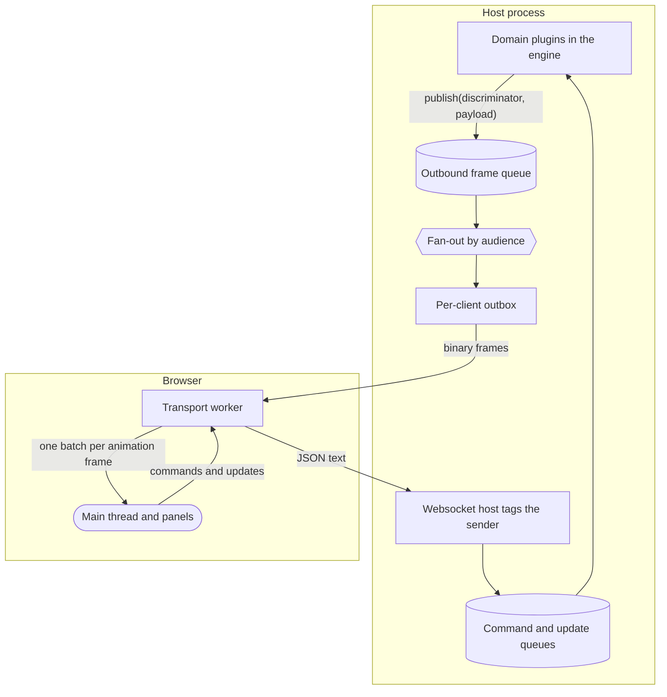
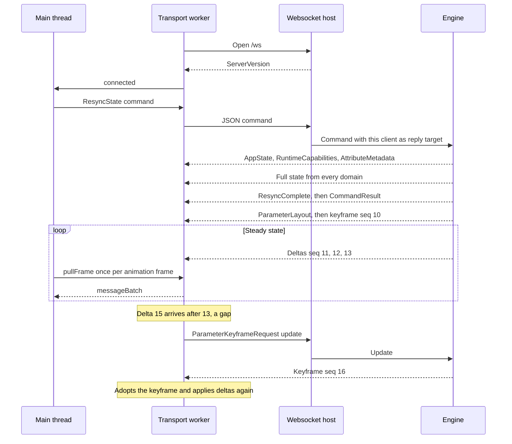
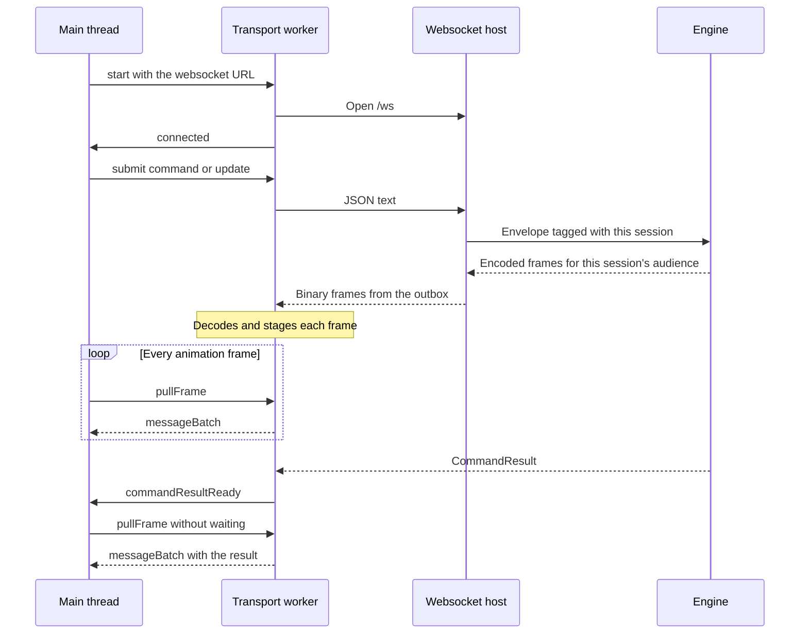
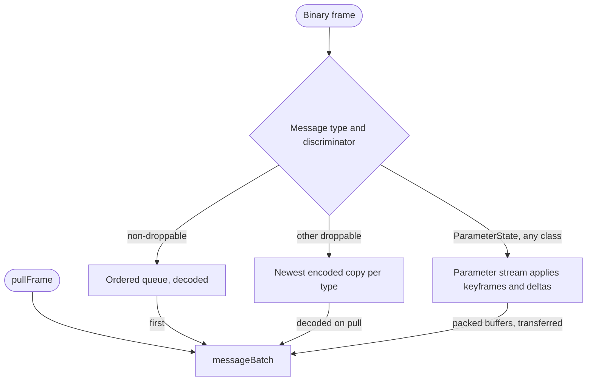

# How the engine and the web UI talk

{{#include ../includes/human-review-disclaimer.md}}

The web UI never reads engine state directly. It keeps one websocket connection to the process that runs the engine, sends its requests as small JSON text messages, and receives everything it shows as binary frames: one discriminator byte followed by a CBOR payload. The discriminator tells every hop whether a frame must arrive, may be replaced by a newer copy, or builds on the frame before it. Every panel, fader, and visualizer crosses this boundary, so knowing which messages can be dropped, who receives them, and how a client recovers after missing some is the base for most UI work.

This page uses a few terms from this part of the guide:

- The **engine** is the Bevy app that runs the show, as described in [how a show becomes light](../concepts/show-to-light.md).
- A **host** is the process that runs the engine: the headless server, the desktop app, or the browser demo. [How the pieces fit together](system-overview.md) describes each one.
- A **host adapter** connects clients to the engine. Native hosts use the `websocket` crate, an Axum HTTP and websocket server. The browser demo runs the engine as WebAssembly inside a worker and passes the same bytes without a socket.
- A **client** is one connected web UI session, such as a desktop window, a browser tab, or a paired phone.
- **CBOR** (Concise Binary Object Representation) is a binary encoding of the same data model as JSON.

## The path in one picture

The following diagram shows both directions between the engine and the panels of one client. The upper box holds the parts that run in the host process, and the lower box holds the parts that run in the browser:



The rest of the page follows this loop: what the UI sends, what the engine sends and to whom, how the parameter stream stays correct when frames go missing, and how a client catches up.

## The connection and HTTP routes

A native host runs one Axum server on the backend port. It listens on the loopback interface, and the **External control** setting in I/O Transports adds one network interface or all of them. Changing that setting rebinds the listeners live: local sessions stay connected and sessions from other devices are closed.

The server survives a showfile load. Loading a show builds a new engine world, and the new world attaches to the running server instead of starting another one, so clients keep their connection. The engine tells them with a `WorldReplaced` message, and they resync (see [Resync on connect and after gaps](#resync-on-connect-and-after-gaps)).

The server answers these routes:

| Path | Owner | Description |
|------|-------|-------------|
| `/ws` | `websocket` crate | The websocket endpoint. All commands, updates, and state frames use it. |
| `/api/pairing` and `/api/pairing/pin` | `websocket` crate | Pairing status, PIN entry, and PIN management for devices on the network. |
| `/api/showfiles/...` | `app-runtime` | Showfile listing, name validation, export, drafts, and files inside the current showfile. |
| `/api/showfiles/current/timeline-audio/{timeline_uid}` | `timeline` | Audio for a timeline. |
| `/api/mesh/...` and `/api/gdtf-wheel/...` | `fixture-library` | 3D meshes and wheel images from fixture profiles. |
| `/api/object-model/{object_path}` | `object-library` | 3D models for scene objects. |
| `/api/diagnostics/export`, `/api/telemetry/client-error`, `/api/beat-detection/model...` | `app-runtime` | Diagnostics, client error reports, and the beat detection model. |
| Any other path | Host | The built web UI, when the host supplies it. Release desktop builds do, so a phone can load the UI from the backend port. |

Domain plugins register their HTTP routes in `HttpRouteRegistry` while the world builds. Routes capture state of their own world, so each new world replaces the previous world's routes. Large or file-shaped data, such as meshes, audio, and exports, goes over HTTP. Everything else goes over the websocket.

## Messages the UI sends

The UI sends text frames that contain JSON. The host recognizes three shapes by their fields:

```json
{ "command_id": "<uuid>", "undo_id": "<uuid>", "module": "ClipCommand", "command": { "type": "StartClip", "data": "<clip>" } }
{ "module": "ParameterKeyframeRequest", "update": {} }
{ "type": "WebSocketHeartbeat", "data": { "id": 7 } }
```

- A **command** carries a `command_id`, an optional `undo_id`, the command `module`, and the command itself. The engine tracks it until it finishes and answers with a `CommandResult`. Each domain registers a deserializer for its module name, such as `ClipCommand` or `EngineCommand`.
- An **update** carries only a `module` and a payload. The engine applies it without tracking, undo, or a reply. Faders, watches, and keyframe requests are updates.
- A **heartbeat** never reaches the engine. The host answers it directly with a `WebSocketHeartbeatResponse` frame, and the transport worker turns the round trip into the latency figure the UI shows. The worker sends one every second. Neither side closes a connection because heartbeats stop.

For when to use a command and when to use an update, see [control layers](../engine/control-layers.md).

### The host tags the sender

The JSON envelope a client sends has no sender field. The websocket host knows which session each text frame arrived on, and it attaches that session when it parses the envelope. For a command, it sets the envelope's reply target to the sending session. For an update, it sets the envelope's sender to that session. Both fields are marked `#[serde(skip)]`, so the host never reads them from the JSON, and a client can't address replies to another session or speak for one. The host gives each session a `ClientId` that is never reused while the server runs.

The browser demo has one client. Its adapter tags commands with `ClientId::EMBEDDED` and leaves updates addressed to every client. Commands that actions submit, such as those from MIDI, OSC, or timelines, have no client, and their feedback goes to every client.

The host ignores binary frames from the client and logs text it can't parse.

## Messages the engine sends

Every frame the engine sends has the same layout: one discriminator byte, then a CBOR map with a `type` field naming the message and a `data` field holding its payload. Each domain defines its messages as one Rust enum, such as `EngineClientMessage`, `DeskWsMessage`, or `FixtureWsMessage`, and the TypeScript types come from those enums (see [Shared message types come from Rust](#shared-message-types-come-from-rust)).

The discriminator puts each frame in one of three delivery classes:

| Byte | Class | Delivery rule | Examples |
|------|-------|---------------|----------|
| 0 | Non-droppable | Delivered in order and never dropped. | `CommandResult`, `ResyncComplete`, `FixtureDefinitions`, `ParameterLayout`, `Controls` |
| 1 | Droppable | A snapshot. A newer snapshot of the same `type` may replace an older one that hasn't reached the client yet. | `ActiveInstances`, `LayerStack`, `Metrics`, parameter keyframes |
| 2 | Delta | Changes on top of the previous frame of the same `type`. Delivered in order and never replaces anything. A newer droppable snapshot of the same type may replace it. | Parameter deltas |

Choose the class by asking what a client loses when the frame disappears:

- When the client would hold wrong state until something else changes, the message is non-droppable. Definitions, results, and anything that arrives once are in this class.
- When the next copy of the message carries everything the client needs, the message is droppable. Snapshots that the engine republishes on a timer or on every change are in this class.
- Use the delta class only together with a droppable snapshot of the same `type` that the engine publishes regularly. The snapshot is what lets a queue or a client throw deltas away safely.

Domain plugins publish through the `ClientEventSink` resource, which encodes the payload as CBOR, prepends the discriminator, and puts the frame on one outbound queue. Because every frame for every client passes through that one queue, a client receives frames in the order the engine published them, whatever their class or audience.

### Audience: every client or one client

Each frame carries an audience. `Audience::All` sends it to every connected client, and `Audience::Client` sends it to one session. A frame addressed to a session that has disconnected reaches no one.

Use one rule to choose: if the message describes the show or the engine, send it to every client. If it answers something one client asked, send it to that client. Today these messages use a single-client audience:

- `CommandResult` and `CommandNotice` for commands a client submitted. Results of commands without a client go to every client. Results of detached internal commands and of commands typed on the host process command line aren't published.
- `DmxUniverseChannels`, the channel values of the universes a client watches with a `DmxUniverseWatch` update.
- `ReferenceList` and `ReferenceListUpdate`, for clients that watch the reference list with a `ReferenceWatch` update.

The browser demo has one client, so it delivers every frame whatever its audience.

## The parameter stream

The visualizer, the **Fixtures** panel, and every other view of live fixture values read one stream: the output of every patched fixture parameter, published in every engine frame that renders. A large rig has many thousands of parameters, so the stream avoids names and maps entirely. It uses two messages:

- `ParameterLayout` lists every patched fixture, and for each of its elements the attribute keys, under a `layout_id`. Read in order, these attributes form one flat list, and each attribute's position in that list is its **slot** number: the first attribute of the first fixture is slot 0, and numbering continues across elements and fixtures. It is non-droppable, and the engine publishes it only when the patch changes or a client resyncs.
- `ParameterState` frames carry values without naming fixtures or attributes. They carry packed little-endian buffers: `f32` output values, and the absolute and relative values asserted on slots. In a keyframe, the output buffer holds one value per slot in slot order, so the value for slot 5 is the sixth value. A delta adds a buffer of `u32` slot numbers that says which slot each of its values belongs to, and assertions always carry their slot numbers. The worker views these buffers as typed arrays without decoding values one by one.

Each `ParameterState` frame has a sequence number, `seq`, one more than the frame before it. A frame is either a keyframe or a delta:

- A **keyframe** carries every slot and replaces whatever the client held. The engine sends keyframes as droppable frames.
- A **delta** carries only the slots whose output bits changed since the previous frame, and applies only on top of the frame numbered one before it. The engine sends deltas with the delta discriminator. A delta leaves out the assertion buffers when the assertions didn't change.

The engine skips a frame entirely when nothing changed, without using a sequence number.

The engine sends a keyframe instead of a delta in these cases:

- The layout changed, or a client resynced.
- A client asked for one with a `ParameterKeyframeRequest` update.
- Two seconds passed since the last keyframe.
- A delta would be at least as large as a keyframe.
- The desk setting `parameter_keyframes_only` is on. It makes every frame a keyframe, as a fallback for clients that can't keep up with deltas.

### Gaps and drift checks

The client applies frames in arrival order. When a delta doesn't follow the last applied frame, the client has a **gap**: it drops its rebuilt state, ignores deltas, sends `ParameterKeyframeRequest` (at most once every 250 ms), and keeps showing the last complete state until a keyframe arrives. The engine then makes its next frame a keyframe. Even a gap the client fails to notice heals within two seconds, at the next interval keyframe.

A keyframe that replaces a small delta is **verifiable**: it also lists the slots that changed since the previous frame. A client that holds the previous frame applies only those slots and compares the result with the whole keyframe. Any difference means the engine and the UI disagreed without a detected gap. The client counts and logs these **drifted** slots, then adopts the keyframe as usual. The counters (keyframes, deltas, gaps, discarded frames, verified and drifted keyframes) appear in the worker's statistics.

## Per-client outbox and back-pressure

The websocket host gives each session an outbox: a queue that the session's send task drains as fast as the socket accepts data. A client that reads slower than the engine publishes falls behind, and the outbox decides what to keep:

- Non-droppable frames are always appended and never removed.
- A droppable snapshot replaces every queued snapshot and delta of the same `type`, as long as no non-droppable frame was queued after the oldest of them. The new snapshot takes the position of the oldest one, so it never moves past a non-droppable frame.
- A delta is always appended. The next snapshot of its type collapses it together with the rest.

For the parameter stream, this means a parameter keyframe replaces the queued deltas before it. The client sees a jump in `seq`, but the keyframe needs nothing before it, so the client stays correct and receives less data.

When the queued bytes would exceed 64 MiB, the host discards the whole queue and closes the connection with close code 4001. The limit is far above a full resync of a large show, so only a client that stopped reading for a long time reaches it. If the client doesn't accept the close frame within five seconds, the host tears down the socket. The client reconnects at once on code 4001 and resyncs from complete state. A second lagging disconnect within ten seconds waits the normal one-second reconnect delay instead, so a client that can't keep up doesn't reconnect in a tight loop.

> [!WARNING]
> The outbox and the transport worker coalesce droppable frames by their `type` alone. Don't publish two droppable messages of the same `type` that carry different subsets of state, because a newer one replaces the older one in a slow client's queue.

## Resync on connect and after gaps

A client that connects knows nothing, and a client that missed frames can't trust what it holds. Both recover the same way: they ask the engine to resync, which republishes the full state.

The following diagram shows one client from connecting, through steady state, to recovering from a gap in the parameter stream:



The resync runs in these steps:

1. The host sends `ServerVersion` straight to the new socket, before it registers the session for broadcasts.
1. When the socket opens, the worker tells the main thread, which discards session-scoped state and sends `EngineCommand::ResyncState`. It follows with commands that list the fixture library and, on native hosts, the object and FX module libraries.
1. The engine turns `ResyncState` into a `ResyncRequested` message. In the same update, the engine publishes `AppState`, `RuntimeCapabilities`, and `AttributeMetadata`, every domain's resync handler publishes its full state, and then the engine publishes `ResyncComplete` and the command's result.
1. The fixtures resync handler also asks the parameter projection for its layout. The layout and a keyframe go out in the engine's next render pass, so they arrive after `ResyncComplete`.
1. When `ResyncComplete` arrives, the UI marks the resync complete and sends its `DmxUniverseWatch` and `ReferenceWatch` updates again, because watches belong to one connection and one world.

> [!NOTE]
> `ResyncComplete` means every domain has published its definitions and snapshots. It doesn't mean live parameter values have arrived. Those follow in the next render pass.

Other events start a resync too:

- `WorldReplaced`, after a showfile load swapped the engine world behind an open connection.
- A reconnect, after the connection dropped or the host closed a lagging client.
- An overflow in the worker. If more than 10,000 non-droppable messages wait for the main thread, the worker discards everything it staged, stops staging, and asks the main thread to resync.

> [!WARNING]
> Resync output goes to every client. When one client connects or reconnects, every connected client receives the full state and a `ResyncComplete` again. In the same way, one client's `ParameterKeyframeRequest` makes the next parameter frame a keyframe for every client. Keep resync handlers idempotent, and keep the UI's resync handling cheap for clients that didn't ask.

## The browser transport worker

The web UI runs the websocket in a dedicated worker. Decoding CBOR takes milliseconds per large message, and the main thread is often busy rendering, so the worker receives and decodes frames as they arrive and the main thread collects them when it is ready to draw.

The following diagram shows how the main thread, the worker, and the host interact over the life of a connection:



The main thread sends everything through the worker with a `submit` message, and the worker writes it to the socket as JSON text. A `submit` that arrives while the socket is still connecting waits in the worker and goes out when the socket opens. The worker also sends the heartbeat every second on its own, without the main thread.

The following diagram shows how the worker stages each frame by its discriminator:



The worker keeps three kinds of staged data:

- An ordered queue of decoded non-droppable messages. Nothing in it is ever dropped, short of the overflow resync described earlier.
- The newest copy of each droppable message type, kept encoded. A snapshot that a newer one replaces before the next pull is never decoded.
- The parameter stream, which applies each keyframe and delta as it arrives and keeps the rebuilt state.

The main thread asks for a batch with `pullFrame` once per browser animation frame, using `requestAnimationFrame`, with only one pull in flight. The worker answers with one `messageBatch`: the ordered messages first, then the decoded snapshots, then the rebuilt parameter state in buffers it transfers to the main thread without copying. Snapshots ride in the same batch as ordered messages and are applied in the same task, so code that awaits a command result sees the state the engine published ahead of it. When a `CommandResult` arrives, the worker tells the main thread at once and the main thread pulls without waiting for the next animation frame.

The main thread then dispatches each message to the handler that a domain module registered for its `type`, and logs a warning for types no module handles.

The browser demo uses the same worker code. Its engine runs as WebAssembly inside the worker and hands its frames to the same decoder and staging, so panels can't tell the two runtimes apart.

## Shared message types come from Rust

The types that cross the boundary between the engine and the web UI are defined once, in Rust: the messages the engine sends, the command and update payloads the UI sends, and the types inside them. These types carry a `#[typeshare::typeshare]` attribute, and `pnpm run typeshare` generates TypeScript versions of them in `webui/types/index.ts`. Typeshare covers only these shared types. The rest of the web UI's TypeScript types are written by hand in `webui/`, including the command envelope around a payload and the messages between the main thread and the transport worker. The file is generated and not checked in, and CI generates it before it type-checks the web UI.

Most message enums use serde's adjacent tagging, `#[serde(tag = "type", content = "data")]`, which typeshare turns into a TypeScript union of `{ type, data }` objects. Byte buffers, such as the parameter stream's packed values, carry a `serialized_as` annotation so they appear as `Uint8Array` in TypeScript.

When you change a message or payload in Rust, run `pnpm run typeshare` and fix what `pnpm run typecheck` reports. Don't write TypeScript types by hand for messages or payloads that Rust defines. The generated types aren't checked at runtime, so a Rust change that you don't regenerate shows up as a UI bug rather than a type error.

## What the UI receives in the running example

In the [running example](../README.md#a-running-example), the programmer holds `Practice light` at 50% intensity, and the operator starts the `First playback` clip, which fades into the `Red` cue. The UI sends one command:

```json
{ "command_id": "<uuid>", "undo_id": "<uuid>", "module": "ClipCommand", "command": { "type": "StartClip", "data": "<clip>" } }
```

Two kinds of messages answer it. Fixture values travel in the parameter stream and the snapshots built from it. Playback state travels in separate playback messages.

| Message | Class | Audience | When | What it carries |
|---------|-------|----------|------|-----------------|
| `CommandResult` | Non-droppable | The client that started the clip | Once, when the command finishes | Success or failure of `StartClip`. |
| `ActiveInstances` | Droppable | Every client | When the playback starts or its controls change, and about 10 times a second | The `First playback` playback: its position in `First sequence` (current cue `Red`, next cue `Blue`), priority, level, activation time, elapsed transition time, and whether it is releasing. |
| `Controls` | Non-droppable | Every client | When a control slot's linked playback changes | Control slot state, when the clip is assigned to a control slot. |
| `ParameterState` | Delta, with droppable keyframes | Every client | Every render pass while values change | `Practice light`'s output values and asserted values, by layout slot. |
| `LayerStack` | Droppable | Every client | About 10 times a second, when it changed | Each layer's values for the **Layers** panel: the programmer layer and the `First playback` layer. |
| `DmxUniverseChannels` | Droppable | Only clients watching console universe 1 | At most every 100 ms, when the values changed | Channels 1 to 4 of console universe 1. |

During the fade, the programmer keeps intensity at 50%, so the intensity slot's output doesn't change. The output values in the parameter deltas cover only the red slot, rising from its starting value to 100%. When the fade ends, nothing changes anymore, so the engine skips parameter frames and sends only the keyframe every two seconds. The UI animates the fade's progress between `ActiveInstances` snapshots by computing it from the activation time and elapsed transition time those snapshots carry.

## Origin policy and PIN pairing

Two checks run before any route, including `/ws`:

- The **origin check** turns away browser pages from other sites. A request that carries an `Origin` header is admitted only from the desktop shell's own origins, or from a page served by the same host name the browser used to reach the backend, on any port. That host name must be a local name, such as `localhost`, an IP address, a single-label name, or a name under `.local`, `.localhost`, `.lan`, `.home.arpa`, or `.internal`. A request without `Origin` must also address the backend by a local name. Without this check, any website open in a browser on the operator's computer could open the websocket and drive the show.
- **PIN pairing** protects the backend from other devices on the network. A client counts as local only when it connects from a loopback address and addressed the backend by a loopback name. Every other client, including a phone relayed through the Vite dev server, must pair before it may use `/ws` or any `/api` route other than `/api/pairing`. The web UI files stay public so a new device can load the page that asks for the PIN.

The engine picks a six-digit PIN when it starts and keeps it for the whole app session. A correct PIN earns the browser a random token in an `HttpOnly`, `SameSite=Strict` cookie named after the backend port, and the browser sends it with every request and websocket upgrade. Tokens live only in memory, so restarting the app signs every device out. Regenerating the PIN on the operator's computer also signs every device out and closes their websocket sessions. After five wrong PINs from one address, the address must wait before each further attempt, starting at one second and doubling up to five minutes.

The UI is served over plain HTTP, so anyone watching the network can read the PIN and the token. Pairing keeps casual users of a trusted network out. It doesn't protect against a hostile network.

## In the code

| Concept | Where to look |
|---------|---------------|
| Discriminators, `Audience`, `ClientEventSink`, command and update envelopes | `crates/engine/src/client_bridge.rs` |
| Engine-level messages such as `ServerVersion`, `ResyncComplete`, and `WorldReplaced` | `crates/engine/src/protocol/client.rs` |
| Resync request and completion | `crates/engine/src/lib.rs` |
| Command and update ingress dispatch | `crates/engine/src/client_ingress.rs` |
| Socket lifecycle, sender tagging, heartbeats, fan-out, router | `crates/websocket/src/websocket.rs` |
| Per-client outbox and lagging disconnects | `crates/websocket/src/outbox.rs` |
| HTTP route registration | `crates/websocket/src/routes.rs` |
| Origin policy | `crates/websocket/src/origin.rs` |
| PIN pairing | `crates/websocket/src/pairing.rs` |
| Parameter layout, keyframes, and deltas | `crates/fixtures/src/parameter_state.rs`, `crates/fixtures/src/websocket.rs` |
| Watched DMX universe channels | `crates/fixtures/src/universe_stream.rs` |
| `ActiveInstances`, `Controls`, and `LayerStack` | `crates/desk/src/websocket/` |
| Browser demo adapter | `crates/browser-runtime/src/lib.rs` |
| Transport worker | `webui/lib/engine-runtime-worker-core.ts` |
| Parameter stream rebuild and drift checks | `webui/lib/parameter-stream.ts` |
| Pulls, resync requests, and command sending on the main thread | `webui/lib/engine-runtime.ts` |
| Handlers for `ResyncComplete` and `WorldReplaced` | `webui/lib/ws/session-handlers.ts` |
| Generated TypeScript types | `webui/types/index.ts`, generated by `pnpm run typeshare` |

## Related topics

- [How the pieces fit together](system-overview.md)
- [Web UI architecture](web-ui.md)
- [The frame loop](../engine/frame-loop.md)
- [Control layers](../engine/control-layers.md)
- [How a show becomes light](../concepts/show-to-light.md)
- [Concept map](../concepts/concept-map.md)
