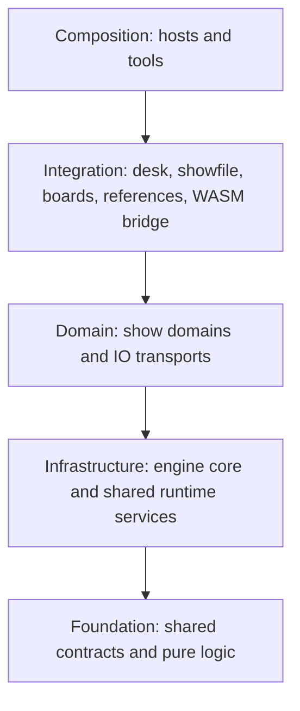

# Crate map

{{#include ../includes/human-review-disclaimer.md}}

The Rust side of Nightfall is a Cargo workspace of 54 crates under `crates/`, plus the Tauri desktop shell in `desktop/app-tauri`. Crate names don't always reveal a crate's job, and several crates' own doc comments are out of date. This page lists every crate by its role, with a one-line description checked against the code, and says which crates also compile to WebAssembly (WASM) for the browser. It ends with the folders outside `crates/`.

For how the crates combine into running programs, see [how the pieces fit together](system-overview.md).

**Note:** This page is maintained by hand. When you add, remove, or repurpose a crate, update its row here.

## Roles and dependency rules

Every crate has an architectural role, assigned in `config/architecture/crate-roles.json`. The `check:crate-boundaries` script reads that file and fails when a crate depends on a crate in a role it must not use. A new crate without a role also fails the check. The roles form layers, from shared building blocks at the bottom to the programs that assemble them at the top:

An arrow means "may depend on." A crate may also depend on any role further down, so a domain crate may use foundation crates directly. The check enforces these rules:

- Foundation crates depend only on other foundation crates.
- Infrastructure crates don't depend on domain, integration, or composition crates.
- Domain crates don't depend on other domain crates, or on integration or composition crates.
- Integration crates don't depend on composition crates.
- The Art-Net and sACN input crates don't reach `fixtures`, `compositor`, or `desk` through any chain of dependencies.

`config/architecture/crate-boundary-exceptions.json` lists the edges that break a rule on purpose, each with a reason. Today they are:

- `flow` depends on `fx-module`, because flows host FX module nodes.
- `fx-module` depends on `fx`, to reuse the FX runtime contracts.
- `programmer` depends on `cues` and `desk`, for storing into cues and for desk services.
- `output_artnet` and `output_sacn` depend on `desk`, for diagnostics and notifications.
- `object-library` depends on `scene-objects`, to import and export scene objects.
- `timeline` depends on `audio`, `cues`, and `fx`, to plan and play what its tracks trigger.

The check rejects any new edge that breaks a rule, and also any listed exception that no longer exists. To add an exception, add an entry with a reason to the exceptions file.

## Reading the tables

Each table below covers one role. The **WASM** column says where the crate compiles to the `wasm32` target:

- **Bridge and demo:** part of both the WASM bridge and the browser demo engine.
- **Demo:** part of the browser demo engine only.
- **Bridge:** the WASM bridge itself.
- **Is the demo:** the browser demo engine itself.
- **Build time:** a procedural macro, which runs inside the compiler on the build machine.
- **No:** native builds only.

The column follows from the `nightfall-browser-runtime` and `nightfall-wasm-bridge` dependency lists, with the Cargo features those crates select. It isn't a guarantee that a "No" crate can't compile to WASM, only that no WASM build includes it.

When a crate's package name differs from its folder name, the table shows the package name in parentheses. Otherwise the package name is the folder name with a `nightfall-` prefix and dashes, for example `input_midi` is `nightfall-input-midi`.

## Foundation: shared contracts and pure logic

Foundation crates hold data types and algorithms with no engine runtime. Most don't use Bevy at all, which is what lets the web UI reuse them through the WASM bridge.

| Crate | WASM | Description |
|-------|------|-------------|
| `common` (`nightfall`) | Bridge and demo | Show data types shared across the engine, such as blueprints, boards, groups, value sources, transitions, and variables. |
| `dmx` | Bridge and demo | Attributes and their metadata, percentages, and DMX value types. |
| `fixture-model` | Bridge and demo | Profile-level fixture model: parameter value mappings, mode masters, relations, and DMX profiles. The engine and the 3D visualizer share it. |
| `cmd-parse` | Bridge and demo | Lexer, parser, and autocomplete for the desk command language, such as `fixture 1 @ 50`. |
| `selection` | Bridge and demo | Fixture selection contracts and resolution, including spatial selections and the store of object references. |
| `lookahead-projection` | Bridge and demo | Lookahead projection for previews in the sequence editor. |
| `io` | Bridge and demo | IO transport settings, named output targets, and IO constants. Bevy support sits behind the default `ecs` feature, which the WASM bridge turns off. |
| `instances` | Demo | Contract types for a running playback's identity, clock, controls, and status. |
| `playback-planner` | Demo | Contracts for deterministic playback planning, such as rebuilding a playback clock from a planned position. |
| `waveform` | Demo | Waveform sampling, such as sine and square, shared by FX and flows. |
| `engine-derive` | Build time | The `EnginePayload` derive macro for engine command types. |
| `beat-detection` | No | Beat and downbeat detection from audio files with the Beat This model. Free of Bevy and networking. |
| `config` | No | Typed startup configuration read from `NIGHTFALL_*` environment variables and `.env`. |
| `coremidi_hotplug` | No | Notifies when macOS CoreMIDI devices change. Does nothing on other platforms. |
| `open-fixture-library` (`open-fixture-library`) | No | Data structures and parser for Open Fixture Library (OFL) JSON files. |
| `workspace-hack` | No | Empty crate generated by `cargo hakari` so every build enables the same third-party features. Native targets only. |

## Infrastructure: engine core and shared runtime services

Infrastructure crates build the engine's runtime that every domain plugs into.

| Crate | WASM | Description |
|-------|------|-------------|
| `engine` | Demo | Core of the Bevy app: app states, schedules and their ordering, the `Render` schedule, the command and update protocol, the client bridge, object stores, and runtime capabilities. |
| `undo` | Demo | Undo and redo: captures undoable commands and stores their inverses. |
| `actions` | Demo | Registry of bindable actions and how each one turns into a command or an update. |
| `clips` | Demo | Clip model, clip commands, and lookups by identifier. The `desk` crate stores clips. |
| `compositor` | Demo | Layer compositing pipeline: builds the layer stack and merges layers by priority and merge rule. |
| `fixtures` | Demo | Fixtures, parameters, universes, patch bindings and their validation, DMX input, and the composition of output DMX frames. |
| `framepace` | Demo | Frame limiter that starts engine frames on the shared tick grid, adapted from `bevy_framepace`. The browser demo uses only its `fps` command handling. |
| `lookahead` | Demo | Runtime lookahead contracts shared by the playback domains. |
| `service_host` | Demo | Process-lifetime worker slots, fixed-rate worker threads, and the shared tick grid. |
| `tempo` | Demo | Show-wide live tempo: one BPM and beat phase, the `tempo` command, and mappable tempo actions. |
| `timecode` | Demo | Timecode objects and the generators that advance them. |
| `websocket` | No | Native websocket and HTTP server: client connections, per-client queues, origin checks, pairing, and serving the built web UI. |

## Domain: show domains

Domain crates each own one area of the show. They add themselves to the engine as Bevy plugins.

| Crate | WASM | Description |
|-------|------|-------------|
| `cues` | Demo | Cues, sequences, tracking, release, and the runtime state that plays them. |
| `programmer` | Demo | The programmer: live values and selection, the programmer layer, and storing into cues. |
| `fx` | Demo | Procedural FX and Step FX, and their runtime state. |
| `fx-module` | No | FX modules: the WebAssembly Interface Type (WIT) contract, Rust types for module authors, and the Wasmtime host that runs modules. |
| `flow` | Demo | Flow node graphs: definitions, built-in nodes, and the runtime. The demo build leaves out FX module nodes. |
| `timeline` | Demo | Timelines: tracks, planning, seeking, recording, and audio and beat grid integration. The demo build leaves out native audio and the HTTP routes. |
| `scene-objects` | Demo | Non-fixture 3D objects for the visualizer, such as trusses and stage elements. |
| `fixture-library` | No | Finds GDTF and OFL files in the data directory, converts them to fixture profiles, and watches for changes. |
| `object-library` | No | Finds `.robj` object bundles in the data directory and watches for changes. |
| `audio` | No | Audio playback service for timeline audio. |

## Domain: IO transports

The IO crates are domain crates too. Each one runs a process-lifetime service on its own thread.

| Crate | WASM | Description |
|-------|------|-------------|
| `input_artnet` | No | Art-Net DMX input. Also builds the `send-artnet`, `listen-artnet`, and `listen-scan` test tools. |
| `input_sacn` | No | sACN DMX input. Also builds the `send-sacn` test tool. |
| `input_midi` | No | MIDI device discovery, MIDI input, and mappings from MIDI messages to actions. |
| `input_osc` | No | OSC input over UDP and mappings from OSC addresses to actions. |
| `output_artnet` | No | Art-Net DMX output. |
| `output_sacn` | No | sACN DMX output. |
| `output_usb` | No | DMX output through uDMX USB interfaces. |

## Integration: crates that coordinate domains

Integration crates combine several domains, which domain crates can't do themselves.

| Crate | WASM | Description |
|-------|------|-------------|
| `desk` | Demo | Shared desk behavior that spans domains. See [what lives in `desk` and why](#what-lives-in-desk-and-why). |
| `desk_audio` | No | Watches the system's audio output devices and moves timeline audio when the chosen device appears or disappears. |
| `boards` | Demo | Boards: grids of buttons, button presses, and button status. |
| `references` | Demo | Show-wide report of which objects use which, for the **References** panel and delete guards. |
| `showfile` | Demo | The versioned showfile JSON format, migrations, applying a showfile to an engine world, and snapshots of a world. |
| `wasm-bridge` | Bridge | Functions the web UI calls in WASM. See [what the WASM bridge exports](#what-the-wasm-bridge-exports). |

## Composition: hosts and tools

Composition crates assemble the others into programs.

| Crate | WASM | Description |
|-------|------|-------------|
| `app-runtime` (`app-runtime`) | No | The native host library and the `nightfall-headless` binary: engine assembly, the session loop and showfile swaps, showfile storage, sample shows, logging, diagnostics, and error and usage reports. |
| `browser-runtime` | Is the demo | The browser demo engine, with its own hand-written plugin list. |
| `cli` | No | `nightfall-cli`, an interactive terminal client that sends commands to the engine over a websocket. |
| `desktop/app-tauri` (`app-tauri`) | No | The Tauri desktop shell and the `nightfall-app` binary. It lives outside `crates/`, and plain `cargo` commands leave it out unless you pass `-p app-tauri`. |

## What the WASM bridge exports

The `wasm-bridge` crate is the only Rust code the web UI calls directly. It isn't a WASM build of the domain crates. It exports a small set of functions, and each one calls into the crates listed below, so only the code those functions reach is compiled to WebAssembly. A change to one of these crates can change what the UI computes, so rebuild the bridge after you change one.

| Export | Functions | Crates it calls |
|--------|-----------|-----------------|
| Command line | `complete_command`, `validate_command`, `split_command_statements` | `cmd-parse` |
| Selection text | `parse_spatial_selection`, `format_spatial_selection` | `cmd-parse`, `common` |
| Selection resolution | `resolve_spatial_selection`, `project_resolved_spatial_selection` | `selection`, `common` |
| Step FX phases | `parse_step_fx_phase`, `format_step_fx_phase` | `cmd-parse` |
| Transition modes | `resolve_transition_modes` | `common` |
| Sequence previews | `project_sequence_lookahead`, `sequence_duration_summary` | `lookahead-projection` |
| Fixture evaluation | `FixtureChannelEvaluator`, `fixture_reading_stride` | `fixture-model` |
| Board placement | `BoardPlacement`, `board_max_dimension` | `common` |
| Reserved DMX target names | `reserved_network_dmx_target_keywords`, `reserved_usb_dmx_target_keywords` | `io`, without its `ecs` feature |

## What lives in `desk` and why

The `desk` crate is the largest integration crate, at about 20,000 lines. It holds the behavior that belongs to the console as a whole rather than to one domain:

- The `DeskCommand` entry point, including `Eval`, which runs a line of the desk command language, and the requests to create, save, load, and import showfiles.
- Clip storage, and the lifecycle of running playbacks that every playback domain shares.
- Masters, control slots with their faders and buttons, and the actions that drive them.
- Groups and blueprints.
- Console settings and the showfile's shared panel layouts.
- The adjustments after the merge: virtual dimmers, virtual relations, and each playback's intensity level.
- User notifications, diagnostics, network statistics, and the layer stack that the **Layers** panel shows.
- Commands that wait a set time before they run, and the release of stale input values.

The domain rules explain why this code collects in `desk`. A domain crate can't depend on another domain crate, so behavior that touches several domains, such as a master that scales playbacks from any domain, needs a crate above them. The result is a crate that many others use: `programmer`, `output_artnet`, and `output_sacn` depend on it through boundary exceptions, and the browser demo compiles all of it.

Before you add code to `desk`, check whether it concerns one domain only. If it does, put it in that domain's crate. Add to `desk` only when the code needs several domains at once.

## Folders outside `crates`

The rest of the repository holds the web UI, the desktop shell, and the tooling around them:

| Folder | Description |
|--------|-------------|
| `webui/` | The SolidJS web UI. `features/` holds one folder per domain with its panels and logic, `components/` holds shared UI building blocks, `lib/` holds utilities such as the transport worker and the WASM bridge wrapper, `state/` holds global stores, and `e2e/` holds the Playwright specs for the app. `types/index.ts` is generated by `pnpm run typeshare`. |
| `webui/assets/` | Built WASM packages (`wasm/` for the bridge, `browser-runtime/` for the demo engine), which `pnpm run wasm` regenerates and Git ignores, plus models and browser demo assets. |
| `desktop/app-tauri/` | The Tauri desktop shell, its configuration, and its icons. |
| `playwright/` | Playwright specs and configuration for checking the documentation books, plus a few app checks. The app's main specs live in `webui/e2e/`, configured by `playwright.config.ts` at the repository root. |
| `scripts/` | Node scripts for building WASM, the Playwright wrapper, CI scoping, architecture checks, packaging, and release notes. Most scripts have a node test beside them. |
| `docs/` | The user manual in `docs/src/`, this guide in `docs/internal/`, decision records in `docs/adr/`, and notes on CI security and desktop releases. |
| `config/` | Architecture rules for crates and the web UI, license header templates, third-party notices, project links, and the beat detection model manifest. |
| `test-fixtures/` | Instructions and data for repeatable performance workloads. |
| `worktree-dashboard/` | The local dashboard and its Model Context Protocol (MCP) server, which start and stop development services for each worktree. |

## In the code

| Concept | Where to look |
|---------|---------------|
| Workspace members | `Cargo.toml` |
| Crate roles | `config/architecture/crate-roles.json` |
| Allowed boundary exceptions | `config/architecture/crate-boundary-exceptions.json` |
| Boundary check | `scripts/check-crate-boundaries.mjs` |
| Browser demo dependencies | `crates/browser-runtime/Cargo.toml`, `scripts/check-browser-demo-dependencies.mjs` |
| WASM bridge dependencies | `crates/wasm-bridge/Cargo.toml` |
| WASM bridge exports | `crates/wasm-bridge/src/lib.rs`, `board_placement.rs`, `fixture_evaluation.rs` |
| Native feature selection | `crates/app-runtime/Cargo.toml` |
| `desk` plugin registration | `crates/desk/src/lib.rs` |

## Related topics

- [How the pieces fit together](system-overview.md)
- [Concept map](../concepts/concept-map.md), which names the crate that owns each show concept
- [Control layers](../engine/control-layers.md)
- [Rust tests and package scripts](https://github.com/stewartadam/nightfall-lightdesk/blob/develop/CONTRIBUTING.md) in CONTRIBUTING.md
