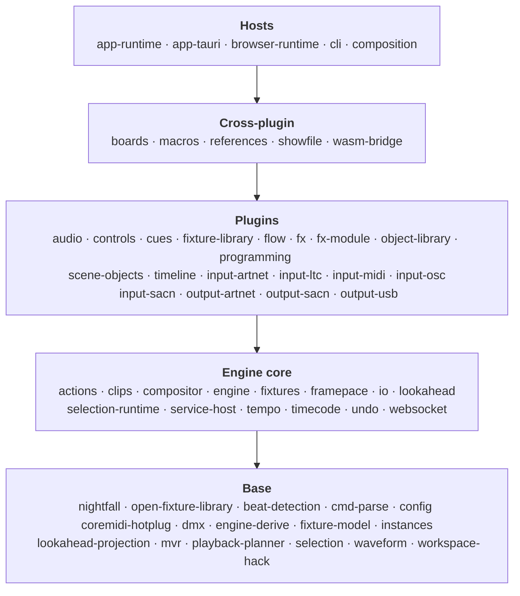

# Crate map

{{#include ../includes/human-review-disclaimer.md}}

The Rust side of Nightfall is a Cargo workspace of 60 crates under `crates/`, plus the Tauri desktop shell in `desktop/app-tauri`.

For how the crates combine into running programs, see [how the pieces fit together](system-overview.md).

## Architectural layers and crate dependency rules

Every crate belongs to an architectural layer, which defines how imports between crates are permitted within Nightfall:

Every crate belongs to one of these architectural layers, manually assigned in `config/architecture/crate-layers.json`. The `check:crate-boundaries` script reads that file and fails when a crate depends on crates in layers above them. A new crate without a layer also fails the check.

`config/architecture/crate-boundary-exceptions.json` lists the edges that break a rule on purpose, each with a reason. Today they are:

- `flow` depends on `fx-module`, because flows host FX module nodes.
- `fx-module` depends on `fx`, to reuse the FX runtime contracts.
- `programming` depends on `cues`, for storing into cues.
- `object-library` depends on `scene-objects`, to import and export scene objects.
- `timeline` depends on `audio`, `cues`, and `fx`, to plan and play what its tracks trigger.

## Reading the tables

Each table below covers one layer. The **WASM** column says where the crate compiles to the `wasm32` target:

- **Bridge and demo:** part of both the WASM bridge and the browser demo engine.
- **Demo:** part of the browser demo engine only.
- **Bridge:** the WASM bridge itself.
- **Is the demo:** the browser demo engine itself.
- **Build time:** a procedural macro, which runs inside the compiler on the build machine.
- **No:** this crate is included on native builds only.

## Base: shared contracts and pure logic

Base crates hold data types and algorithms with no engine runtime. Most don't use Bevy at all, which is what lets the web UI reuse them through the WASM bridge.

| Crate | WASM | Description |
|-------|------|-------------|
| `common` | Bridge and demo | Show data types shared across the engine, such as blueprints, boards, groups, value sources, transitions, and variables. |
| `dmx` | Bridge and demo | Attributes and their metadata, percentages, and DMX value types. |
| `fixture-model` | Bridge and demo | Profile-level fixture model: parameter value mappings, mode masters, relations, and DMX profiles. The engine and the 3D visualizer share it. |
| `cmd-parse` | Bridge and demo | Lexer, parser, and autocomplete for the desk command language, such as `fixture 1 @ 50`. |
| `selection` | Bridge and demo | Fixture selection contracts and resolution, including spatial selections and the store of object references. |
| `lookahead-projection` | Bridge and demo | Lookahead projection for previews in the sequence editor. |
| `instances` | Demo | Contract types for a running playback's identity, clock, controls, status, and held fader button effect. |
| `playback-planner` | Demo | Contracts for deterministic playback planning, such as rebuilding a playback clock from a planned position. |
| `waveform` | Demo | Waveform sampling, such as sine and square, shared by FX and flows. |
| `engine-derive` | Build time | The `EnginePayload` derive macro for engine command types. |
| `beat-detection` | No | Beat and downbeat detection from audio files with the Beat This model. Free of Bevy and networking. |
| `config` | No | Typed startup configuration read from `NIGHTFALL_*` environment variables and `.env`. |
| `coremidi_hotplug` | No | Notifies when macOS CoreMIDI devices change. Does nothing on other platforms. |
| `mvr` | No | Reader for My Virtual Rig (MVR) files, the rig format CAD tools such as Vectorworks and Capture export: fixtures with their GDTF types, IDs and DMX addresses, and the 3D position of every object. |
| `open-fixture-library` | No | Data structures and parser for Open Fixture Library (OFL) JSON files. |
| `workspace-hack` | No | Empty crate generated by `cargo hakari` so every build enables the same third-party features. Native targets only. |

## Engine core: engine runtime and shared services

Engine core crates build the engine's runtime that every plugin plugs into.

| Crate | WASM | Description |
|-------|------|-------------|
| `engine` | Demo | Core of the Bevy app: app states, schedules and their ordering, the `Render` schedule, the command and update protocol, the client bridge, object stores, runtime capabilities, the settings registry, runtime log filters, the UI preference and panel layout settings sections, and the metrics feed. |
| `undo` | Demo | Undo and redo: captures undoable commands and stores their inverses. |
| `actions` | Demo | Registry of bindable actions and how each one turns into a command or an update, plus the eval action that runs a line of the command language. |
| `clips` | Demo | Clip model, clip commands, lookups by identifier, and clip playback: routing clip starts and stops to the plugin registered for each clip source, launch quantize, the lifecycle and clocks of running playbacks, the running playbacks feed, and the bindable clip actions. |
| `compositor` | Demo | Layer compositing pipeline: builds the layer stack and merges layers by priority and merge rule. |
| `fixtures` | Demo | Fixtures, parameters, universes, patch bindings and their validation mode, the fixture and patch commands, DMX input and the release of stale input values, virtual dimmers and virtual relations, the composition of output DMX frames, lookahead assertions, and the layer stack feed. |
| `framepace` | Demo | Frame limiter that starts engine frames just before each DMX send time on the shared schedule, adapted from `bevy_framepace`. The browser demo uses only its `fps` command handling. |
| `io` | Bridge and demo | IO transport settings with their `io` settings section and command, named output targets, IO constants, the host's network interfaces with their client feed and the alerts shown when the interface the transports bind to disappears or returns, and IO failure toasts. The plugin sits behind the default `plugin` feature, which the WASM bridge turns off. |
| `lookahead` | Demo | Runtime lookahead contracts shared by the playback domains. |
| `selection-runtime` | Demo | Bevy system parameters that resolve fixture selections against the live patch, and the per-frame cache of resolved selections. |
| `service_host` | Demo | Process-lifetime worker slots, fixed-rate worker threads, and the shared schedule of DMX send times. |
| `tempo` | Demo | Show-wide live tempo: one BPM and beat phase, the `tempo` command, and mappable tempo actions. |
| `timecode` | Demo | Timecode objects and the generators that advance them. |
| `websocket` | No | Native websocket and HTTP server: client connections, per-client queues, origin checks, pairing, serving the built web UI, and external control, which decides whether other computers may connect and on which interface. |

## Plugins: show domains

Plugin crates each own one area of the show. They add themselves to the engine as Bevy plugins.

| Crate | WASM | Description |
|-------|------|-------------|
| `controls` | Demo | Masters, the fader bank with its levels and buttons, each playback's intensity level, and the actions that drive them. |
| `cues` | Demo | Cues, sequences, tracking, release, and the runtime state that plays them. |
| `programming` | Demo | The programmer (live values and selection, the programmer layer, storing into cues), and groups and Blueprints: their stores, commands, undo, and command line words. |
| `fx` | Demo | Procedural FX and Step FX, and their runtime state. |
| `fx-module` | No | FX modules: the WebAssembly Interface Type (WIT) contract, Rust types for module authors, and the Wasmtime host that runs modules. |
| `flow` | Demo | Flow node graphs: definitions, built-in nodes, and the runtime. The demo build leaves out FX module nodes. |
| `timeline` | Demo | Timelines: tracks, planning, seeking, recording, and audio and beat grid integration. The demo build leaves out native audio and the HTTP routes. |
| `scene-objects` | Demo | Non-fixture 3D objects for the visualizer, such as trusses and stage elements. |
| `fixture-library` | No | Finds GDTF and OFL files in the data directory, converts them to fixture profiles, and watches for changes. |
| `object-library` | No | Finds `.robj` object bundles in the data directory and watches for changes. |
| `audio` | No | Audio playback service for timeline audio, the list of audio outputs, and moving timeline audio when the chosen output appears or disappears. |

## Plugins: IO transports

The IO crates are plugin crates too. Each one runs a process-lifetime service on its own thread.

| Crate | WASM | Description |
|-------|------|-------------|
| `input_artnet` | No | Art-Net DMX and timecode input. Also builds the `send-artnet`, `send-artnet-timecode`, `listen-artnet`, and `listen-scan` test tools. |
| `input_sacn` | No | sACN DMX input. Also builds the `send-sacn` test tool. |
| `input_midi` | No | MIDI device discovery, MIDI input, mappings from MIDI messages to actions, controller LED feedback with bundled controller profiles, and MIDI timecode (MTC) input. |
| `input_ltc` | No | SMPTE linear timecode (LTC) decoded from a channel of an audio input device. |
| `input_osc` | No | OSC input over UDP and mappings from OSC addresses to actions. |
| `output_artnet` | No | Art-Net DMX output. |
| `output_sacn` | No | sACN DMX output. |
| `output_usb` | No | DMX output through uDMX USB interfaces and the list of connected uDMX devices. |

## Cross-plugin: crates that coordinate plugins

Cross-plugin crates combine several plugins, which plugin crates can't do themselves.

| Crate | WASM | Description |
|-------|------|-------------|
| `boards` | Demo | Boards: grids of buttons, button presses, and button status. |
| `macros` | Demo | Macros: numbered command-line scripts, the backend runner that executes them line by line, and the `macro.start`, `macro.release`, and `macro.stop` actions. |
| `references` | Demo | Show-wide report of which objects use which, for the **References** panel and delete guards. |
| `showfile` | Demo | The versioned showfile JSON format, migrations, applying a showfile to an engine world, snapshots of a world, and the requests to create, save, load, import, and delete shows. |
| `wasm-bridge` | Bridge | Functions the web UI calls in WASM. See [what the WASM bridge exports](#what-the-wasm-bridge-exports). |

## Hosts: programs and tools

Host crates assemble the others into programs.

| Crate | WASM | Description |
|-------|------|-------------|
| `app-runtime` (`app-runtime`) | No | The native host library and the `nightfall-headless` binary: engine assembly, the session loop and showfile swaps, showfile storage, sample shows, logging, diagnostics, telemetry consent, and error and usage reports. |
| `browser-runtime` | Is the demo | The browser demo engine, built from the shared show plugins plus a built-in fixture library. |
| `cli` | No | `nightfall-cli`, an interactive terminal client that sends commands to the engine over a websocket. |
| `composition` | Yes | The shared show plugin groups by domain (core, desk, FX, timecode), nested in `ShowPlugins` for every host to build. |
| `desktop/app-tauri` (`app-tauri`) | No | The Tauri desktop shell and the `nightfall-app` binary. It lives outside `crates/`, and plain `cargo` commands leave it out unless you pass `-p app-tauri`. |

## What the WASM bridge exports

The `wasm-bridge` exports a small set of code from Nightfall crates to WASM so the web UI can re-use its logic. It is not a WASM build of the plugin crates. A change to one of these crates can change what the UI computes, so rebuild the bridge with `pnpm run wasm:bridge` after you change one.

| Export | Functions | Crates it calls |
|--------|-----------|-----------------|
| Command line | `complete_command`, `validate_command`, `split_command_statements` | `cmd-parse` |
| Selection text | `parse_spatial_selection`, `format_spatial_selection` | `cmd-parse`, `common` |
| Selection resolution | `resolve_spatial_selection`, `project_resolved_spatial_selection` | `selection`, `common` |
| Step FX phases | `parse_step_fx_phase`, `format_step_fx_phase` | `cmd-parse` |
| Transition modes | `resolve_transition_modes` | `common` |
| Sequence previews | `project_sequence_lookahead`, `sequence_duration_summary` | `lookahead-projection` |
| Fixture evaluation | `FixtureChannelEvaluator`, `fixture_reading_stride` | `fixture-model` |
| Board placement | `BoardPlacement`, `board_max_dimension` | `common` |
| Output target names | `output_target_ids`, `reserved_network_dmx_target_keywords`, `reserved_usb_dmx_target_keywords` | `io`, without its default features |

## Where settings live

Each setting belongs to the crate whose behavior it changes. That crate defines a settings section, which is one resource with a key, and its own command to change it. For example, `programming` owns the auto-select setting and `ProgrammingSettingsCommand`. The registry in `engine` collects the sections, saves them in the showfile's `settings` map under their keys, and sends the changed ones to clients in one `Settings` message.

To add a setting, add a field to its owner's section. Register a new section with `register_settings_section` and its command with `add_settings_command`.

## Where client feeds and metrics live

Each crate sends the client feed for the state it owns, so no crate gathers feeds from several plugins. For example, `clips` sends the running playbacks, `fixtures` sends the layer stack that the **Layers** panel shows, and `fx` sends the clock of each Step FX editor preview. A held fader Flash or Swop reaches every feed as a `HeldButtonEffect` component that `controls` puts on the playback it changes.

A feed is declared once and registered with one call, which wires both directions: replaying the snapshot to clients that resync, and publishing it to every client when it changes.

- A resource whose whole value is the snapshot implements `ResourceFeed` and is registered with `add_resource_feed`, which publishes when the resource changes. `add_resource_feed_when` takes a run condition instead, for a resource that changes every frame and needs deduplicating or throttling.
- A snapshot built from several resources or queries is a `SystemParam` that implements `ClientFeed`, registered with `add_client_feed`. Its builder adds `on_change` with a run condition, `on_interval` for values that drift, and `resync_after` when a client must receive another feed's snapshot first, such as faders after masters.
- Deltas, such as committed cue edits, stay hand-written systems in `ClientFeedback` beside the feed whose snapshot they amend.

Metrics work the same way. Each crate registers and records its own Bevy diagnostics, such as the compositor's layer count or a timeline system's run time, and `engine` sends the smoothed value of every diagnostic, keyed by its path. A new measurement reaches the **All Diagnostics** list in the **Instrumentation** panel without any change to the feed.

Running a line of the command language (`EngineCommand::Eval`), quitting, log filters, delayed commands, and user notifications live in `engine`, so any crate can use them. Each crate converts the command-language words it owns: `engine` converts `sleep`, `fps`, `quit`, and `log`, `showfile` converts `save`, `load`, and `new show`, and `clips` and `undo` convert theirs.

## Folders outside `crates`

The rest of the repository holds the web UI, the desktop shell, and the tooling around them:

| Folder | Description |
|--------|-------------|
| `webui/` | The SolidJS web UI. `features/` holds one folder per domain with its panels and logic, `components/` holds shared UI building blocks, `lib/` holds utilities such as the transport worker and the WASM bridge wrapper, `state/` holds global stores, and `e2e/` holds the Playwright specs for the app. `types/index.ts` is generated by `pnpm run typeshare`. |
| `webui/assets/` | Built WASM packages (`wasm/` for the bridge, `browser-runtime/` for the demo engine), which `pnpm run wasm` regenerates and Git ignores, plus models and browser demo assets. |
| `desktop/app-tauri/` | The Tauri desktop shell, its configuration, and its icons. |
| `playwright/` | Playwright specs and configuration for checking the documentation books, plus a few app checks. The app's main specs live in `webui/e2e/`, configured by `playwright.config.ts` at the repository root. |
| `scripts/` | Node scripts for building WASM, the Playwright wrapper, CI scoping, architecture checks, packaging, and release notes. Most scripts have a node test beside them. |
| `docs/` | The user manual in `docs/src/`, this guide in `docs/internal/`, decision records in `docs/adr/`, and notes on CI security and desktop releases. |
| `config/` | Architecture rules for crates and the web UI, license header templates, third-party notices, project links, and the beat detection model manifest. |
| `test-fixtures/` | Instructions and data for repeatable performance workloads. |
| `worktree-dashboard/` | The local dashboard and its Model Context Protocol (MCP) server, which start and stop development services for each worktree. |

## In the code

| Concept | Where to look |
|---------|---------------|
| Workspace members | `Cargo.toml` |
| Crate layers | `config/architecture/crate-layers.json` |
| Allowed boundary exceptions | `config/architecture/crate-boundary-exceptions.json` |
| Boundary check | `scripts/check-crate-boundaries.mjs` |
| Browser demo dependencies | `crates/browser-runtime/Cargo.toml`, `scripts/check-browser-demo-dependencies.mjs` |
| WASM bridge dependencies | `crates/wasm-bridge/Cargo.toml` |
| WASM bridge exports | `crates/wasm-bridge/src/lib.rs`, `board_placement.rs`, `fixture_evaluation.rs` |
| Native feature selection | `crates/app-runtime/Cargo.toml` |
| Metrics feed | `crates/engine/src/metrics.rs` |

## Related topics

- [How the pieces fit together](system-overview.md)
- [Concept map](../concepts/concept-map.md), which names the crate that owns each show concept
- [Control layers](../engine/control-layers.md)
- [Rust tests and package scripts](https://github.com/stewartadam/nightfall-lightdesk/blob/develop/CONTRIBUTING.md) in CONTRIBUTING.md
