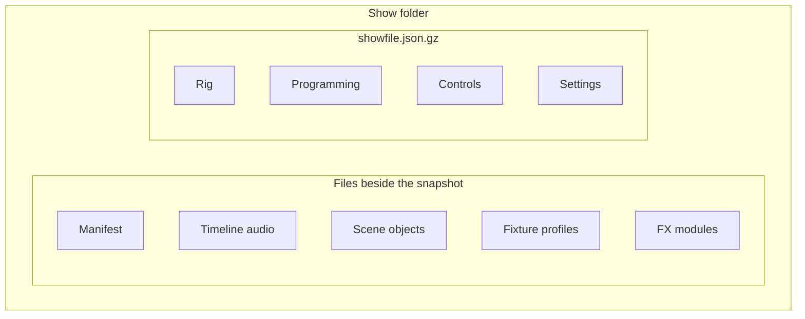
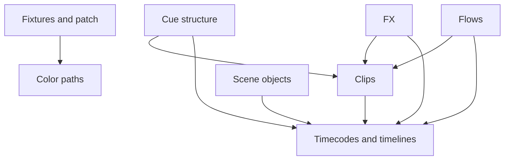
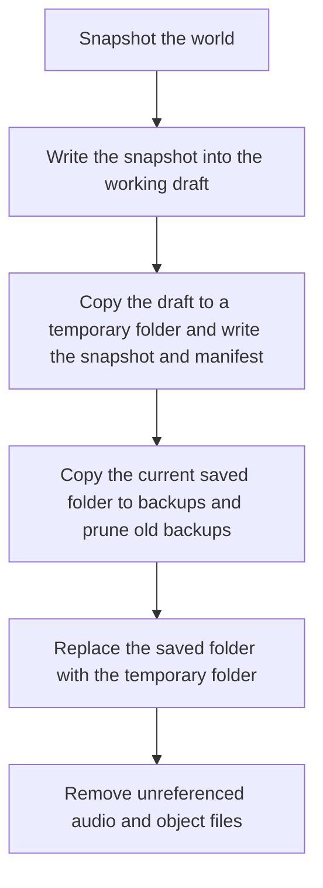
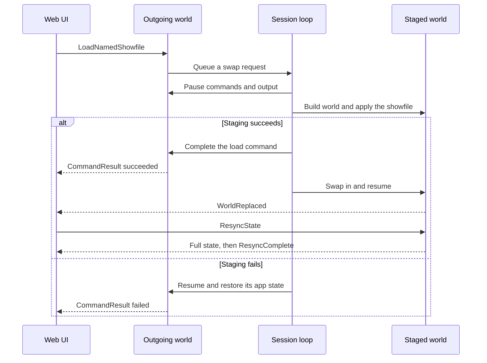

# Showfiles and loading a show

{{#include ../includes/human-review-disclaimer.md}}

A showfile is a folder that holds one saved show: a versioned JSON snapshot of the rig, the programming, and the controls, plus the files the show refers to, such as timeline audio. The engine never edits a saved showfile while you work. It works on a draft copy, saves that draft in the background, and writes the saved folder only when you save. Loading a show doesn't change the running world either. The native host builds a complete new engine world from the showfile and swaps it in, while clients and IO services stay connected. Knowing these paths tells you what you must change when a domain gains data that should survive a restart, and what a contributor can and can't rely on during a show load.

This page uses the [running example](../README.md#a-running-example) and builds on [how the pieces fit together](system-overview.md). It uses two engine terms:

- The **world** is the Bevy container that holds all of the engine's show state. One world runs at a time.
- A **domain** is one area of the show, such as fixtures and patch, or cues and sequences, together with the plugins that own its state.

## What a showfile stores

A showfile stores what you programmed and how the desk is set up. The following diagram shows the parts of a show folder:



The snapshot groups its objects the way the [concept map](../concepts/concept-map.md) does:

| Group | Contents |
|-------|----------|
| Rig | Fixtures with their profiles embedded, patch bindings, scene objects, and color paths. |
| Programming | Cues, sequences, groups, masters, blueprints, FX, flows, timecodes, and timelines. |
| Controls | Clips, control slots, boards, MIDI and OSC mappings, and variables. |
| Settings | Desk settings, IO settings, and version metadata. |

The files beside the snapshot hold what doesn't fit in JSON. The manifest records file hashes and sizes so the show list loads without reading every snapshot. Timeline audio and 3D object bundles are copied into the folder, and a show can also package the fixture profiles and FX modules it uses. [The show folder on disk](#the-show-folder-on-disk) lists the exact paths.

In the running example, `Par 1` is one entry in the fixture list, with its profile embedded so the show opens on a machine that doesn't have the profile installed. Its patch at console universe 1, address 1 and the bindings that route that universe to an output are in the patch bindings. `First sequence` is in the sequence list, `Red` and `Blue` are in the cue list, and `First playback` is in the clip list.

A showfile stores definitions, never live state. These things are not saved:

- Running playbacks, their positions, and fades in progress. After a load, no clip is running, even if `First playback` was in `Red` when you saved.
- The programmer. The 50% intensity you held on `Par 1` is gone after a load.
- Undo history.
- Control slot levels and pickup state. A control slot saves its assignment and button mode only.

The snapshot is flat JSON: one top-level key per kind of object, such as `fixtures`, `cues`, `sequences`, `clips`, `controlSlots`, and `ioSettings`, and a `metadata` object. The metadata records the Nightfall version that wrote the file, the schema version (`showfileVersion`), and the save time.

### The show folder on disk

Every show is a folder whose name ends in `.nightfall-show`. The show called `default` is the one you get when you save without a name. The following tree shows a saved show and the folders the engine keeps beside it in the data directory:

```plaintext
<data-dir>/
  <showfile-name>.nightfall-show/         saved show
    showfile.json.gz                      gzip-compressed snapshot
    showfile-manifest.json                hashes and sizes for fast listing
    timeline-audio/<timeline-uid>/...     audio files for timelines
    scene-objects/...                     copies of 3D object bundles
    fixtures/  fx-modules/                packaged profiles and modules (optional)
  drafts/<showfile-name>.nightfall-show/  working draft, same layout
  backups/<showfile-name>-<YYYYMMDD-HHMMSS>.nightfall-show/
  trash/<entry>/                          deleted shows, kept for 7 days
  fixtures/  objects/  fx-modules/        installed libraries shared by all shows
```

The engine writes the snapshot gzip-compressed. It also reads a plain `showfile.json`, which is what a zip export contains, and prefers the compressed file when both exist. A snapshot can be at most 1 GiB uncompressed.

The manifest is a small sidecar that the show list reads instead of parsing every snapshot. It holds a hash of the snapshot's contents and the snapshot file's size and modification time, so the engine can tell when the manifest is stale. The engine ignores a missing or stale manifest and writes a new one the next time it loads or saves the show.

Files that a show refers to live inside its folder, and the snapshot refers to them by relative path. A timeline stores the path of its audio file, such as `timeline-audio/<timeline-uid>/<timestamp>-track.wav`. After each save, the engine deletes audio files and scene object copies that no saved object refers to anymore.

### Data directories

The data directory comes from the `directories` crate's project directories for Nightfall. The following table lists where it is on each platform:

| Platform | Data directory | Fixture library |
|----------|----------------|-----------------|
| Linux | `$XDG_DATA_HOME/nightfall`, usually `~/.local/share/nightfall` | `~/.local/share/nightfall/fixtures` |
| macOS | `~/Library/Application Support/com.nightfall.nightfall` | `~/Library/Application Support/com.nightfall.nightfall/fixtures` |
| Windows | `%APPDATA%\nightfall\nightfall\data` | `%APPDATA%\nightfall\nightfall\data\fixtures` |

Set `NIGHTFALL_DATA_DIR` to use another directory, for example to keep test shows away from your own. The application log file is in the data directory too.

## Versions and migrations

Every showfile records the schema version that wrote it. The engine reads the version first and decides what to do with the rest of the file:

- A file at the current version deserializes straight into the current Rust types.
- A file at an older supported version goes through migrations first. Each migration step rewrites the raw JSON from one version to the next. The engine runs every step from the file's version up to the current one, stamps the current version into the metadata, and only then deserializes the result.
- A file older than the oldest supported version, or newer than the current one, fails with an "unsupported showfile version" error. A file without a valid version fails too, rather than being treated as an old one.

Migrations work on raw JSON rather than on Rust types, because the data they convert often has no Rust type anymore. For example, the step from schema 19 to 20 turns each `controlAssignments` entry into a `controlSlots` entry with the Go button mode, and the type for the old list no longer exists.

Loading migrates in memory. The engine writes the migrated snapshot into the show's working draft right away, but the saved folder keeps the old schema until you save. An older build of Nightfall can't open the show after that save, because it rejects versions newer than its own.

> [!WARNING]
> Change the shape of existing JSON only together with a new schema version and a migration step. A renamed or restructured field that deserializes with a default instead silently drops data from every older showfile.

## Loading: how each domain applies its part

The `showfile` crate turns a parsed snapshot into world state. It doesn't know where the bytes came from: the native host reads files, and the browser demo reads its packaged demo show.

Each domain has a load contributor that applies its slice of the snapshot. The contributors run in a fixed order, so a domain that refers to objects of another domain always finds them. The following diagram shows the dependencies between load domains:



Desk state and boards have no dependencies. The crate sorts the domains with a depth-first walk of this graph and fails the load if the graph has a cycle.

Loading then runs in three phases, and each phase visits every domain in that order before the next phase starts:

1. **Import definitions.** Each domain copies its definitions into the world's stores and plain settings. `Par 1`, `First sequence`, `Red`, and `Blue` arrive here.
1. **Resolve links.** This phase is for work that needs another domain's definitions. No domain uses it today.
1. **Materialize runtime.** Domains create the runtime objects that the frame needs, derived from the definitions: fixture parameters, step FX, clip instances such as `First playback`, timecode generators, and timelines.

Keeping object creation in the last phase means every definition is in place before anything starts running against it. Before the phases run, the load also rejects a showfile that holds two different library versions of the same fixture or 3D object, and it rewrites group references in selections so they point at groups by a stable identity.

## Snapshots: from world to showfile

Saving runs the same domains in the other direction. Each domain has a save contributor that reads the world and returns its slice, and the crate merges the slices into the flat snapshot. Contributors sort objects by ID, so the same show always serializes to the same JSON. That stability matters, because the engine detects unsaved changes by comparing hashes.

The engine keeps a hash of the clean show: the snapshot as it was last loaded or saved. To check whether the show has changed, it takes a new snapshot, serializes it with the clean snapshot's metadata in place of its own, and compares the hashes. Copying the metadata first keeps the save time and app version from counting as a change.

## Drafts: the working copy

While a show is open, the engine works in its draft folder under `drafts/`, not in the saved folder. When you load a show, the engine copies the saved folder into the draft folder and points the process's active show folder at the draft. Uploads, such as a new audio file for a timeline, go into the draft, so the saved folder changes only when you save.

The engine saves the draft when the show has changed since the last load or save. The following events trigger a draft save:

- Every 60 seconds.
- When the last client disconnects. Closing one browser tab while another stays open saves nothing.
- When the engine quits through the quit command, a termination signal, or the desktop app closing.
- When a client sends the command to save the draft.

The draft's manifest records the hash of the saved show the draft started from. When you open the list of shows, a draft counts as recoverable unless both its own hash and that base hash match the saved show. The native backend doesn't open a show by itself at startup. Unless `NIGHTFALL_SAMPLE_DATA` asks for the sample show, it starts with an empty world, and the web UI offers to recover the last show's draft or to open a show. Both choices load the show through a world swap.

> [!WARNING]
> Loading the saved version of a show replaces that show's draft folder with a copy of the saved folder, which discards any unsaved draft of that show. To keep the draft, load the draft instead.

## Saving

An explicit save promotes the working draft to the saved folder. The following diagram shows the steps:



Save As works the same way with a new name. The engine first copies the current draft into the new name's draft folder and points the active show folder at it, so the show's files follow it to the new name.

Each save keeps the previous saved folder as a timestamped backup. The number of backups to keep is a setting in the show's desk settings, 20 by default, and 0 keeps every backup. You can load a backup as a revision: the engine loads it into the show's working draft and leaves the saved folder alone until you save.

The final replace step removes the old saved folder and then renames the temporary folder into its place. These are two file system operations, not one atomic rename. If the process stops between them, the saved folder is missing, but the new backup and the working draft still hold the show.

Deleting a show moves its saved folder, draft, and backups into one entry under `trash/`. You can restore it from the show list for 7 days. The engine purges older entries the next time it lists deleted shows. You can't delete the show that is open.

## World swaps: loading without disconnecting

A native host loads a show, or creates a new one, by building a fresh world and swapping it in. It never clears the running world and refills it. Building fresh means a load can't leave stale state behind from the previous show, and the running show keeps going until the new one is complete.

Three pieces work together:

- The **world factory** builds a complete engine world from a bootstrap source: an empty show, the sample show, or a showfile. Every world it builds shares the same process-scoped services.
- The **swap orchestrator** owns the active world, stages a new one, and replaces the active world with it.
- The **session loop** runs the active world's frames on the engine thread and handles swap requests between frames.

### What happens during a swap

The following diagram shows a load of a named show from one client:



The swap runs in these steps:

1. The showfile command handler doesn't load anything itself. It queues a swap request with the command's ID, the show name, and the folder to read, and the frame finishes normally.
1. After the frame, the session loop takes the queued requests and handles them one at a time, in the order they arrived.
1. The orchestrator sets the outgoing world's app state to show loading and pauses its command processing and output. For the system sets this affects, see [the frame loop](../engine/frame-loop.md).
1. The world factory builds the new world. For a showfile, it parses and migrates the snapshot, prepares the show's draft folder, points the fixture library at the show folder's packaged profiles, applies the snapshot, and records the clean hash. The new world stays paused.
1. If staging succeeded, the loop completes the load command in the outgoing world and sends its result to clients straight away, because the outgoing world won't run another frame to send it.
1. The orchestrator swaps the worlds, resumes the new one, and drops the outgoing world.
1. The new world sends `WorldReplaced` to every client and queues a notice that the current showfile changed.

Staging runs on the engine thread between two frames, so the outgoing world runs no frames while the new world builds. The DMX output workers run on their own threads. The Art-Net and sACN workers keep resending the last frames they received, so the lights hold their look until the new world renders.

The outgoing world isn't saved before the swap drops it. Changes made since its last draft save, at most 60 seconds earlier, are lost when you load another show without saving first.

### What survives a swap

The world holds the show, but some things belong to the process, so a swap doesn't touch them:

- The client transport: the channels between the clients and the engine, and the websocket server. Clients stay connected, and commands sent during staging wait in the channels for the new world.
- The IO services for Art-Net, sACN, and USB DMX output, MIDI and OSC input, and audio. They start once per process, so a load doesn't drop sockets or MIDI connections.
- The process settings, such as the data directory, the transport permissions, and the shared schedule of send times that paces frames and DMX output.

Everything else is new: the show data, the programmer, undo history, running playbacks, and any per-client watches. HTTP routes are replaced too. Domain plugins register their routes while the new world builds, and the new world installs them in the running server during its first frame, so routes that serve files from the current show serve the new show's files.

### What clients see

A client sees the load command succeed, followed by `WorldReplaced`. The web UI then hides the panel area behind a veil and resyncs the same way it does after connecting, as described in [resync on connect and after gaps](client-protocol.md#resync-on-connect-and-after-gaps). It reveals the panels once the resync is complete, the new current showfile is confirmed, and the panel layout for that show is restored, or after 10 seconds at most. Every client resyncs, not only the one that asked for the load.

### When a load fails

If building the new world fails, the orchestrator resumes the outgoing world, restores its app state, and fails the command with the error code `showfile.world_swap_failed`. The current show keeps running and clients stay connected. Most failures, such as an unreadable file, an unsupported version, or conflicting library versions, happen while the engine parses and validates the snapshot, before anything changes on disk.

> [!WARNING]
> The draft folder and the active show folder are process-wide, not part of a world. Once the snapshot has parsed and validated, staging replaces the loaded show's draft folder and points the active show folder at it before it applies the snapshot. If a later step fails, for example the fixture library scan of the show folder, the outgoing world keeps running with its active show folder pointing at the other show's draft. Uploads and draft saves after such a failure can mix files between the two shows.

Importing parts of another showfile is different: the engine merges the selected domains into a combined snapshot and reloads it into the running world in place, without a swap. The browser demo has no showfile handling at all. It applies its packaged demo show once at startup.

## Add data to the showfile

When a domain gains state that should survive a restart, add it to the snapshot and to that domain's contributors. Two recent changes show both cases: boards were added as a new field and a new load domain without a schema change, and control slots replaced `controlAssignments` with `controlSlots`, which needed a new schema version and a migration.

Follow these steps to add a stored field:

1. Add the field to `ShowfileSnapshot` in `crates/showfile/src/snapshot.rs`. Give it `#[serde(default)]` so files written before the field existed still load, and an explicit camelCase `rename`, as `controlSlots` and `ioSettings` have. Older fields such as `color_paths` predate this convention.
1. Add the field to the domain's slice in `crates/showfile/src/contributors/<domain>.rs`. Fill it in the save contributor, and apply it in the load contributor in the right phase: import plain data in the import phase, and create entities only in the materialize phase.
1. Copy the field between the slice and the snapshot in `apply_save_contribution` and `load_contribution_for_domain` in `crates/showfile/src/contributors/mod.rs`.
1. If the domain reads a resource the showfile code doesn't have yet, add it to `ShowfileSaveState` in `crates/showfile/src/world.rs`, and to `ShowfileApplyState`, `apply_showfile_snapshot`, and `initialize_showfile_resources` in `crates/showfile/src/apply.rs`.
1. In `app-runtime`, add the resource to `ShowfileLoadState` and `load_showfile_in_place` in `systems/showfile_events/load.rs`, and clear it in `load/reset.rs`, so an import starts from an empty store.
1. Decide how an import merges the field in `systems/showfile_events/import.rs`. The boards change added a `boards` import option and merged boards by identity.
1. For a new load domain, add it to `ShowfileLoadDomain`, its `ALL` list, and its `dependencies` in `apply.rs`, and list it with the other contributors in `apply_showfile_snapshot`.
1. Add a round-trip test that saves a world, serializes it, parses it, and loads it into a fresh world.

When a change renames, removes, or restructures existing JSON, also add a migration:

1. Increase `CURRENT_SHOWFILE_VERSION` in `crates/showfile/src/lib.rs` by one.
1. In `crates/showfile/src/migrations.rs`, add a match arm for the previous version that calls a new function, such as `19 => control_assignments_to_slots(showfile)?`.
1. Write the function against `serde_json::Value`. Document it as `Schema N → N+1`, return an error for data it can't convert rather than dropping it, and leave a file without the old key unchanged.
1. Add tests for the step: one that converts the old shape and one for a file that doesn't contain it.
1. Check real showfiles with `cargo run -p nightfall-showfile --features midi,osc --example validate -- <showfile>`, which parses and migrates through the same path the engine loads with.

> [!NOTE]
> Color path defaults are saved by the color paths contributor but applied by the fixtures and patch contributor, because the fixture store holds them. A field's save and load contributors don't have to belong to the same domain, but both must handle it.

## In the code

| Concept | Where to look |
|---------|---------------|
| Snapshot type, schema version, and parsing | `crates/showfile/src/snapshot.rs`, `crates/showfile/src/lib.rs` |
| Migration steps and the oldest supported version | `crates/showfile/src/migrations.rs`, `crates/showfile/src/migrations/` |
| Load domains, phases, and order | `crates/showfile/src/apply.rs` |
| Save and load contributors for each domain | `crates/showfile/src/contributors/` |
| Snapshot of a world | `crates/showfile/src/world.rs` |
| Showfile commands, such as save, load, delete, and import | `crates/app-runtime/src/systems/showfile_events/commands.rs` |
| Folder names and paths | `crates/app-runtime/src/systems/showfile_events/paths.rs` |
| Reading and writing snapshots and manifests | `crates/app-runtime/src/systems/showfile_events/storage.rs`, `crates/app-runtime/src/systems/showfile_events/manifest.rs` |
| Saving, drafts, backups, and trash | `crates/app-runtime/src/systems/showfile_events/save.rs`, `draft.rs`, `backup.rs`, `trash.rs` in the same folder |
| Periodic and last-client draft saves | `crates/app-runtime/src/composition.rs` |
| Data directory and active show folder | `crates/common/src/lib.rs` |
| World factory and bootstrap sources | `crates/app-runtime/src/world_factory.rs` |
| Staging, pausing, and swapping worlds | `crates/app-runtime/src/swap_orchestrator.rs` |
| Session loop and `WorldReplaced` | `crates/app-runtime/src/session.rs` |
| Attaching a new world to the running server | `crates/websocket/src/lib.rs` |
| Web UI veil during a show load | `webui/state/showfile-transition.ts`, `webui/components/shell/docking/showfile-transition-veil.tsx` |

## Related topics

- [How the pieces fit together](system-overview.md)
- [How the engine and the web UI talk](client-protocol.md)
- [Crate map](crate-map.md)
- [The frame loop](../engine/frame-loop.md)
- [From command to state change](../engine/command-path.md)
