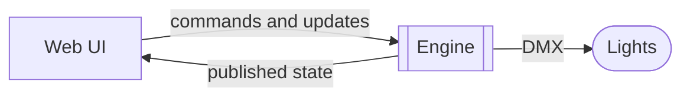
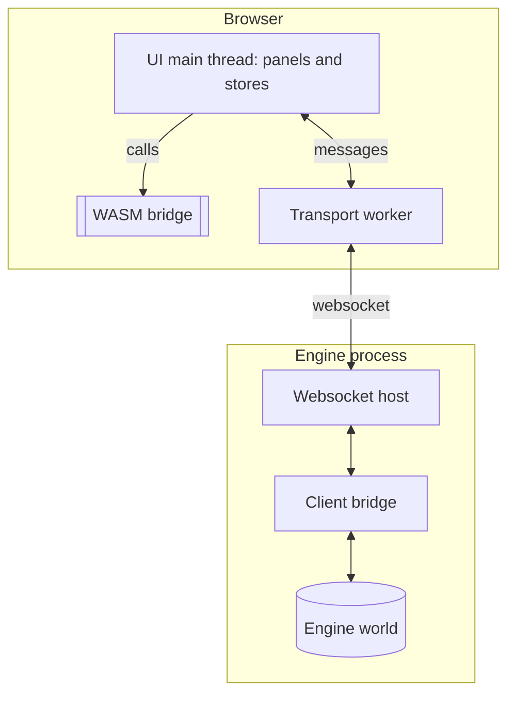
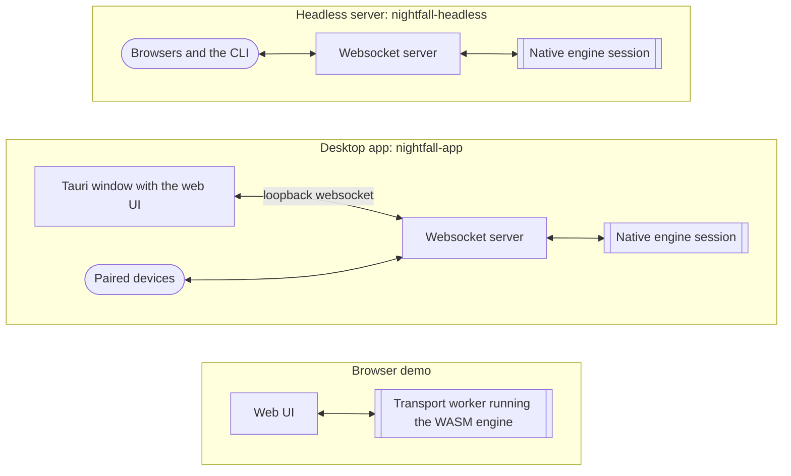
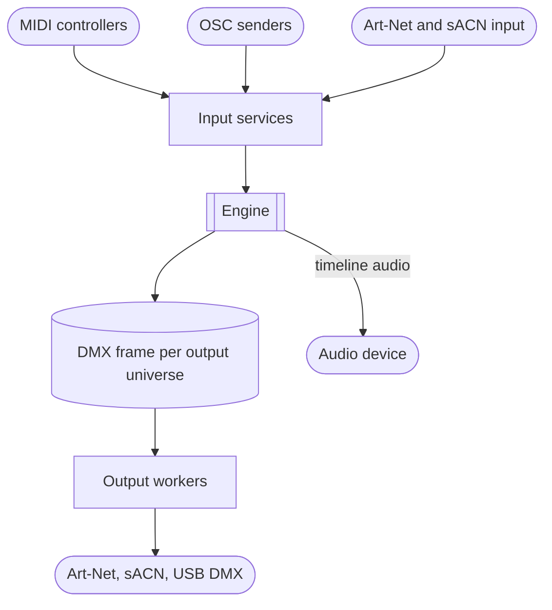

# How the pieces fit together

{{#include ../includes/human-review-disclaimer.md}}

Nightfall is one engine that several programs can run. The engine is a Rust program that holds the show and calculates every frame. The web UI is a SolidJS app that shows the engine's state and sends it your changes. A host is the program that runs the engine and connects the UI to it. Nightfall has three hosts: a headless server, a desktop app, and a browser demo that runs the engine as WebAssembly (WASM). Knowing how these parts connect tells you where a change belongs, which builds it reaches, and why the UI never calculates the show itself.

This page builds the picture in layers: the engine and the UI, then the hosts, then the inputs and outputs, and finally the showfile. The [crate map](crate-map.md) lists the Rust crates that implement each part.

## The engine, the web UI, and the lights

The following diagram shows the three things every Nightfall setup has:

The engine owns all show state. It runs the frame described in [how a show becomes light](../concepts/show-to-light.md), and it is the only part that merges layers or produces DMX. The engine is a [Bevy](https://bevyengine.org/) app. Bevy is a Rust game engine, and Nightfall uses its entity component system (ECS) and scheduler but none of its graphics. The engine has no window and draws nothing.

The web UI is a client. It sends the engine two kinds of messages:

- Commands, which the engine tracks, answers with a result, and can usually undo. Typing `fixture 1 @ 50` in the command line sends a command.
- Updates, which carry continuous values such as a fader position. The engine applies them without tracking or undo.

[Control layers](../engine/control-layers.md) explains how commands and updates differ inside the engine. The engine answers with published state: fixture values, playback status, stored objects, and so on. Every connected UI sees the same show state, so two screens never disagree about the show.

In the running example, typing `fixture 1 @ 50` sends the text to the engine as a command. The engine parses it, and the programmer starts holding `Practice light` at 50% intensity. In the next frame, the engine merges that programmer layer over `First playback`, publishes the new values to every connected UI, and sends the DMX to the lights. The UI shows 50% because the engine published it, not because the UI predicted it.

## Why the UI talks to the engine over a websocket

Even in the desktop app, where the UI window and the engine run in the same process, the window reaches the engine through a websocket on the computer's own loopback address. The desktop shell injects the engine's port into the page before the UI starts, and the UI connects to it like any other client. The design gives Nightfall several properties:

- Every client uses one protocol. The desktop window, a second desktop window, a browser on a tablet, and the `nightfall-cli` terminal client all speak the same messages, so the engine doesn't need to know which kind of client it serves.
- The same UI build runs everywhere. The UI in a desktop window is the same code that a phone loads from the console over the network. Only the lookup of the engine's address differs.
- A slow client can't stall a frame. Messages cross between the engine thread and the network through queues. Each websocket client has its own bounded queue, and when a client falls behind, newer snapshots replace older queued ones. A client that stops reading entirely is disconnected and resyncs when it reconnects.
- Connections outlive a show. The websocket server belongs to the process, not to the loaded show, so loading a showfile keeps every client connected.

Browsers on other devices must pair before they can control the engine. The engine picks a six-digit pairing PIN, and a browser that enters it receives a session cookie. Browsers on the operator's own computer don't need the PIN.

## Inside the web UI

The UI splits its connection work across a main thread and a transport worker. The following diagram shows the path from a panel to the engine on a native host, where the engine process is the headless server or the desktop app:

The transport worker is a web worker that owns the connection. It receives the engine's messages and decodes them off the main thread, then hands the main thread batches of decoded messages. This keeps decoding work from delaying the UI's rendering. The UI sends commands and updates as JSON. The engine sends binary messages: one leading byte says whether the message must arrive in order, may be replaced by a newer one, or builds on the previous message of its type, and the rest is the message body in Concise Binary Object Representation (CBOR).

The client bridge is the engine's side of this boundary, and it doesn't know about sockets. It accepts command and update envelopes from a host and hands back encoded messages. The websocket host is one adapter that connects it to the network. The browser demo, described later on this page, plugs in a different adapter with no network at all.

For the message formats, the order of messages after a client connects, and how the engine keeps a slow client from falling behind, see [how the engine and the web UI talk](client-protocol.md).

The message types are Rust types. The `pnpm run typeshare` script generates matching TypeScript types for the UI from them, so the Rust definitions are the source of truth for both sides.

### The WASM bridge shares engine logic with the UI

Some engine logic has to run inside the UI to keep it responsive, and the UI doesn't reimplement it in TypeScript. Instead, the WASM bridge is a small Rust crate that exports functions to the UI. Each function calls logic in other Nightfall crates, and the build keeps only the code those functions reach, rather than compiling whole domain crates to WebAssembly. The bridge covers:

- Command parsing: completion and error checking as you type, and splitting a line into separate statements.
- Selection: parsing, formatting, and resolving spatial selections on each keystroke.
- Timing previews: Step FX phases, sequence lookahead projections, and sequence durations.
- Fixture profiles: converting DMX channel values into beam colors and positions for the 3D visualizer.
- Boards: checking where a board element fits.

The WASM bridge is a library, not a second engine. It holds no show state and never talks to the engine. When you press <kbd>Enter</kbd> in the command line, the UI uses the bridge to split the line into statements, and then sends each statement to the engine, which parses it again with the same parser and decides the result.

The code the bridge calls must compile for the `wasm32` target. Keep the crates it depends on free of native-only dependencies such as Bevy's runtime, sockets, or threads. The [crate map](crate-map.md#what-the-wasm-bridge-exports) lists each export and the crates it calls. After you change one of those crates, rebuild the bridge with `pnpm run wasm:bridge --dev` so the UI picks up the change.

## Three hosts around one engine

Each host wraps the same engine in a different program. The following diagram shows the three hosts and how the UI reaches the engine in each:

### Headless server

The `nightfall-headless` binary runs the engine with no window. It starts an async runtime, runs the engine session on a dedicated thread, and serves the websocket and HTTP routes on `NIGHTFALL_PORT`. It also runs any commands piped to its standard input or set in `NIGHTFALL_STARTUP_CMDS`. <kbd>Ctrl</kbd>+<kbd>C</kbd> or a termination signal asks the engine to save the current draft and exit, and a second signal exits at once.

The headless server doesn't serve the web UI's files. During development, the Vite dev server serves the UI on `NIGHTFALL_PORT` plus one and forwards the websocket and `/api` requests to the backend. This is the setup most contributors run, and the setup the Playwright `native` target uses.

### Desktop app

The `nightfall-app` binary is a [Tauri](https://tauri.app/) shell. Tauri shows web content in the operating system's own webview, so the window displays the same web UI. The shell starts the same engine session as the headless server on a background thread, and adds the parts a desktop app needs:

- Native menus, file dialogs, and commands to export a showfile or a diagnostics bundle.
- More windows. Each window is a separate client of the same engine.
- An updater that downloads new versions and installs them only after the engine has stopped, so an update never interrupts a running show.
- An orderly quit. Quitting asks the engine to save the draft and stop, and waits up to 10 seconds for it before exiting anyway.

Release builds embed the web UI's files in the executable. The shell also hands those files to the engine's HTTP server, so a phone or tablet on the network can load the UI from the console. Development builds load the UI from the Vite dev server and embed nothing.

### Browser demo

The browser demo runs the whole show in a web page with no backend. The engine compiled to WASM runs inside the UI's transport worker, in place of the websocket connection. The worker passes commands and updates to the engine directly and drains its published messages after each frame, in the same binary format a websocket would carry. Everything above the worker works unchanged.

The browser can't sleep a thread until the next DMX tick, so the worker drives the engine's clock itself. It calls the engine about 60 times a second by default, and passes the elapsed time in as the frame's duration. The `fps` command changes the rate within 10 to 120 frames a second. The demo loads a packaged demo show at startup and can't save it.

### What each host includes

The following table compares the hosts. "Yes" for a native host means the default build includes the feature. Cargo features on `app-runtime` can leave parts out, and startup settings can turn off network input, network output, and USB output for the whole process.

| Part | Headless server | Desktop app | Browser demo |
|------|-----------------|-------------|--------------|
| Program | `nightfall-headless` binary | `nightfall-app` binary | WASM package loaded by the web UI |
| Where the engine runs | Dedicated engine thread | Dedicated engine thread | The web UI's transport worker |
| Frame timing | Paced to the DMX output rate, 44 frames a second by default and never fewer than 30 | Same as headless | Worker timer, 60 frames a second by default |
| How the UI reaches the engine | Websocket | Websocket on the loopback address | Function calls inside the worker |
| Serves the web UI files | No | Yes, in release builds | The demo is static files |
| Fixtures, programmer, cues, clips, boards, FX, flows, tempo, timecode, timelines | Yes | Yes | Yes |
| FX modules | Yes | Yes | No |
| Fixture library | GDTF and OFL files in the data directory | GDTF and OFL files in the data directory | Built-in profiles only |
| Object library | Yes | Yes | No |
| Art-Net, sACN, and USB output | Yes | Yes | No |
| Art-Net and sACN input, MIDI, OSC | Yes | Yes | No |
| Timeline audio | Played by the engine | Played by the engine | Played by the browser from bundled files |
| Beat detection | Yes | Yes | No |
| Saving showfiles and drafts | Yes | Yes | No |
| Loading another showfile | Yes | Yes | No |
| Menus, updater, and exports | No | Yes | No |

The engine reports what it supports to the UI as runtime capabilities, so the UI can hide features the current host lacks. For example, the demo reports that it has no persistence, no FX modules, and only built-in fixture profiles.

### The browser demo has its own plugin list

A Bevy app is assembled from plugins, and each Nightfall domain, such as cues or fixtures, adds itself to the engine as one or more plugins. The native hosts share one assembly: a set of plugin groups for the core, the desk, effects, timecode, inputs, and outputs, plus the systems that load, save, and swap showfiles. The browser demo can't use those groups as they are, because several plugins need sockets, threads, the file system, or a WASM runtime of their own. The browser runtime lists its plugins by hand instead.

Today the browser list differs from the native groups in these ways:

- It leaves out the websocket, audio, input, output, fixture library, and object library plugins, and the FX module plugin. In place of the FX module plugin, it registers an empty store for FX modules.
- It adds a built-in fixture library that serves the compiled-in profiles, and a timeline plugin variant that asks the browser to play bundled audio.
- It has none of the showfile handling systems, such as draft autosave and showfile loading.
- It adds the scene object plugin after the fixture compositor plugin. The native core group adds it before.

**Warning:** Nothing checks that the two lists stay in step. When you add a plugin to the native plugin groups, decide whether the browser demo needs it too, and either add it to the browser runtime or report the missing feature through the runtime capabilities. The `check:browser-demo-dependencies` script only confirms that the browser build pulls in no native-only packages, such as Tokio or Wasmtime. It doesn't compare plugin lists.

## Inputs and outputs

The engine talks to lighting hardware and other software through IO services. The following diagram shows what flows in and out on a native host:

The IO services live as long as the process. They start once and keep running when you load another showfile, so a show load doesn't drop network sockets or MIDI connections.

### DMX output

In every frame, the engine composes one DMX frame for each output universe. Patch bindings decide what goes into it: console universes routed to that output, fixtures patched straight to it, and DMX input passed through. Output workers for Art-Net and sACN each run on their own thread and transmit on a fixed schedule. These workers and the engine's frame limiter share one grid of ticks: the engine starts each frame shortly before a tick, so each transmission carries the most recently finished frame. USB DMX output doesn't follow the grid. It writes each frame to the interface as soon as the engine finishes it. The default DMX output rate is 44 frames a second.

Output transports are off until something routes to them. A console universe reaches the wire only when a patch binding routes it to a transport, as [how a show becomes light](../concepts/show-to-light.md) describes.

### Control and DMX input

The other services bring outside input into the show:

- Art-Net and sACN input receive DMX from another console. The engine merges incoming DMX into the DMX input layer at priority -128, or passes it straight through to an output. For more information, see [priorities and merging](../concepts/priorities-and-merging.md).
- MIDI and OSC input receive messages from controllers and other software. Mappings turn them into actions, such as Go on a clip or a master level, which run through the same commands as the UI. MIDI input also feeds tap tempo.
- Timecode objects provide a clock that timelines can follow.
- Timeline audio plays through the engine's audio service on the native hosts. Set `NIGHTFALL_TIMELINE_AUDIO_ENABLED=0` to keep it silent while you develop.
- Beat detection analyzes a timeline's audio files to build its beat grid. It uses a machine learning model whose weights you install on request.

**Warning:** A timecode object can name an external source, such as MIDI timecode, SMPTE linear timecode (LTC), or Art-Net timecode, but the engine doesn't read any external source yet. Every timecode advances from the engine's own clock, whatever its source setting says.

## Where the showfile fits

The showfile is the saved show: the rig, the programming, the controls, and the settings. On the native hosts, the engine reads and writes showfiles in its data directory. The showfile format is versioned JSON, and older showfiles go through migrations when they load.

Loading a showfile doesn't edit the running show in place. The host builds a fresh engine world from the showfile and swaps it in once it is complete, so a failed load leaves the current show running. The client connections and the IO services belong to the process rather than to the world, so they carry over. After the swap, the engine tells every client that the world was replaced, and each client asks for fresh state, as it does when it first connects.

The engine also keeps a draft of unsaved work. It saves a changed draft every 60 seconds and when the last client disconnects, so closing the last browser tab doesn't lose work.

The browser demo reads its packaged demo showfile, in the same format, when it starts, but it has no storage, so it can't save or load another show.

## In the code

| Concept | Where to look |
|---------|---------------|
| Native engine assembly | `crates/app-runtime/src/composition.rs` |
| Native plugin groups | `crates/app-runtime/src/plugin_groups.rs` |
| Engine session loop and showfile swaps | `crates/app-runtime/src/session.rs`, `crates/app-runtime/src/swap_orchestrator.rs`, `crates/app-runtime/src/world_factory.rs` |
| Headless entry point | `crates/app-runtime/src/main.rs` |
| Desktop shell | `desktop/app-tauri/src/desktop_shell.rs`, `desktop/app-tauri/src/updates.rs` |
| Web UI served to other devices | `desktop/app-tauri/src/web_ui.rs`, `crates/websocket/src/web_ui.rs` |
| Browser demo engine and its plugin list | `crates/browser-runtime/src/lib.rs` |
| Runtime capabilities | `crates/engine/src/runtime_capabilities.rs` |
| Client bridge | `crates/engine/src/client_bridge.rs` |
| Websocket host, client queues, origin check, and pairing | `crates/websocket/src/websocket.rs`, `crates/websocket/src/outbox.rs`, `crates/websocket/src/origin.rs`, `crates/websocket/src/pairing.rs` |
| Transport worker | `webui/lib/engine-runtime-worker-core.ts`, `webui/lib/engine-runtime-embedded.ts` |
| Engine address lookup in the UI | `webui/lib/api.ts` |
| WASM bridge | `crates/wasm-bridge/src/lib.rs`, `webui/lib/wasm-bridge.ts` |
| Generated TypeScript types | `webui/types/index.ts` |
| WASM builds | `scripts/build-wasm.mjs` |
| Browser demo dependency check | `scripts/check-browser-demo-dependencies.mjs` |
| DMX output frames | `crates/fixtures/src/output_frames.rs` |
| Shared tick grid and output workers | `crates/service_host/src/tick_grid.rs`, `crates/service_host/src/fixed_rate.rs` |
| Startup settings | `crates/config/src/lib.rs` |
| Timecode clock | `crates/timecode/src/systems.rs` |

## Related topics

- [How the engine and the web UI talk](client-protocol.md)
- [Web UI architecture](web-ui.md)
- [Crate map](crate-map.md)
- [The frame loop](../engine/frame-loop.md)
- [How a show becomes light](../concepts/show-to-light.md)
- [Concept map](../concepts/concept-map.md)
- [Control layers](../engine/control-layers.md)
- [Running the app](https://github.com/stewartadam/nightfall-lightdesk/blob/develop/CONTRIBUTING.md) in CONTRIBUTING.md
