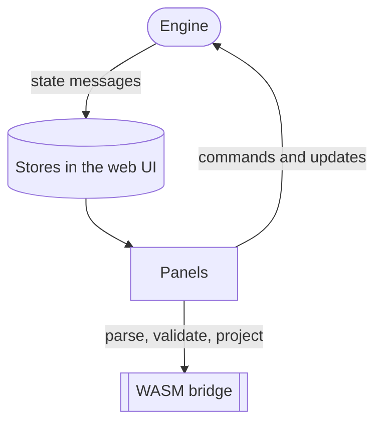
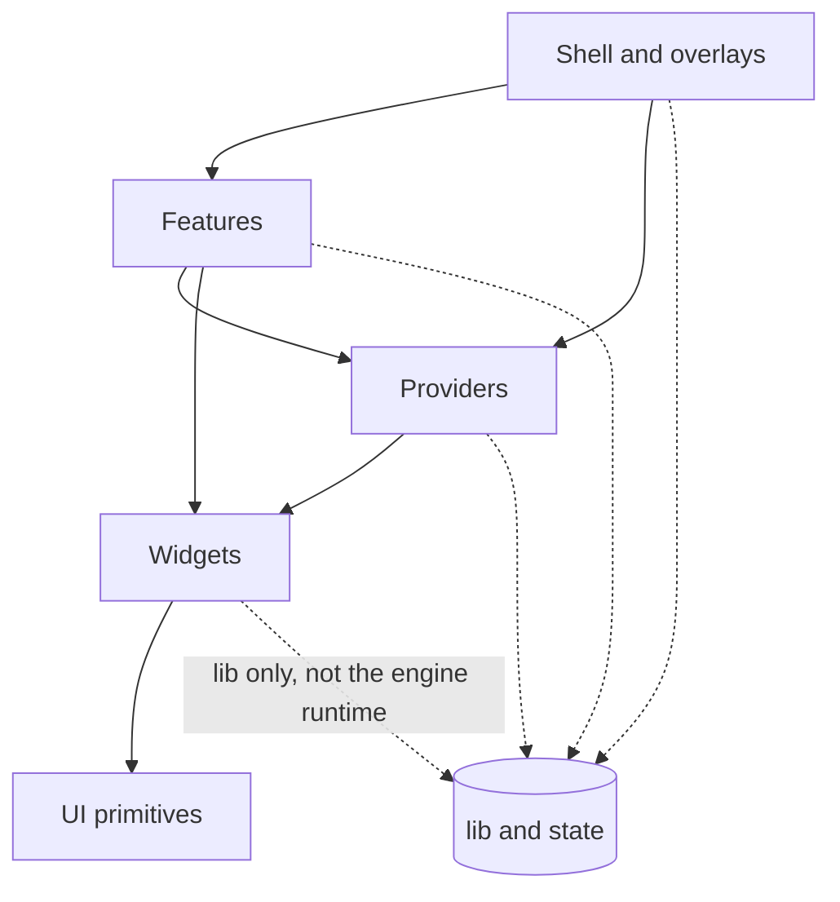
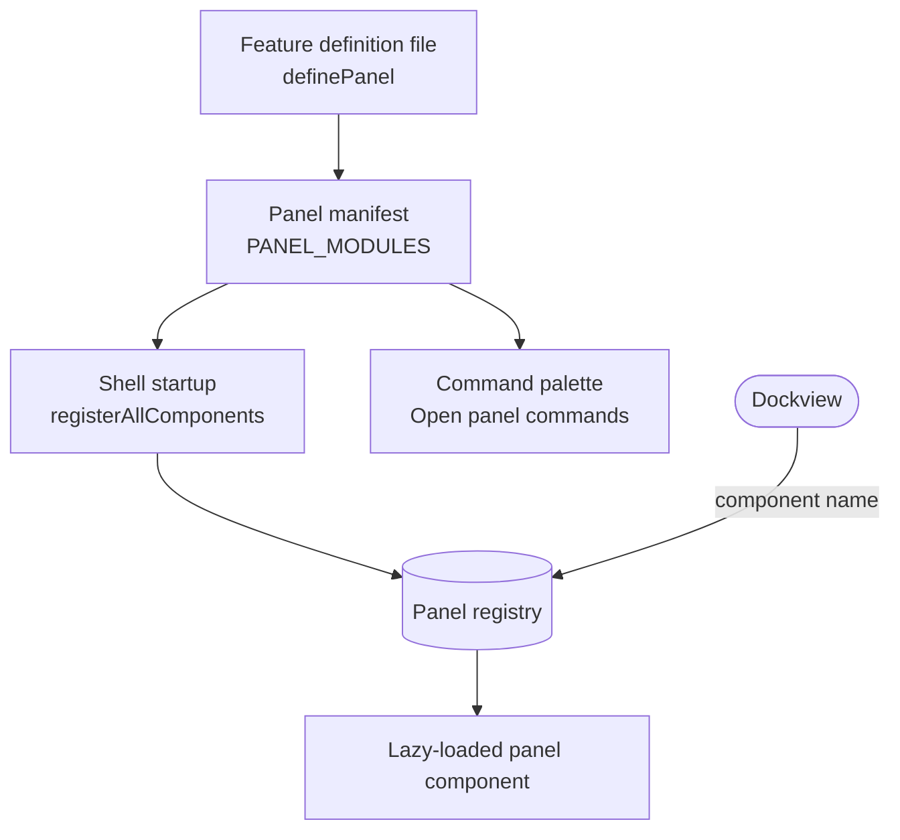
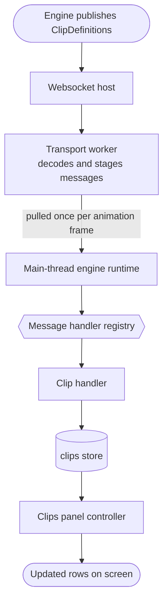
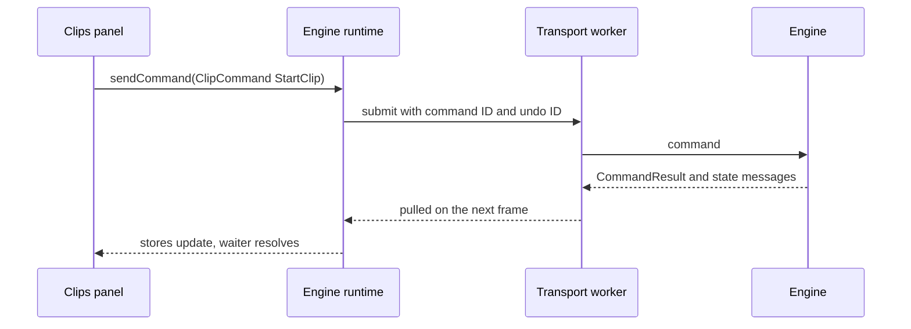

# Web UI architecture

{{#include ../includes/human-review-disclaimer.md}}

The web UI is a SolidJS app in `webui/` that shows engine state and sends the operator's commands back to the engine. It holds no authoritative show state: the engine decides what a cue, clip, or fixture is, and the UI mirrors what the engine sends. The code is split into folder layers with import rules, and node tests fail when you break those rules. This page explains the layers, the shape of a feature folder, how panels are registered, where state lives, and how data travels between the engine and a rendered panel, so you know where new code belongs before a test tells you.

## The UI is a view of the engine

The engine runs the show and the UI renders it. The following diagram shows the two directions of traffic:

State flows one way. A panel never changes engine state by writing a store. It sends a command, the engine applies it, and the engine's next state message updates the store. This keeps every connected screen consistent, because each one renders the same messages. The [control layers](../engine/control-layers.md) page describes what commands and updates are on the engine side.

When the UI needs Rust logic before it sends anything, such as autocompleting a typed command or projecting a sequence's timing, it calls the WebAssembly (WASM) bridge instead of reimplementing the rule in TypeScript. The [WASM bridge section](#shared-logic-through-the-wasm-bridge) explains when to use it.

## Folders form layers

Most of `webui/` is organized as layers, where a lower layer knows nothing about the layers above it. The `components/` folder holds exactly five shared layers, and a node test fails if any other file or folder appears there. Domain code lives in `features/`.

The following table lists the top-level folders under `webui/`:

| Folder | Layer | Contents |
|--------|-------|----------|
| `components/ui` | UI primitives | Buttons, menus, popovers, dialogs, tables, segmented controls, and the visual language. Primitives know nothing about Nightfall's domain. |
| `components/widgets` | Widgets | Reusable composite components such as the data grid, color picker, CRUD panel helpers, and the context-menu widget. Widgets render data passed to them and don't read app state. |
| `components/providers` | Providers | App-wide Solid context providers without their own presentation, such as keyboard shortcuts, the command registry, context menus, and the panel capability registry. |
| `components/shell` | Shell | The app frame: startup, header, status bar, command palette, Dockview docking, layouts, and the compact (phone-width) shell. |
| `components/overlays` | Overlays | App-wide floating presentation: the connection overlay, the global context-menu host, the shortcuts popup, and pairing. |
| `features/<domain>` | Features | One folder per domain, such as `cues`, `clips`, or `visualizer`, holding that domain's panels, components, and logic. |
| `lib` | Not classified | Runtime services and pure helpers: the engine runtime, message handlers, panel registry, logger, WASM bridge, and keyboard shortcuts. |
| `state` | Not classified | Global Nanostores (`appStores.ts`) and app-level state such as settings, notifications, and showfile transitions. |
| `types` | Not classified | TypeScript types generated from the Rust crates by typeshare. Don't edit by hand. Run `pnpm run typeshare` instead. |
| `styles`, `assets` | Not classified | Theme CSS, form defaults, and generated assets such as the WASM packages. |
| `design-lab` | Not classified | A development-only page that demonstrates the shared components with sample data. |
| `e2e` | Not classified | Playwright specs. |

The following diagram shows which layer may import which. An arrow means "may import from":

Every layer may also import from the layers below the ones it points to. For example, features may import UI primitives directly. One more rule applies across features: a feature may import another feature only through that feature's public `index.ts`.

`lib/` and `state/` sit outside the layer model. The boundaries test doesn't classify files there, so they may import anything, and a few do: the panel manifest in `lib/` imports every feature's panel definition, and `appStores.ts` imports a type from the visualizer feature. Treat `lib/` and `state/` as shared infrastructure and keep feature-specific code in `features/`.

## Import and component rules

Node tests scan the source tree and fail when code breaks a layer rule or bypasses a shared component. Run them with `pnpm run test:webui-node`. The following table lists each rule and the test that enforces it:

| Rule | Enforced by | What it means |
|------|-------------|---------------|
| `ui-must-only-depend-on-ui` | `architecture-boundaries.node.test.ts` | Files in `components/ui` import only other files in `components/ui`. They can't use `lib/`, so primitives don't log or read app state. |
| `widgets-must-not-depend-on-application-runtime` | `architecture-boundaries.node.test.ts` | Widgets don't import providers, shell, overlays, features, `state/`, or `lib/engine-runtime*`. |
| `providers-must-not-depend-on-presentation` | `architecture-boundaries.node.test.ts` | Providers don't import features, shell, or overlays. |
| `features-must-not-depend-on-shell` | `architecture-boundaries.node.test.ts` | Features don't import shell or overlays. |
| `cross-feature-imports-must-use-public-entrypoints` | `architecture-boundaries.node.test.ts` | Code in `components/` or one feature imports another feature only through `features/<domain>` or `features/<domain>/index`. |
| Component root has five layers | `architecture-boundaries.node.test.ts` | `components/` contains only the `ui`, `widgets`, `providers`, `shell`, and `overlays` folders. |
| Dialog chrome stays in `Dialog` | `shared-dialogs.node.test.ts` | Only the shared `Dialog` renders `Modal`, `DialogBackdrop`, or `DialogCloseButton`. The connection overlay and the palettes are listed exceptions. |
| Portals mount on an explicit host | `shared-overlays.node.test.ts` | Every `<Portal>` passes a `mount` that isn't `document.body`. Use `overlayHost()`. |
| Menu roles stay in shared menus | `shared-overlays.node.test.ts` | Only `components/ui` and the context-menu widget assign `menu`, `menubar`, or `menuitem*` roles, apart from a listed few. |
| Tab and radio roles stay in segmented components | `shared-segmented-controls.node.test.ts` | Outside `components/ui`, only three listed files assign `tablist`, `tab`, `radiogroup`, or `radio` roles. Use `SegmentedTabs` or `SegmentedControl`. |
| Native tables stay in `Table` | `shared-tables.node.test.ts` | Only the shared `Table` component renders a native `<table>`. |
| Capability hooks stay in non-JSX modules | `components/providers/panel-capabilities/context-boundary.node.test.ts` | Panel capability hooks come from `context-core.ts`, not from the provider's `.tsx` file, so hot reload can't create a second context. |
| Injected contexts aren't looked up again | `features/sequences/controllers/sequence-editor-context-boundary.node.test.ts` | The **Sequence Editor** controller uses the context passed to it as a prop, for the same hot-reload reason. |

The boundaries test compares the violations it finds with the list in `config/architecture/webui-boundary-exceptions.json`. That list is empty today, and the test also fails on stale entries, so an exception must be removed once the code is fixed. Each exception needs a kebab-case ID and a reason.

The other tests keep their allowed files in an exact list inside the test. The list must match the code in both directions: when you move a listed file onto the shared component, remove its entry too.

Be aware of what the tests don't see:

- The boundaries test checks relative imports in `components/` and `features/` only. Package imports and files in `lib/` and `state/` are never checked.
- The `shared-*` tests scan `.tsx` and `.jsx` files only. A role assigned in a plain `.ts` file isn't caught.

The [shared UI components README](https://github.com/stewartadam/nightfall-lightdesk/blob/develop/webui/components/ui/README.md) explains how to use each shared component that these rules point you to, and the [dialog presentation README](https://github.com/stewartadam/nightfall-lightdesk/blob/develop/webui/components/ui/dialog/README.md) explains dialog kinds and close behavior.

## Feature folders

A feature folder owns one domain end to end, from its panels to the commands it sends. Folders share a common set of subfolders, though small features skip the ones they don't need. The following subfolders are common:

- `panels/` holds each panel component and its `<name>.definition.ts` file. Features with a single panel may put `definition.ts` and `panel.tsx` at the feature root instead, as `masters` and `history` do.
- `components/` holds the feature's own Solid components.
- `controllers/` holds the logic behind a panel, such as selection, search, and Properties registration, so the panel component stays a thin boundary. The **Clips** panel, for example, renders only its controller.
- `model/` holds pure domain logic and data shaping, which is where most of a feature's node tests live.
- `services/` holds functions that send commands to the engine, such as starting or storing a clip.
- `state/` holds UI-only state, such as panel preferences kept in browser storage.
- `context/` holds Solid contexts that a feature's components share, such as the cue editor context.

The feature's `index.ts` is its public surface. Other features, and the shell, import only what `index.ts` exports. For example, the `property-inspector` feature exports `usePropertiesInspector` and the provider, and keeps everything else private. A feature without an `index.ts` can't be imported by another feature at all. Its panels still reach the app through their definition files, because the panel manifest in `lib/` isn't subject to the boundary rules.

## Panels

Every dockable view in the app is a panel. The shell docks panels with [Dockview](https://dockview.dev/), and the command palette offers an **Open** command for each one.

### How a panel is registered

A panel is described by a definition file and listed in one manifest. The following diagram shows how a definition becomes a mounted panel:

A definition file default-exports the result of `definePanel`. The definition holds:

- `panelId`, the Dockview ID of the panel, such as `panel-ClipList`.
- `componentName`, the name Dockview uses to find the component, such as `ClipList`.
- `title`, `icon`, and an optional `shortcut`.
- `minWidth` and `minHeight` for the dock group.
- `loadComponent`, a dynamic import of the panel component, so panel code loads only when a panel first opens.
- `showInPalette`, which controls whether the command palette lists an **Open** command for it.
- `singleton`, which is `singleton` for a panel that opens once or `multi` for a panel that can open several instances.
- `capabilities`, the optional features the panel supports.

At startup the shell calls `registerAllComponents`, which wraps each component with focus tracking and registers it by `componentName`. When Dockview restores a layout or opens a panel, it asks the registry for the component by name. An unknown name renders a "component missing" placeholder instead of failing the whole layout.

A panel component receives its Dockview panel ID as `props.id` and the Dockview panel API as `props.panelApi`. Use the panel ID when you register capabilities, because multi-instance panels get a different ID per instance.

### Capabilities and the Properties panel

A capability is an optional service a panel offers to the rest of the app. Nightfall has three:

- `panel-focus` lets the app focus the panel. Every panel gets it unless its definition sets `focusable: false`.
- `render-properties` lets the panel show content in the **Properties** panel.
- `reveal-object` lets the panel scroll to and select a show object, which the showfile object palette uses to jump to a cue, clip, or fixture.

A panel declares its capabilities in its definition and registers a handler for each one at runtime through the panel capability registry, a provider in `components/providers`. Registering a capability the definition doesn't declare logs a warning.

The **Properties** panel shows settings for whatever the operator is working with in another panel. It renders nothing of its own. Instead, each panel that has properties registers a renderer with `usePropertiesInspector(panelId, label, component)`. The properties provider watches Dockview's active panel and shows the renderer registered for it. When the operator focuses **Properties** itself, it keeps showing the panel that was active before.

In the running example, selecting `First playback` in the **Clips** panel makes **Properties** show that clip's settings. The **Clips** controller registers a renderer labeled "Clip" that renders the selected clip, so the content follows the selection.

Renderers register only while their panel's workspace is active, so a hidden layout's panels don't compete for **Properties**.

### Layouts

A layout is a saved arrangement of panels. Named layouts are stored in the showfile and shared by every device that opens it, and changing one sends a settings command to the engine. Each device also keeps its own working arrangement in browser storage, so moving panels on a tablet doesn't rearrange the desktop.

## Where state lives

State lives in one of three places, depending on who owns it and who reads it. The following table compares them:

| Place | Owner | Lifetime | Use it for |
|-------|-------|----------|------------|
| Global stores in `state/appStores.ts` | Message handlers in `lib/ws`, plus some shared UI state | The whole session | Engine state that several panels read, such as cues, clips, fixtures, and parameters. Also shared UI state such as the Dockview API and navigation requests between panels. |
| Feature `state/` folders | One feature | Usually persisted in browser storage | UI preferences that only one feature reads, such as a panel's column settings or the height of the clip controls. |
| Solid contexts | A provider component | The provider's subtree | State scoped to part of the tree. App-wide providers, such as keyboard shortcuts and the panel capability registry, wrap the whole app. Feature contexts, such as the cue editor context, wrap one panel. |

The global stores are [Nanostores](https://github.com/nanostores/nanostores) atoms and deep maps. A component subscribes with `useStore`, or with `useSharedStore` when many components read the same large store and should share one reconciled copy. In development and end-to-end test builds, the stores are also available in the browser console as `window.appStores`. Shipped builds don't expose them.

Put a value in a context, not a global store, when two instances of the same panel must not share it.

## From engine message to rendered panel

Engine state reaches a panel through a transport worker, a typed handler registry, and a store. The following diagram follows one message, using the clip definitions that the engine sends after you store a change to `First playback`:

Each step has one job:

1. The engine publishes a message. Every message type is a Rust enum variant, and typeshare generates the matching TypeScript type, so handlers are typed against the engine's own definitions.
1. A web worker owns the connection and decodes each binary message, which uses Concise Binary Object Representation (CBOR). Decoding off the main thread keeps rendering smooth. The worker keeps ordered, lossless messages in a queue and keeps only the newest copy of each droppable snapshot type, so a slow frame never builds up stale snapshots.
1. The main thread pulls staged messages once per animation frame and dispatches each one. Parameter values also go straight to the 3D visualizer's fast path before dispatch.
1. The handler registry looks up the handler for the message type. Each domain registers its handlers in one `lib/ws/<domain>-handlers.ts` file, registering the same type twice throws, and an unhandled type logs a warning.
1. The handler writes the store with a named action, so the Nanostores logger shows which message changed it.
1. Components that read the store re-render only the parts that changed.

When you add a message type on the engine side, add a handler for it and add the type to the list in `main-thread-handlers.node.test.ts`, which checks that every listed type reaches a handler.

In the browser demo, the same worker runs the engine itself, compiled to WASM, instead of opening a websocket. Everything from the main-thread pull onward is identical. For the connection, resync, and delta encoding, see [how the engine and the web UI talk](client-protocol.md).

## Sending commands

A panel sends work to the engine as a command or an update, the same split that [control layers](../engine/control-layers.md) describes on the engine side. The engine runtime offers four ways to send:

| Method | Returns | Use it when |
|--------|---------|-------------|
| `sendCommand` | The command ID, right away | The panel doesn't need the result, because the engine's next state message shows the outcome. Most services use it. |
| `sendCommandAndAwait` | A promise of the `CommandResult` | The caller needs to know whether the command succeeded before it continues, such as closing a dialog only after a save. |
| `CommandClient.submitCommand` | A promise of the `CommandResult` | Same as `sendCommandAndAwait`, behind a small class that takes a module name and a typed command. The class receives its transport as a constructor argument, so code that uses it doesn't import the engine runtime directly. |
| `sendUpdate` | Whether it was sent | Continuous, untracked state, such as watching a DMX universe. Updates have no command ID and no undo. |

The following diagram shows a command's round trip when you press play on `First playback` in the **Clips** panel:

Every command gets a command ID, which also serves as its undo ID unless the caller sets one. When the `CommandResult` arrives, its handler resolves any waiting promise, updates the console scrollback, and shows an error toast for a failed command. You don't need to report failures yourself unless you want a more specific message.

**Warning:** Don't change a store to predict what a command will do. If the engine rejects the command, or applies it differently, the UI shows something the engine doesn't have. Wait for the engine's state message.

## Shared logic through the WASM bridge

Some rules must behave the same in the UI and the engine, such as the command grammar, spatial selection, and sequence timing projections. The `wasm-bridge` crate compiles those Rust functions to WebAssembly, and `lib/wasm-bridge.ts` wraps them in typed async functions for the UI. The UI uses the bridge to:

- Autocomplete, validate, and split command-line input.
- Parse and format spatial selections and Step FX phase expressions.
- Project sequence lookahead and duration summaries for display.
- Read reserved output target keywords.

The bridge gives the UI the engine's answer without a round trip. It doesn't make the UI authoritative: anything the operator commits still goes to the engine as a command, and the engine checks it again.

**Warning:** Don't reimplement an engine rule in TypeScript. A copy drifts from the engine and shows the operator something the engine won't do. If the UI needs the rule, expose it through the bridge, or ask the engine with a command and use its result.

After you change Rust code that the bridge uses, such as command parsing, rebuild it with `pnpm run wasm:bridge --dev`.

## Logging and error reporting

Use the module logger in `lib/logger.ts`, not `console.log`. Create one logger per file with `const log = getLogger(import.meta.url)`. The logger derives the module name from the file's path below `webui/`, with slashes replaced by colons, so `lib/engine-runtime.ts` logs as `lib:engine-runtime`.

Log levels use the same syntax as `RUST_LOG`. The default is `debug` in development and `info` in other builds. You can change levels at runtime from the browser console with `nightfallLog.configure('warn,engine-runtime=debug')`, or once with a `logLevel` URL parameter, and the setting persists in browser storage. A module override matches a module's full name or its trailing path segments.

When you add temporary debug output, put a `// Debug` comment above it so it's easy to find and remove.

Uncaught errors are handled once for the whole app. The entry module installs a reporter first, so even errors while other modules load are caught. The reporter shows the operator a fatal error dialog and forwards the error to the engine, which decides whether to send an error report based on the operator's consent.

## Overlays and dialogs

A modal dialog in Nightfall is a native `<dialog>` opened in the browser's top layer, and everything outside it becomes inert. A menu or tooltip mounted on the document body would render beneath an open dialog and ignore clicks. To avoid this, all floating UI mounts through `overlayHost(anchor)`, which returns the dialog that contains the anchor, else the frontmost open dialog, else the document body. The shared `Popover` already does this. Call `overlayHost()` yourself only when you build floating UI that can't be a `Popover`.

Build modal dialogs with the shared `Dialog` component, which owns the backdrop, the close button, and every way to close. App-wide overlays that aren't tied to one panel, such as the connection overlay and the global context menu, live in `components/overlays`.

## Add a panel

The following steps add a panel to a feature. For a small working example, compare with the `history` feature's **Undo Stack** panel, which keeps its two files at the feature root because it is the feature's only panel:

1. In `features/<domain>/panels/`, create the panel component as the default export of `<name>-panel.tsx`. Type its props as `BasePanelComponentProps`, and read engine state from the stores in `state/appStores.ts`.
1. Next to it, create `<name>.definition.ts`, which default-exports `definePanel({ ... })` with a `panelId` of the form `panel-<Name>`, a unique `componentName`, a `title`, an `icon`, `minWidth`, `minHeight`, `showInPalette`, `singleton`, and `loadComponent: () => import("./<name>-panel")`.
1. Import the definition in `lib/panel-manifest.ts` and add it to `PANEL_MODULES`.
1. If the panel has properties, add `RENDER_PROPERTIES_CAPABILITY.id` to its `capabilities` and call `usePropertiesInspector` with the panel's ID from the component or its controller.
1. If the panel can reveal show objects, add `REVEAL_OBJECT_CAPABILITY.id`, register a handler with `useRevealObjectCapability`, and add the panel ID to the expected list in `lib/panel-definitions.node.test.ts`.
1. Put command senders in `services/` and pure logic in `model/`, and export anything other features need from the feature's `index.ts`.
1. Run `pnpm run lint`, `pnpm run typecheck`, and `pnpm run test:webui-node`.
1. Open the panel with **Open** `<title>` from the command palette (<kbd>Ctrl</kbd>+<kbd>Shift</kbd>+<kbd>P</kbd>), and check it with a Playwright spec as the quality checks section of `CONTRIBUTING.md` describes.

## In the code

| Concept | Where to look |
|---------|---------------|
| Layer import rules and the exception list | `webui/architecture-boundaries.node.test.ts`, `config/architecture/webui-boundary-exceptions.json` |
| Shared component rules | `webui/shared-dialogs.node.test.ts`, `webui/shared-overlays.node.test.ts`, `webui/shared-segmented-controls.node.test.ts`, `webui/shared-tables.node.test.ts` |
| Panel definitions and the manifest | `webui/lib/panel-module.ts`, `webui/lib/panel-manifest.ts`, `webui/lib/panel-definitions.ts` |
| Panel registration and Dockview | `webui/lib/panel-registration.ts`, `webui/lib/panel-registry.ts`, `webui/components/shell/docking/dockview/dockview-app.tsx` |
| Panel capabilities | `webui/lib/panel-capabilities/`, `webui/lib/panel-capability-registry.ts`, `webui/components/providers/panel-capabilities/context-core.ts` |
| Properties panel | `webui/features/property-inspector/` |
| App-wide providers | `webui/components/shell/app/app-providers.tsx` |
| Layouts | `webui/lib/layout-management.ts`, `webui/lib/layoutStorage.ts` |
| Global stores | `webui/state/appStores.ts` |
| Transport worker | `webui/lib/engine-runtime-worker-core.ts` |
| Main-thread runtime and command sending | `webui/lib/engine-runtime.ts`, `webui/lib/command-client.ts` |
| Message handlers | `webui/lib/ws/message-registry.ts`, `webui/lib/ws/main-thread-handlers.ts`, `webui/lib/ws/<domain>-handlers.ts` |
| Command results | `webui/lib/ws/command-result-handlers.ts` |
| Generated message types | `webui/types/index.ts` |
| WASM bridge | `crates/wasm-bridge/src/lib.rs`, `webui/lib/wasm-bridge.ts`, `webui/lib/wasm-module.ts` |
| Logging | `webui/lib/logger.ts` |
| Error reporting | `webui/lib/report-uncaught-errors.ts`, `webui/lib/error-report-forwarding.ts` |
| Overlay host | `webui/components/ui/modal/dialog-stack.ts` |
| Example panel | `webui/features/history/definition.ts`, `webui/features/history/panel.tsx` |

## Related topics

- [How the pieces fit together](system-overview.md)
- [How the engine and the web UI talk](client-protocol.md)
- [Control layers](../engine/control-layers.md)
- [Shared UI components README](https://github.com/stewartadam/nightfall-lightdesk/blob/develop/webui/components/ui/README.md)
- [Design lab README](https://github.com/stewartadam/nightfall-lightdesk/blob/develop/webui/design-lab/README.md)
- [Quality checks and browser tests in CONTRIBUTING.md](https://github.com/stewartadam/nightfall-lightdesk/blob/develop/CONTRIBUTING.md#quality-checks-and-browser-tests)
