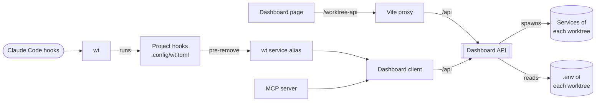

# Worktree tooling

{{#include ../includes/human-review-disclaimer.md}}

The worktree tooling has two halves. Worktrunk (`wt`) hooks prepare a worktree when it's created and clean up when it's removed. The worktree dashboard is one Node.js process that owns the running services of every worktree, and three clients drive it over HTTP: a web page, the `wt service` terminal alias, and an MCP server for agents. This page explains how the pieces fit, how the dashboard tracks services, and the HTTP API they share. For day-to-day use, see [working in worktrees](../contributing/worktrees.md).

None of this ships with Nightfall. It lives in `worktree-dashboard/`, `scripts/`, `.config/wt.toml`, and `webui/worktree-dashboard.tsx`, and only contributors run it.

## The pieces

The following diagram shows who talks to whom:

Only the dashboard API starts or stops services. The clients hold no service state. They ask the API for a snapshot and send it actions, so a service started from the terminal shows up on the page and an agent can stop it.

The `.env` file in each worktree is the contract between the two halves. The `wt` hooks write it, and the dashboard reads it on every request to learn the worktree's ports and settings.

## Worktree hooks

`.config/wt.toml` declares the project hooks. Worktrunk runs the commands in one `[[pre-start]]` or `[[post-start]]` table in parallel, and runs the tables in order:

| Stage | Hooks | Purpose |
|---|---|---|
| pre-start | `setup-env` | Writes `.env`. Runs alone, because the steps after it read the port. |
| pre-start | `install`, `typeshare` | Installs packages and generates TypeScript types, so the editor works at once. |
| post-start | `copy-data-dir`, `copy-assets`, `copy-demo-audio` | Seeds the data directory and copies untracked assets from the main worktree. |
| post-start | `build`, `wasm-build` | Builds the backend, test binaries, and WASM bridge in the background. |
| pre-remove | `stop-services` | Runs `wt service stop -s all --best-effort`. |

Pre-start hooks block until they finish. Post-start hooks run in the background after `wt` hands you the worktree, which is why a service can start before its build is done.

`scripts/setup-env.mjs` copies the main worktree's `.env` and overrides a few keys. It picks a random block of 10 ports between 3000 and 3999, aligned to a multiple of 10, that overlaps no other worktree's `NIGHTFALL_PORT`. It treats each taken port as the start of a full block, which also keeps older worktrees with unaligned ports safe. Secondary worktrees also get a private `NIGHTFALL_DATA_DIR` and have network input and output turned off.

The `[aliases]` table adds `wt done`, which removes landed branches through `scripts/worktree-done.mjs`, and `wt service`, which runs `worktree-dashboard/worktree-service.mjs` with the worktree path. Worktrunk reads aliases and hooks from the `wt.toml` of the worktree you run it in, so a change to them reaches a worktree only once its branch includes the change.

Claude Code doesn't read `wt.toml`. Its `WorktreeCreate` and `WorktreeRemove` hooks in `.claude/settings.json` run `scripts/claude-worktree-hook.mjs`, which calls `wt switch --create` and `wt remove`, so the same project hooks run for agent worktrees.

## How the dashboard tracks a service

The dashboard knows a service in two ways:

- Managed: the dashboard spawned the process and holds its child handle, process ID, log path, exit code, and last error. It keeps this record in memory only.
- Observed: something answers on the service's port. On every snapshot the dashboard probes the backend, web UI, and both book ports on `127.0.0.1` and `::1`, and looks up the listening process ID.

The status phrase combines the two:

| Managed process running | Port answers | Status |
|---|---|---|
| Yes | Yes | managed + reachable |
| Yes | No | managed starting/unreachable |
| No | Yes | external process detected |
| No | No | stopped |

The `wasm` service has no port. It's a one-off build, so its status is `completed` or `failed` from its exit code. The sender examples have no port either, so the dashboard reports them as observed while their managed process runs.

Because the managed record lives in memory, restarting the dashboard forgets every process it started. On shutdown it stops them, so they don't outlive it as orphans. Services you start by hand appear as external processes.

## Service lifecycle

Each service is an entry in `SERVICE_DEFINITIONS`: a command, its arguments, and whether it runs through Cargo. Cargo services run `NIGHTFALL_CARGO_COMMAND` when the worktree sets it, so a wrapper such as Mr Boxington works. Arguments can be a function of the worktree's environment, which is how the book services pass `--port`. A service whose port comes from `SERVICE_PORT_OFFSETS` gets `NIGHTFALL_PORT` plus its offset.

The three actions work like this:

- Start: skips a service the dashboard already runs, and leaves an external process on the service's port running and reports it as unmanaged. Otherwise it reads the worktree's `.env`, layers it over the environment the dashboard started with, and spawns the command in the worktree with output going to a new log file.
- Stop: sends `SIGTERM`, then `SIGKILL` after 3 seconds, and waits up to 5 seconds for exit. If the port still answers, it terminates whatever listens there, so stop also clears external processes.
- Recycle: stops, clears the port, and starts again.

Backends started by the dashboard default to `NIGHTFALL_STARTUP_CMDS=fps 5` to keep idle CPU use low, unless the worktree sets the value itself. The backend of the checkout running the dashboard gets no startup commands, and uses the default data directory unless its `.env` sets one.

The API answers an action as soon as it spawns the process. The client then polls snapshots every 500 milliseconds until each service is online or failed, and reads the tail of each failed service's log. This keeps the API stateless between requests, and each client chooses how long to wait. The `wt service` alias waits up to 600 seconds and the MCP server 90 seconds by default.

## Dashboard API

The API listens on `127.0.0.1:4780` by default. `NIGHTFALL_WORKTREE_DASHBOARD_HOST` and `NIGHTFALL_WORKTREE_DASHBOARD_PORT` change it, for both the API and its clients. A worktree's ID is its absolute path, encoded as base64url. Every route that takes an ID returns 404 when `git worktree list` no longer lists that path.

| Method and path | Query | Description |
|---|---|---|
| `GET /health` | None | Returns `{"ok": true}`. |
| `GET /api/worktrees` | None | Returns a snapshot of every worktree with its ports, URLs, managed records, and observed ports. |
| `POST /api/worktrees/<id>/start` | `service`, `sample-data` | Starts services. Returns 400 when the worktree has no `.env`. |
| `POST /api/worktrees/<id>/stop` | `service` | Stops services and clears their ports. |
| `POST /api/worktrees/<id>/recycle` | `service`, `sample-data` | Stops and starts services. |
| `POST /api/worktrees/<id>/open-log` | `service` | Opens the latest log of a service in VS Code. |
| `POST /api/worktrees/<id>/open-editor` | None | Opens the worktree in VS Code. |
| `POST /api/worktrees/<id>/reseed-data-dir` | None | Runs the `copy-data-dir` hook with `--force` to replace the data directory with a fresh copy from the main worktree. |
| `POST /api/worktrees/<id>/remove` | `force` | Removes the worktree through `wt done`, or `wt remove --force` with `force=1`. Returns 409 with the reason when it keeps the worktree. |

`service` is one service name, or a group: `both` for the backend and web UI (the default), `docs` for both books, `senders` for both sender examples, or `all`. `SERVICE_SELECTORS` in the dashboard client defines the groups, and the API and every client share it. `sample-data=1` starts the backend with generated sample show data.

The API refuses to remove the primary worktree or the checkout running the dashboard.

## Clients

`worktree-dashboard/dashboard-client.mjs` is the one client library for code outside the browser. It resolves the dashboard address, expands group selectors into service names, sends actions, waits for startup, and reduces a snapshot to a summary with one status phrase per service. The `wt service` alias and the MCP server both use it, so add new API calls there instead of calling `fetch` in either one.

The dashboard page is a Solid app in `webui/worktree-dashboard.tsx`. The Vite dev server proxies `/worktree-api` to the API's `/api`, so the page needs no cross-origin setup. It polls `GET /api/worktrees` every 2 seconds. It keeps its own types for the snapshot, so a new field in the API needs a matching type on the page.

## In the code

| Location | Description |
|---|---|
| `.config/wt.toml` | Worktrunk hooks and aliases. |
| `scripts/setup-env.mjs` | Writes `.env` and picks the port block. |
| `scripts/seed-data-dir-from-main.mjs` | Seeds or re-seeds the data directory. |
| `scripts/claude-worktree-hook.mjs` | Routes Claude Code worktrees through `wt`. |
| `scripts/worktree-done.mjs` | The `wt done` alias. |
| `worktree-dashboard/worktree-dashboard.mjs` | The dashboard API, service definitions, and process management. |
| `worktree-dashboard/worktree-remove.mjs` | Worktree removal for the API. |
| `worktree-dashboard/dashboard-client.mjs` | Shared client for the alias and the MCP server. |
| `worktree-dashboard/worktree-service.mjs` | The `wt service` alias. |
| `worktree-dashboard/worktree-dashboard-mcp.mjs` | The MCP server. |
| `webui/worktree-dashboard.tsx` | The dashboard page. |

## Related topics

- [Working in worktrees](../contributing/worktrees.md)
- [How the pieces fit together](system-overview.md)
- [CI builds](../contributing/ci-builds.md)
