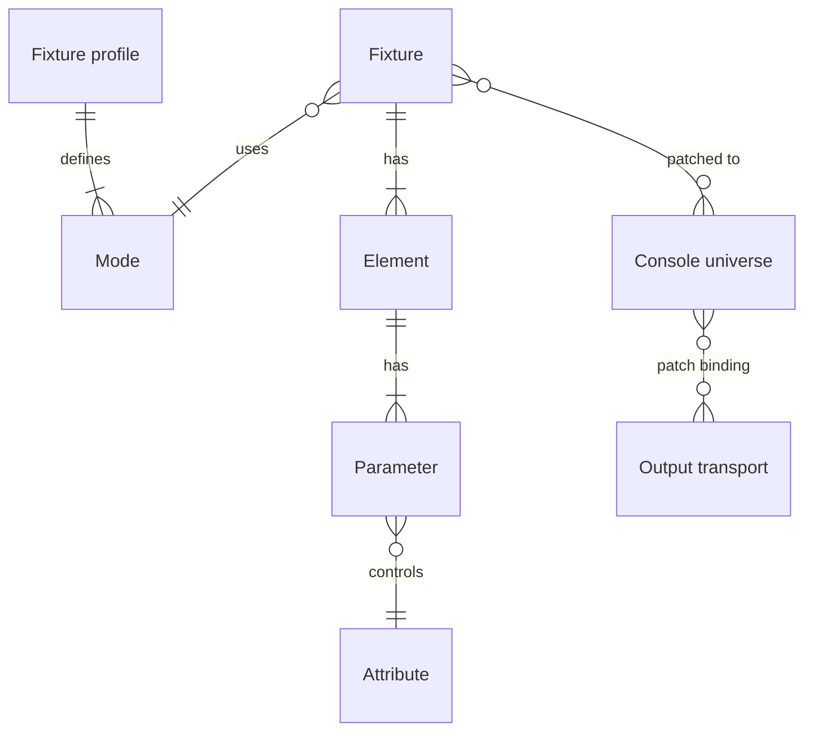
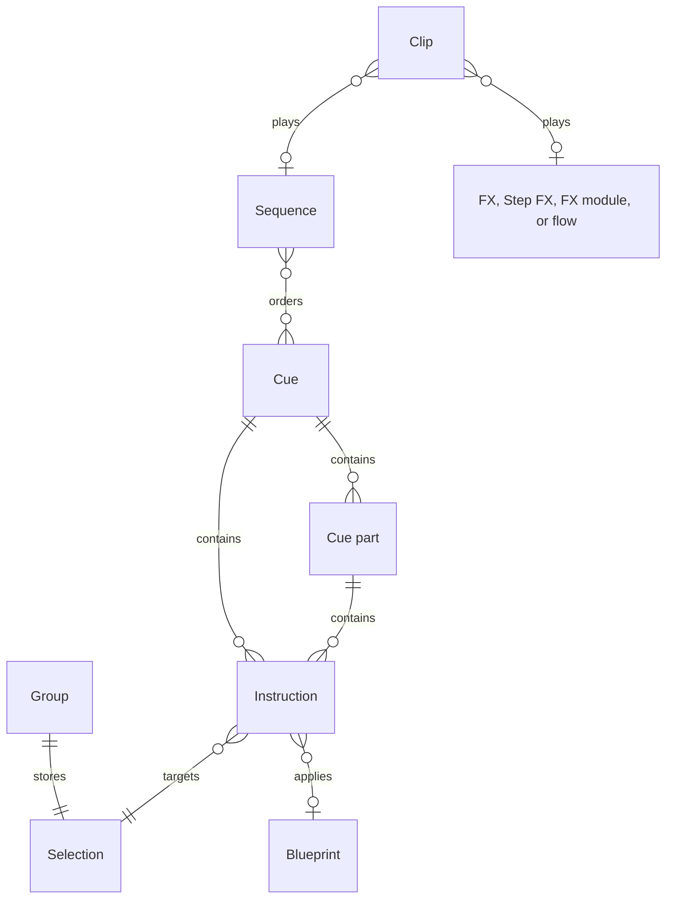
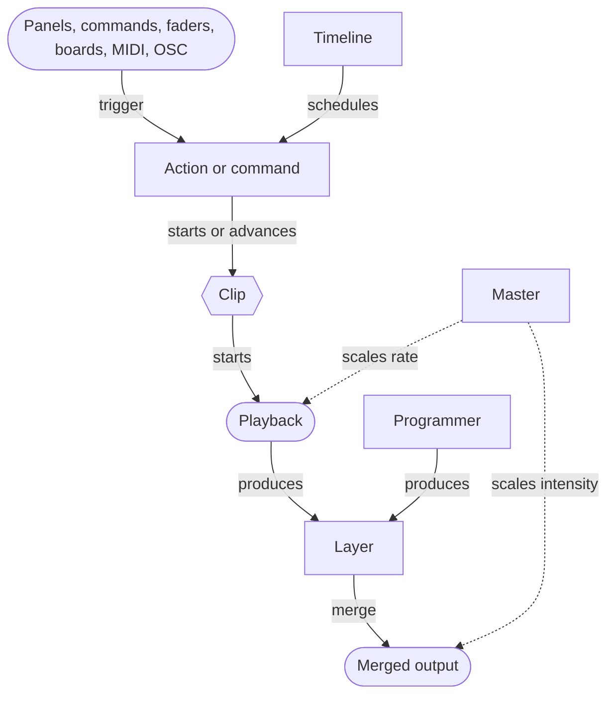

# Concept map

{{#include ../includes/human-review-disclaimer.md}}

Nightfall's show objects fall into three groups: the rig (what lights exist and where their DMX goes), the programming (what the lights should do), and the controls (what starts and shapes playback). This page shows how the objects in each group relate, lists the terms with the crate that owns each one, and points out words that mean different things in different parts of the code.

## The rig: fixtures and where their output goes

The rig describes the lights and their DMX addresses. The following entity relationship diagram shows how a fixture's attributes reach an output transport. Each line end shows how many of that object take part: a bar means exactly one, a crow's foot means many, and a circle means the relationship is optional:

A fixture has one or more elements, such as the cells of an LED bar. Each element has parameters, and each parameter controls one attribute, such as intensity or red. Commands and cues address attributes, and the engine stores values per parameter.

## The programming: what lights should do

Programming objects describe looks and how they change over time. The following entity relationship diagram shows how they reference each other:

Cues play as part of a sequence, and a clip usually starts the sequence.

## The controls: what starts and shapes playback

Controls turn operator input into playback. The following diagram shows the paths from input to a running playback and its layer:

## Terms

The following table lists the main terms. "Owning crate" is the crate under `crates/` that defines the type. When two crates are listed, the first defines the stored type and the second runs it.

| Term | Owning crate | Description |
|------|--------------|-------------|
| Action | `actions` | A named, bindable entry point, such as "go on clip 3", that MIDI, OSC, keyboard shortcuts, timelines, and boards can trigger. See [control layers](../engine/control-layers.md). |
| Attribute | `dmx` | A kind of fixture property, such as intensity, pan, or red. |
| Blueprint | `common` | Reusable attribute values, similar to a palette on other consoles. Cues can reference a blueprint so changing the blueprint updates every cue that uses it. |
| Board | `common`, `boards` | A grid of buttons arranged by the operator, each running a show object's default action. |
| Clip | `clips` | A slot that plays one source (sequence, FX, Step FX, FX module, or flow) with its own priority and options. |
| Console universe | `fixtures` | Nightfall's internal 512-channel DMX address space. Fixtures patch into it. |
| Cue | `cues` | Stored instructions, with timing, that a sequence plays. |
| Cue part | `cues` | A subset of a cue's instructions with its own timing. |
| Element | `fixtures` | An independently controlled part of a fixture, such as one cell of an LED bar. |
| Fader | `desk` | A numbered strip with a level and a button that drives a clip or master. |
| Fixture | `fixtures` | A patched light, using one mode of a fixture profile. |
| Fixture profile | `fixture-model`, `fixture-library` | The definition of a fixture type: modes, attributes, channels, and value ranges. Imported from GDTF or Open Fixture Library (OFL) files. |
| Flow | `flow` | A node graph that generates values or triggers actions, such as an oscillator driving intensity on the beat. |
| FX | `fx` | A procedural effect that applies a waveform to attributes across a selection. |
| FX module | `fx`, `fx-module` | An effect written as a WebAssembly component, loaded at runtime. |
| Group | `common` | A stored, ordered fixture selection. |
| Layer | `compositor` | The set of values one playback contributes in a frame, with a priority. |
| Merge rule (HTP and LTP) | `fixture-model` | How equal-priority layers combine an attribute: highest takes precedence (HTP) keeps the larger value, and latest takes precedence (LTP) keeps the most recently started layer's value. |
| Master | `desk` | A control that scales intensity of targeted fixtures or the rate of targeted playbacks. |
| Output transport | `io` | A connection that sends DMX to hardware: an Art-Net or sACN network gateway, or a USB DMX interface. |
| Parameter | `fixtures` | One attribute on one fixture element. The engine stores values per parameter. |
| Patch binding | `fixtures` | A route between console channels, fixtures, and input or output transports. |
| Playback (instance) | `instances` | A running clip or programmer, with its own clock and level. |
| Priority | `common` | A number from -128 to 127 that orders layers. See [priorities and merging](priorities-and-merging.md). |
| Programmer | `programmer` | The live working values and selection used to build looks. |
| Selection | `common`, `selection` | An expression that picks fixtures and elements, such as `1 thru 10` or a group, with optional spatial rules. |
| Sequence | `cues` | An ordered list of cues with default timing, tracking, and setup and release cues. |
| Showfile | `showfile` | The saved show: rig, programming, controls, and settings. |
| Step FX | `fx` | An effect built from steps on tracks, played in time. |
| Timecode | `timecode` | A clock position that timelines can follow. |
| Timeline | `timeline` | Tracks of actions scheduled against time, often with audio and a beat grid. |
| Tracking | `cues` | Carrying values from earlier cues into later cues that do not change them. |

## Words with more than one meaning

Some words mean different things in different crates. Check which one a piece of code uses before relying on the name.

| Word | Meanings |
|------|----------|
| Action | A bindable action in the `actions` crate. A timeline action, which is one scheduled item on a timeline track. |
| Release | A sequence's release cue. The fade-out when a playback stops (`ReleaseMarker`). The `Release` value source, which clears a tracked value from that cue forward. A clip's auto-release option. |
| Tracking | A sequence's tracking mode (`TrackingMode`). A cue's tracking flags (`TrackingFlags`), which choose what tracks for HTP, LTP, and FX values. |
| References | The `references` crate, which reports which objects use which. The `ReferenceBook` in the `selection` crate, which stores those reports. The `References` struct in `common`, which still has a `palettes` field from before blueprints. |
| Waveform | The `waveform` crate, which samples effect shapes such as sine and square. The audio waveform shown on a timeline. |
| Controls | `InstanceControls`, which hold one playback's level and rate. The desk's faders were called control slots before schema 23. |
| Lookahead | Preparing dark fixtures before their next cue. It appears in the `lookahead` and `lookahead-projection` crates, cue part options, playback options, and timeline settings. |

## Related topics

- [How a show becomes light](show-to-light.md)
- [Priorities and merging](priorities-and-merging.md)
- [Glossary](../../user-guide/glossary.html) in the user manual
