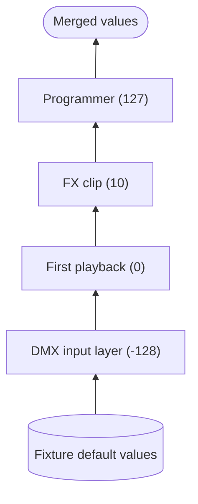
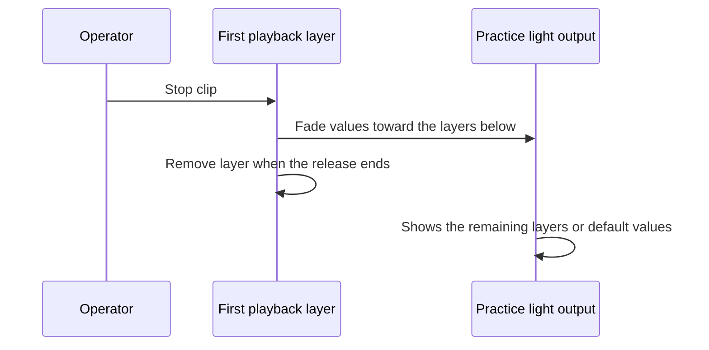

# Priorities and merging

{{#include ../includes/human-review-disclaimer.md}}

When several running playbacks control the same fixture attribute, Nightfall decides the output with two rules. Higher priority wins. When priorities are equal, the attribute's merge rule decides: highest takes precedence (HTP) keeps the larger value, and latest takes precedence (LTP) keeps the value from the most recent layer. This page explains both rules, where each priority comes from, and what happens when playbacks fade and release.

It builds on [how a show becomes light](show-to-light.md), which introduces playbacks and layers.

## Layers stack from lowest to highest priority

Every layer carries a priority, a whole number from -128 to 127. In each frame, Nightfall sorts the layers by priority and merges them from the bottom up. Each layer's absolute values replace the values below it, so the highest-priority layer that sets an attribute decides that attribute.

The following diagram shows the stack for the running example, with an FX running on `Practice light` from a second clip at priority 10:

Layers with the same priority stack by their activation time, so the most recently activated layer merges last.

**Warning:** Sequence layers currently take a new activation time in every frame, while FX and FX module layers keep the time they started. As a result, a sequence clip sits above an FX clip of the same priority whichever started first, and the order between two sequence clips of the same priority doesn't follow their start order. Don't rely on start order between equal-priority sequences until this is fixed.

## Where priorities come from

Most layers come from clips, and a clip's priority is a setting on the clip. The other sources use fixed priorities.

| Source | Priority | Description |
|--------|----------|-------------|
| DMX input | -128 | Incoming DMX routed to fixtures by input bindings. Everything else overrides it. |
| Manual channel values | -127 | Console DMX channel values set with the `channel` command. |
| Clips | Set per clip, 0 by default | Sequences, FX, and Step FX started from a clip use the clip's priority. |
| Flow playback | 0 | Flow layers use 0 today, even when a clip with another priority starts them. |
| Step FX started from its editor | 50 | Step FX playback started outside a clip. |
| FX module playback | 50 | FX module layers use 50 today, even when a clip with another priority starts them. |
| FX preview | 75 | Previewing an FX from its editor. |
| Cue preview | 126 | Previewing a cue from the **Sequence Editor**. |
| Programmer | 127 | Live programmer values. The programmer always wins. |

**Warning:** These priorities are constants defined in several crates. When you add a new kind of layer, choose its priority deliberately and add it to this table.

## Equal priorities use the attribute's merge rule

When a layer has the same priority as the layer below it, Nightfall checks each attribute's merge rule before replacing the value:

- **HTP**: the higher of the two values wins. When intensity is HTP, two clips that both raise it on the same fixture produce the brighter of the two, whichever started first.
- **LTP**: the upper layer's value wins, which is the most recently activated layer.

The fixture profile sets the rule for each attribute, and the importers decide it differently:

- GDTF profiles make intensity HTP and every other attribute LTP.
- Open Fixture Library (OFL) profiles use each channel's `precedence` field, and fall back to LTP when the field is missing. OFL matrix template channels make intensity and color-mixing attributes HTP.

`Practice light` comes from an OFL file without `precedence` fields, so all of its attributes, including intensity, merge LTP.

Between different priorities the merge rule doesn't matter. A priority 10 clip at 20% intensity overrides a priority 0 clip at 100%, even when intensity is HTP.

## Relative values add instead of replacing

A layer can hold relative values, such as "intensity 20% lower than it is now." Relative values don't replace what lies below. They add up across layers and apply to the merged absolute value. This lets an FX move a fixture around whatever position a cue gives it.

## Fades and releases happen inside a layer

A layer doesn't jump to its values. When a cue starts or a playback advances, each changed value fades from the value currently below the layer toward its target, using the cue's delay and fade time. Because the fade starts from the merged value underneath, a cue that takes over from another playback blends smoothly from what the fixture is actually doing.

Stopping a playback starts its **release**. The layer stays in the stack while its values fade back toward whatever is below it, then it disappears. The **Status Display** panel shows these playbacks as releasing.

## Levels and masters scale intensity

Two kinds of control scale intensity, at different points:

- A playback's own level, such as a clip fader, scales the intensity values in that playback's layer before the merge. It only affects that playback's contribution.
- An intensity master scales the merged output of the fixtures it targets, after the merge. It affects those fixtures whichever layer set them, including the programmer.

## Inspect the stack in the app

The **Layers** panel lists the active layers and the values each one sets. The **Fixtures** panel shows the merged result. When an output doesn't match what you expect, compare the two to find which layer wins.

## In the code

| Concept | Where to look |
|---------|---------------|
| `Layer`, `Priority`, and layer sorting | `crates/compositor/src/types.rs`, `crates/common/src/data.rs` |
| Merge rules for same and different priorities | `crates/compositor/src/stages/merge.rs` |
| Fades, delays, and releases inside a layer | `crates/compositor/src/stages/transition.rs` |
| DMX input and manual channel layers | `crates/fixtures/src/compositor.rs` |
| Programmer priority | `crates/programmer/src/painter.rs` |
| Clip priority | `crates/clips/src/model.rs` |
| Per-playback intensity level | `crates/desk/src/systems/instance_controls.rs` |
| Intensity and rate masters | `crates/desk/src/masters.rs` |
| Merge rule per attribute | `MergeStrategy` in `crates/fixture-model/src/parameter.rs`, set by the importers in `crates/fixture-library/src/converters/` |

## Related topics

- [How a show becomes light](show-to-light.md)
- [Concept map](concept-map.md)
- [Layers panel](https://github.com/stewartadam/nightfall-lightdesk/blob/develop/docs/src/user-guide/panels/layers.md) in the user manual
