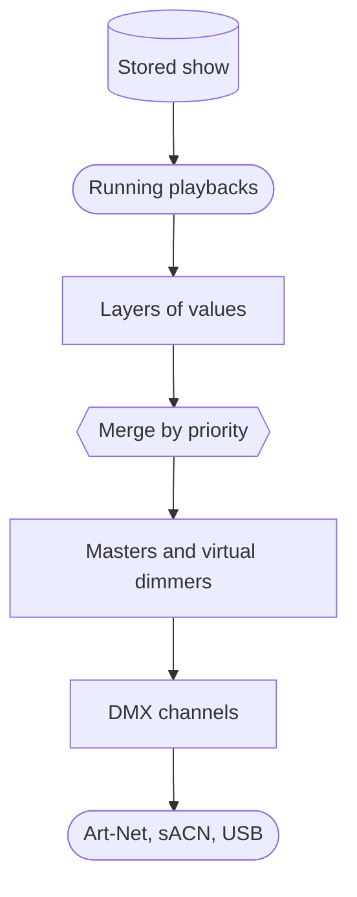
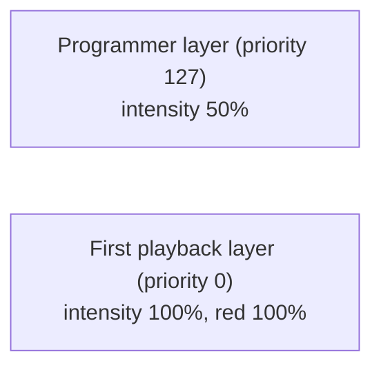
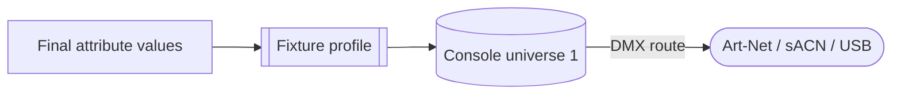

# How a show becomes light

{{#include ../includes/human-review-disclaimer.md}}

Nightfall recalculates every fixture's output many times a second. Each time, everything that is currently running contributes values for the fixture attributes it controls. Nightfall merges those contributions by priority, adjusts the result with masters, and converts it into Digital Multiplex (DMX) channel values that go out to the lights. Nightfall calls this cycle a frame. By default the engine runs 44 frames per second, matching the DMX output rate, and it never runs fewer than 30.

This page follows one frame from start to finish, using the [running example](../README.md#a-running-example): `Par 1`, `First sequence` with its `Red` and `Blue` cues, and the `First playback` clip.

## The journey in one picture

The following diagram shows the stages a frame passes through. Each stage gets its own section below.

## Stored show objects describe looks

A showfile holds what you programmed. Nothing in it produces light on its own.

- A **fixture** is a patched light. Its **profile** lists the attributes it has, such as intensity, red, or pan, and how each one maps to DMX channels. `Par 1` has four attributes: intensity, red, green, and blue.
- A **cue** stores instructions: "set these attributes on these fixtures to these values, with this timing." `Red` sets `Par 1` to full intensity and full red.
- A **sequence** orders cues and decides how they advance. `First sequence` plays `Red`, then waits for Go before `Blue`.
- A **clip** says what to play and how. `First playback` points at `First sequence` and carries the playback's priority and options.

Groups, blueprints, FX, flows, timelines, and boards are also stored show objects. The [concept map](concept-map.md) explains how they relate.

## Playbacks bring show objects to life

When you start a clip, Nightfall creates a running **playback** for it, also called an instance. The playback has its own clock, so it knows how far into a fade it is and when the next cue is due. The clock counts seconds, or beats of the show tempo when the sequence or effect is beat-timed. Several playbacks can run at once, and each one keeps its own position.

Many things can start or control a playback:

- The **Clips** panel, a fader or its button, or a board button.
- A typed command, such as `clip 1 go`.
- A mapped MIDI or OSC control.
- A timeline action at a point in a song.
- A flow, which can start clips as part of a node graph.

These all lead to the same action on the same playback, so a clip behaves the same way whether you press a button in the UI or on a MIDI controller.

The **programmer** is a special case. It isn't stored, and it doesn't need starting. While you set values with commands such as `fixture 1 red @ 100`, the programmer behaves like a playback that is always running.

## Each playback produces a layer

In every frame, each playback works out the values it currently wants. The result is a **layer**: a set of values for specific attributes of specific fixtures, together with a priority.

The following diagram shows the layers for the running example at the moment `First playback` finishes fading into `Red`, while the programmer holds `Par 1` at 50% intensity:

A layer only contains the attributes its playback controls. The `First playback` layer says nothing about pan or green, so it leaves those attributes to lower layers, or to the fixture's default value when nothing controls them.

Timing happens inside the layer. During a fade, the layer's value moves from the value the earlier cues in the sequence left toward the new cue's target. When you press Go on `First playback`, its layer fades red down and blue up over the `Blue` cue's fade time.

Each playback also has its own level, such as a clip's fader. The level scales the intensity values in that playback's layer before the layers merge. Pulling `First playback` to 50% halves its intensity contribution without affecting the programmer or other clips.

## Layers merge by priority

Nightfall stacks the layers from the lowest priority to the highest and merges them one at a time. Higher priority wins. The programmer runs at the highest priority, so whatever you set in it always overrides playback.

In the running example, the merge produces:

| Attribute | Programmer (127) | First playback (0) | Output |
|-----------|------------------|--------------------|--------|
| Intensity | 50%              | 100%               | 50%    |
| Red       | **None**         | 100%               | 100%   |
| Green     | **None**         | **None**           | Default value |
| Blue      | **None**         | **None**           | Default value |

When two layers share a priority, each attribute's merge rule decides. With highest takes precedence (HTP), the brighter value wins, which is the usual rule for intensity. With latest takes precedence (LTP), the more recent layer wins, which is the usual rule for everything else. The fixture profile sets the rule for each attribute.

A layer can also hold relative values, such as "10% brighter than whatever is underneath." Relative values add to the merged result instead of replacing it.

For the full set of priorities and the merge rules, see [priorities and merging](priorities-and-merging.md).

## Masters adjust the merged result

After the merge, Nightfall applies adjustments that act on the whole stage rather than on one playback:

- **Intensity masters** scale down the intensity of the fixtures they target. A master at 50% halves those fixtures' merged intensity, whichever layer it came from. The fixture profile marks which attributes masters affect.
- **Virtual dimmers** give fixtures without an intensity channel a usable intensity. For a color-only light, Nightfall scales the color attributes, such as red, green, blue, and white, by the virtual intensity, with a gamma curve so dimming looks even.
- **Virtual relations** apply other profile rules that involve virtual attributes.

Speed masters are different. They change how fast the targeted playbacks run, so they act on the playbacks' clocks rather than on the merged values.

## Values become DMX

Each fixture's profile converts its final attribute values into DMX channel values at the fixture's patched address. `Par 1` is patched at console universe 1, address 1, so its intensity, red, green, and blue land in channels 1 to 4 of console universe 1.

Console universes are Nightfall's internal address space. DMX routes send them to output transports, which send DMX to hardware: Art-Net or sACN network gateways, or a USB DMX interface. Until a DMX route sends a console universe to a transport, nothing leaves the computer. This is why the tutorial can run without hardware.

Nightfall can also receive DMX from another console. Incoming DMX can drive fixtures through a layer at the lowest priority, or pass straight through to an output.

## What else happens in a frame

The same frame also prepares the state the user interface shows: fixture values for the 3D visualizer and the **Fixtures** panel, playback positions for **Status Display**, and so on. Every connected screen sees the same engine state. A later page of this guide, the frame loop, describes how the engine schedules this work.

## Related topics

- [Priorities and merging](priorities-and-merging.md)
- [Concept map](concept-map.md)
- [Control layers](../engine/control-layers.md)
- [Cues and timing](../../user-guide/cues.html) in the user manual
