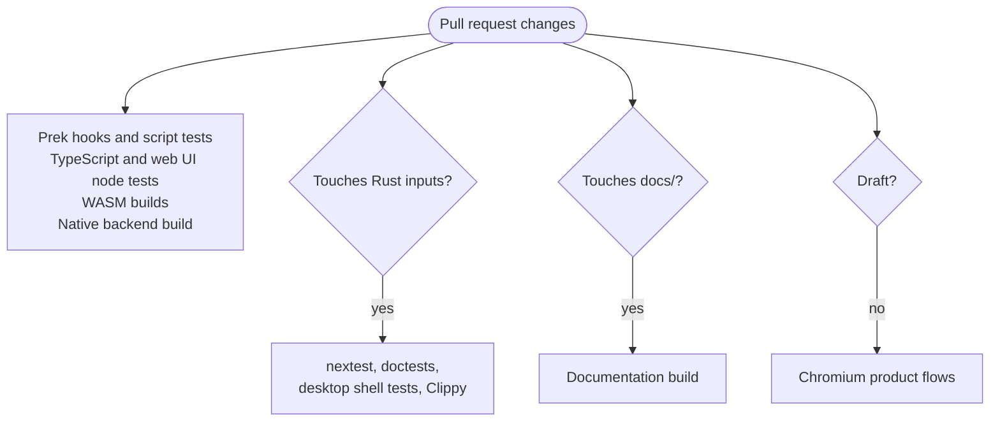

# Testing strategy

{{#include ../includes/human-review-disclaimer.md}}

Nightfall has four kinds of automated tests, and each one catches a different kind of bug. Rust tests check engine and domain logic without a UI. Web UI node tests check TypeScript logic and the web UI's architecture rules without a browser. Script tests check the repository tooling and the CI policy. Playwright drives the real web UI in a browser, against either a native engine or the engine compiled into the page. Git hooks and CI decide which of these run for a given change. This page tells you which test to write for a change, where it goes, and what runs it, so a bug fails a test before it reaches a pull request.

[CONTRIBUTING.md](https://github.com/stewartadam/nightfall-lightdesk/blob/develop/CONTRIBUTING.md#quality-checks-and-browser-tests) lists the commands. This page explains how the pieces fit and links there for details.

## Which test catches which bug

Pick the cheapest test that can see the bug. A Rust test runs in milliseconds and points at one system. A Playwright test takes seconds, builds the whole app, and fails far from the cause, but it's the only kind that sees what the operator sees. A Rust test can check that the `Red` cue sets `Practice light` to full red, while only a Playwright spec can check that the visualizer then draws the fixture red.

| Test kind | Catches | Lives in | Runs on |
| --- | --- | --- | --- |
| Rust unit test | Logic errors inside one module, including private functions | `#[cfg(test)]` modules in `crates/<crate>/src/` | Push hook, CI |
| Rust integration test | A plugin's systems, messages, and resources working together through the crate's public API | `crates/<crate>/tests/it/` | Push hook, CI |
| Rust doctest | Code examples in doc comments that no longer compile or pass | Doc comments in `crates/` | CI only |
| Web UI node test | TypeScript logic, store updates, WASM bridge calls, and broken architecture rules | `webui/**/*.node.test.ts` | Push hook, CI |
| Script test | Broken tooling, CI scoping, workflow structure, and workspace-hack rules | `scripts/*.node.test.mjs` | Push hook, CI |
| Playwright spec | Rendering bugs, broken UI flows, and protocol mismatches between the UI and the engine | `webui/e2e/*.spec.ts` | Wrapper on demand, smoke specs in CI |
| Documentation spec | Books that fail to render, or diagrams that do not draw | `playwright/tests/docs-*.spec.ts` | On demand only |
| GDTF bench | Real GDTF archives that import wrongly | `crates/fixture-library` | On demand only |

## Rust tests

Rust tests cover most of Nightfall's behavior, because the engine owns all show state. If a command changes the wrong value, a cue fades with the wrong timing, or a showfile loses a field, a Rust test can catch it without a browser.

### Unit tests and integration tests

A unit test sits next to the code in a `#[cfg(test)]` module, or in a `tests.rs` file that the module declares. It can reach private functions and types. Use it for pure logic and for a single system in isolation.

An integration test lives under `tests/it/` and sees only the crate's public API. Each crate links all its integration tests into one `tests/it` binary, because every separate file under `tests/` becomes its own executable, and each executable costs link time and, on macOS, a security scan on first run. Add a new integration test as a module in `tests/it/` and declare it in `tests/it/main.rs`. A test that needs its own harness, such as the command parser's design-matrix golden test, gets a separate target with `harness = false`. Helpers it shares with `tests/it` go under `tests/support/`.

### How a plugin test builds a Bevy app

Most engine and domain tests don't start the full engine. They build a bare Bevy `App` with `App::new()`, register only the messages, resources, and systems the test needs, call `app.update()` to run one frame, and then read the world. The cue tests that check clip lifecycle commands, for example, register the command and operation messages, the cue, sequence, and group data providers, and the two systems under test, and nothing else. A bare app keeps each test fast and makes it obvious which systems a behavior depends on.

Tests that only need to call one system against a prepared world skip the `App` and use a bare `World` with `run_system_once`. The showfile tests do this: a `setup_world` helper inserts every data provider and resource the save and load systems read.

A bare app has the `Update` schedule but not the engine's `Render` schedule. `EnginePlugin` adds `Render` to the main schedule order, so a test without `EnginePlugin` must call `add_render_schedule` before adding systems to `Render`. The [frame loop](../engine/frame-loop.md#register-the-render-schedule-in-plugin-tests) page explains why. The `RenderPass` resource defaults to rendering, so in a test every `app.update()` runs a render pass. Some compositor tests instead add the compositor system to `Update` directly, which is fine when the test doesn't depend on the order of the render sets.

**Warning:** A system added to `Render` in an app that never called `add_render_schedule` doesn't run, and Bevy reports no error. A test that asserts on render output then fails for a confusing reason, or passes because it only checks defaults.

Because every `app.update()` in a test renders, tests don't exercise input-only frames. A render system that reads messages can pass its tests and still miss input in the running engine. Follow the frame loop's rules for render systems rather than relying on a test to catch this.

### Shared test helpers

A few crates export helpers for other crates' tests behind a `test-support` Cargo feature. Enable the feature on the dependency in your crate's `[dev-dependencies]`, never in normal dependencies. The following helpers exist today:

- `nightfall_fixtures::testing` patches many synthetic fixtures into a world, with parameter lists modeled on a moving-head spot and an LED fixture with a virtual dimmer. Benchmarks and the desk's websocket tests use it.
- `nightfall_fixture_library::testing` builds GDTF archives in memory, checks structural invariants, and decodes DMX with an independent reference decoder.

Helpers that only one crate needs stay private to that crate. The compositor's `test_support` module, for example, defines a minimal `TestParameter` component, and the FX crate keeps step FX definitions for its event tests in `events/test_support.rs`.

### nextest and doctests

Rust tests run with cargo-nextest, which starts each test in its own process. nextest flags a test as slow after 10 seconds and stops it after 60. Run `cargo nextest run --tests` rather than plain `cargo test`. The `--tests` flag selects the same targets and feature graph as the Playwright backend build, so the two reuse each other's compiled code. Narrow a run with a filter expression, such as `-E 'rdeps(nightfall-cues)'` for a crate and everything that depends on it.

Plain `cargo` commands cover every crate under `crates/` but not the Tauri desktop shell. Test the shell with `cargo test -p app-tauri --all-targets`. Don't pass `--workspace`, because it pulls the shell into the feature graph CI uses.

nextest can't run doctests, and the push hook skips them because rustdoc processes every library crate even when it has no doctests. CI runs them. When you change a code example in a doc comment, run them yourself with `pnpm exec prek run cargo-doctest --stage manual`. [CI builds](ci-builds.md) explains the cost trade-off.

### Showfile round-trip tests

Saving and loading a show must not change it. The showfile event tests in `app-runtime` check this in three ways:

- A save, load, save cycle produces identical snapshot JSON.
- Loading into a fresh world twice in a row gives the same result, so a restart doesn't drift.
- One `roundtrip_preserves_*` test per domain, such as patch bindings, boards, desk settings, and MIDI and OSC mappings, checks that domain survives a round trip.

When you add a persisted domain or field, seed it in the test world and add a round-trip test for it. If the save or load system reads a new resource, add it to `setup_world` too.

A second test parses `crates/app-runtime/tests/data/procedural-showfile-parse-data.json`, once as written and once with native parameter units removed to imitate older showfiles. CI's Chromium product flows also seed their `default` and `sample` shows from this file, so a schema change that breaks it fails both. For a manual end-to-end check through a real data directory, follow [validating showfile restore idempotency](https://github.com/stewartadam/nightfall-lightdesk/blob/develop/CONTRIBUTING.md#validating-showfile-restore-idempotency), which ends with `scripts/verify_showfile_roundtrip.sh`.

### The GDTF regression bench

GDTF import has its own layered tests, from synthetic archives built in memory on every pull request to a bench of real archives you fetch with your own GDTF Share account and run with `pnpm run gdtf:bench`. The bench never runs in CI because the archives can't be redistributed. [GDTF regression testing](gdtf-regression-testing.md) covers every layer.

## Web UI node tests

Web UI node tests are TypeScript files named `*.node.test.ts`, anywhere under `webui/`. They use Node's built-in test runner, not a browser, and no DOM library is installed. Test pure logic with them: the `model/` folders of features, helpers in `lib/`, store updates, and anything that calls the WASM bridge, such as command autocomplete.

`pnpm run test:webui-node` runs the whole suite. The runner compiles every matching file with `tsc` and `tsconfig.node-tests.json` into a temporary folder, copies the WASM bridge from `webui/assets/wasm` next to the output, and runs the compiled files with `node --test` and a loader that resolves extensionless imports. Two consequences follow:

- Build the WASM bridge with `pnpm run wasm:bridge --dev` before the first run, and again after changing command parsing, or the bridge tests fail.
- The runner picks up only `.node.test.ts` files. A test named `.node.test.tsx` never runs.

### Architecture tests

Some node tests read the source tree instead of running code. `webui/architecture-boundaries.node.test.ts` enforces the web UI's layer import rules against an exception list, and the `shared-*` tests keep dialogs, portals, menus, and tables on their shared components. The [web UI architecture](../architecture/web-ui.md#import-and-component-rules) page lists each rule and its test. When one fails, move the code to the right layer rather than adding an exception.

Two scripts check the Rust side in the same spirit. `pnpm run check:crate-boundaries` fails when a crate depends on a crate in a role it must not use, as the [crate map](../architecture/crate-map.md#roles-and-dependency-rules) describes. `pnpm run check:command-architecture` fails when code reintroduces retired command types or moves domain-owned command types into the engine crate. They're scripts, not node tests, and the commit hooks run them.

## Script tests

The repository's tooling has its own tests in `scripts/*.node.test.mjs`, run with `pnpm run test:scripts`. They cover the Playwright wrapper, the WASM build, release notes, distribution notices, and the worktree tooling. Several of them pin down CI behavior:

- `ci-scope.node.test.mjs` checks which jobs each changed path selects.
- `ci-validation.node.test.mjs` parses `ci.yml` and checks job dependencies and the **CI gate** logic.
- `workspace-hack.node.test.mjs` checks that every crate uses the workspace-hack only for native targets.

When you change a workflow or `scripts/ci-scope.mjs`, update these tests in the same change.

## Playwright

Playwright drives a real browser through the web UI. Use it for anything you can only see on screen: a panel that doesn't update, a button that sends the wrong command, a visualizer that renders the wrong color. Specs live in `webui/e2e/`.

Always run Playwright through the repository wrapper, `pnpm run test:webui-playwright`, never with a plain `playwright test`. The wrapper does the setup a spec depends on:

1. Outside CI, it rebuilds both WASM packages in development mode.
1. For the native target, it builds the web UI once in `e2e` mode and builds `nightfall-headless` with `--tests`.
1. It starts one shared web server and gives every test a freshly seeded backend with its own data directory, so tests can't affect each other or your own session.
1. It turns off timeline audio.

[Running Nightfall](https://github.com/stewartadam/nightfall-lightdesk/blob/develop/CONTRIBUTING.md#running-nightfall) in CONTRIBUTING.md describes the worker pool, the seed data, `--vite-mode dev` for quick edit loops, and the `window.__nightfallTest` hooks specs use to wait for the app.

### Native and embedded-demo targets

The wrapper's `--target` option chooses which engine the page talks to. The two targets match two of the [three hosts](../architecture/system-overview.md#three-hosts-around-one-engine):

| Target | Engine | Use it for |
| --- | --- | --- |
| `native` (default) | A `nightfall-headless` process per test, reached over the websocket | Flows that depend on engine behavior, the client protocol, showfiles, or IO settings |
| `embedded-demo` | The browser runtime compiled to WASM and running inside the page, with no backend process | The browser demo, visualizer optics specs that render into harness pages, and UI behavior that needs no real backend |

An embedded-demo run skips the Rust build, so it starts faster. A spec opts into the embedded engine by loading the page with `?engine=embedded-demo`. Native runs serve a production `e2e` build by default, and embedded-demo runs serve the Vite dev server.

### What CI runs

CI doesn't run every spec. It runs three sets:

- The **Chromium product flows** job runs the five smoke specs in `pnpm run test:webui-smoke` against the backend the native job just built and tested.
- The **Browser demo** job, when a PR selects the browser distribution, runs `pnpm run demo:test` against the packaged demo in Chromium and Firefox.
- The **Full Playwright suite** workflow runs every spec in six shards, but only when you start it by hand.

For a change with visible UI, run the specs for that area locally, and start the full suite for broad changes.

### Documentation specs

`playwright/tests/docs-*.spec.ts` check the two built mdBooks: the user manual's navigation, and that every Developer Guide diagram renders in light and dark themes. They use their own configuration file, not the wrapper. Build both books, then follow [building the documentation](https://github.com/stewartadam/nightfall-lightdesk/blob/develop/CONTRIBUTING.md#building-the-documentation). The diagram specs need network access to load Mermaid. CI doesn't run these specs. Its **Documentation** job only builds the books and fails on any mdBook error or warning.

## What the git hooks run

Nightfall uses prek to run checks from Git hooks. Install the hooks once as described in [Git hooks](https://github.com/stewartadam/nightfall-lightdesk/blob/develop/CONTRIBUTING.md#git-hooks). Each hook runs only when the commit or push touches files that match its filter. The following table lists them by stage:

| Stage | Checks | Triggered by |
| --- | --- | --- |
| Pre-commit | License headers, `actionlint`, Biome, TypeScript typecheck | Source files, workflows, and TypeScript or JavaScript files |
| Pre-commit | `rustfmt`, Clippy with `--all-targets`, typeshare generation | Rust files, and Cargo manifests for Clippy |
| Pre-commit | Workspace-hack check with `cargo hakari` | Cargo manifests, `Cargo.lock`, and the hakari configuration |
| Pre-commit | `check:command-architecture`, `check:crate-boundaries` | Rust and TypeScript sources, Cargo manifests, and the architecture configuration |
| Commit message | Sign-off matches the commit author | Every commit |
| Pre-push | `cargo nextest run --tests` | Rust files, Cargo manifests, `Cargo.lock`, and the nextest configuration |
| Pre-push | `pnpm test`, which runs script tests and web UI node tests | TypeScript and JavaScript files, `tsconfig` files, and the web UI boundary exceptions |
| Manual | `cargo test --doc` | Only when you run it with `--stage manual` |
| Post-merge and post-rewrite | `pnpm run typeshare`, `pnpm run wasm:bridge --dev` | Every merge, rebase, or amend |

The push hook can take several minutes on a cold build. Let it finish. CI runs the pre-commit stage again against all files, so skipping a hook locally only moves the failure to CI.

## How CI picks what to run

CI doesn't run everything for every pull request. `scripts/ci-scope.mjs` reads the list of changed paths and sets flags that turn jobs on or off. The following diagram shows the main decisions for a pull request:

### Jobs every pull request runs

The **Prek hooks and script tests** job runs every pre-commit hook against all files, except Clippy and the typecheck, which have their own jobs. The **TypeScript and WebUI Node tests** job runs the typecheck and `pnpm run test:webui-node` with the release WASM bridge. Both WASM packages build, and the **Native** job always builds `nightfall-headless`, because the Chromium product flows run against it.

### Rust tests run only for Rust inputs

For a pull request, the native job runs nextest, doctests, the desktop shell tests, and Clippy only when the change touches a path in the `rustTests` list in `ci-scope.mjs`. That list covers `crates/`, `desktop/`, the Cargo manifests and lockfile, the toolchain file, Cargo, nextest, Clippy, rustfmt, and hook configuration, the native workflow, and a few files outside `crates/`. A pull request that only changes the web UI or the docs skips the Rust tests but still builds the backend. Pushes to `main` and `develop` and manual runs always run every Rust step.

**Warning:** Rust code that embeds a file from outside `crates/` with `include_str!` or `include_bytes!` depends on that file, but CI can't see the dependency. Add the file's path to `rustTests` in `scripts/ci-scope.mjs`, and add a case for it in `ci-scope.node.test.mjs`. Otherwise a pull request that changes only that file skips the Rust tests that would catch the break. The list today covers the browser demo showfile, the beat model notice and configuration, and `config/project-links.json`.

### Other selections

The scope script also decides the following:

- The **Documentation** job runs for pull requests that touch `docs/`, the scope script, or `ci.yml`, drafts included. Branch pushes and manual runs don't build the books.
- The **Desktop check** job runs the desktop shell tests on macOS and Windows when a change touches the desktop shell or the startup, shutdown, and diagnostics code it shares with the runtime.
- Desktop installers and the browser demo build when a change touches their packaging inputs. The [workflow README](https://github.com/stewartadam/nightfall-lightdesk/blob/develop/.github/workflows/README.md#distribution-selection) has the full table.

### Draft pull requests

A draft pull request skips the slowest browser and packaging work:

- The Chromium product flows.
- The browser demo's Playwright tests and its `pnpm test` step. The demo still builds when selected.
- The desktop installers.

Marking the pull request ready for review runs CI again with these jobs. The Rust tests, node tests, hooks, and documentation build run for drafts as usual.

### The CI gate

The **CI gate** job is the single required check. It fails if any of the hook, documentation, native, WASM, web UI, or Chromium product flow jobs fails or is skipped unexpectedly. It accepts a skipped product flow job when the pull request is a draft, and a skipped documentation job when no documentation changed. The desktop check, the desktop installers, and the browser demo job aren't part of the gate. They report as separate checks, so read their results yourself when your change selects them. Version tag pushes skip the validation jobs and the gate entirely.

## If you change X, run Y

The following table lists common changes and the checks to run locally before you push. The hooks run some of these for you.

| If you change | Run locally | CI adds |
| --- | --- | --- |
| Engine or domain logic in a crate | `cargo nextest run --tests -E 'rdeps(<crate>)'` | All Rust tests, doctests, Clippy |
| A render system or a new plugin | A plugin test that calls `add_render_schedule`, then nextest | All Rust tests |
| Command grammar in `cmd-parse` | `cargo test -p nightfall-cmd-parse`, `pnpm run wasm:bridge --dev`, `pnpm run test:webui-node` | All Rust tests, smoke specs |
| Rust types shared with the web UI | `pnpm run typeshare`, `pnpm run typecheck`, `pnpm run test:webui-node` | All Rust tests, web UI node tests |
| A persisted showfile field or domain | A round-trip test in the showfile event tests, then nextest for `app-runtime` | All Rust tests, smoke specs seeded from the parse fixture |
| GDTF import | Synthetic tests in `fixture-library`, then `pnpm run gdtf:bench` | Synthetic tests only |
| Web UI logic in `model/` or `lib/` | `pnpm run test:webui-node` | Typecheck, web UI node tests, smoke specs |
| A panel or UI flow | `pnpm run test:webui-playwright <spec>` on the native target | Smoke specs |
| Visualizer optics | `pnpm run test:webui-playwright --target embedded-demo <spec>` | Smoke specs |
| The browser demo | `pnpm run demo:build`, then `pnpm run demo:test` | Demo product flows in Chromium and Firefox |
| The desktop shell | `cargo test -p app-tauri --all-targets` | Desktop check on macOS and Windows |
| A file that Rust embeds from outside `crates/` | Add it to `rustTests`, then `pnpm run test:scripts` | All Rust tests |
| A workflow or a script in `scripts/` | `pnpm run test:scripts` | Hooks, including `actionlint` |
| A code example in a Rust doc comment | `pnpm exec prek run cargo-doctest --stage manual` | Doctests |
| A hot path such as the compositor | The Criterion suite for it, as listed in [microbenchmarks](https://github.com/stewartadam/nightfall-lightdesk/blob/develop/CONTRIBUTING.md#microbenchmarks) | Clippy type-checks benchmarks but does not run them |
| Pages in either mdBook | `mdbook build`, then the documentation specs | Documentation build |

## In the code

| Concept | Where to look |
| --- | --- |
| `add_render_schedule` and `RenderPass` | `crates/engine/src/render_pass.rs` |
| nextest profiles and timeouts | `.config/nextest.toml` |
| Shared fixture test helpers | `crates/fixtures/src/testing.rs` |
| GDTF builder, invariants, and reference decoder | `crates/fixture-library/src/testing.rs` |
| Showfile round-trip tests | `crates/app-runtime/src/systems/showfile_events/tests.rs` |
| Showfile parse test and fixture | `crates/app-runtime/tests/showfile_data_parse.rs`, `crates/app-runtime/tests/data/` |
| Web UI node test runner | `scripts/run-webui-node-tests.mjs`, `tsconfig.node-tests.json` |
| Web UI boundary rules | `webui/architecture-boundaries.node.test.ts`, `config/architecture/webui-boundary-exceptions.json` |
| Rust architecture checks | `scripts/check-crate-boundaries.mjs`, `scripts/check-command-architecture.mjs` |
| Playwright wrapper and target selection | `scripts/run-playwright.mjs`, `scripts/playwright-run-mode.mjs` |
| Playwright configuration | `playwright.config.ts`, `playwright/docs.config.ts` |
| CI smoke specs | `test:webui-smoke` in `package.json`, `.github/actions/playwright-smoke/action.yml` |
| Git hooks | `.pre-commit-config.yaml` |
| CI scoping policy and its tests | `scripts/ci-scope.mjs`, `scripts/ci-scope.node.test.mjs` |
| CI jobs and the gate | `.github/workflows/ci.yml`, `.github/workflows/native-validation.yml` |

## Related topics

- [CI builds](ci-builds.md)
- [GDTF regression testing](gdtf-regression-testing.md)
- [The frame loop](../engine/frame-loop.md)
- [Web UI architecture](../architecture/web-ui.md)
- [Quality checks and browser tests in CONTRIBUTING.md](https://github.com/stewartadam/nightfall-lightdesk/blob/develop/CONTRIBUTING.md#quality-checks-and-browser-tests)
