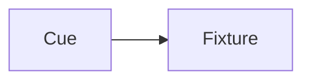

# Writing style

{{#include ../includes/human-review-disclaimer.md}}

Nightfall's documentation follows the key rules of the [GitLab documentation style guide](https://docs.gitlab.com/development/documentation/styleguide/), adapted for mdBook. This page lists the rules that matter most. When this page doesn't cover a question, follow the GitLab guide.

## Structure a page around its subject

Pages take the shape their subject needs. A complex mechanism can walk through several diagrams with explanation between them, while a short reference page may have no diagram. A few guidelines keep pages predictable:

- Open with the answer. The first paragraph says what the page explains and why it matters, using only terms from the page's part of the guide or earlier parts.
- Build up complexity. Show a simple diagram first and a detailed one once the reader has the basics. Introduce each diagram with a sentence and explain it in the text that follows.
- Keep code references out of the explanation. Put type and file references in an **In the code** table near the end of the page or section, rather than in every paragraph.
- Put rules for contributors where they apply. A rule such as "render systems must not read messages" belongs in the section that explains render systems.
- Use topic types as building blocks. A section is a concept (how something works), a task (numbered steps to do something), a reference (facts to look up), or troubleshooting (symptoms and fixes). Add task and troubleshooting sections only where readers need them.
- End with a **Related topics** list of links to the next part of the guide and to neighboring pages.

Don't add pages that only link to other pages, and don't add topics with only one or two sentences. Fold small topics into a neighbor.

## Voice and wording

- Address the reader as "you" and use active voice: "The compositor merges layers by priority," not "Layers are merged by priority."
- Use the present tense. Describe what the code does today. For planned work, link to the issue or pull request instead of describing it.
- Lead with the answer. Don't open with "This page explains…"
- Cut filler and selling words, such as "simply," "easily," "just," and "powerful."
- Avoid "there is" and "there are," and make sure "it" always has a clear subject.
- Don't use Latin abbreviations. Write "for example," "that is," and "and so on."
- Break up stacked nouns: "the output target for each universe," not "universe output target binding."
- Spell out an abbreviation the first time a page uses it, for example highest takes precedence (HTP). The [concept map](../concepts/concept-map.md) lists the common ones.
- Don't use semicolons or em dashes. Split the sentence or use a comma.
- Avoid idioms. Contractions are fine in explanations. Avoid them in reference tables.
- Use US English spelling.

## Titles and headings

- Use sentence case for page titles, headings, and table headers.
- Don't title a page "Overview" or "Introduction." Name what the page explains.
- Keep titles under 70 characters.
- Increase heading levels one step at a time, and don't go deeper than level 4. Split the page instead.
- Don't use bold or links in headings. Put code identifiers in backticks.
- Every page starts with one `#` heading. mdBook needs it, so GitLab's front matter title rule doesn't apply here.

## Lists and tables

- Use numbered lists only for steps that happen in order. Use dashes for everything else.
- Introduce a list with a complete sentence that ends in a colon. List items must not finish the introductory sentence.
- Keep list items parallel. End an item with a period only when it is a complete sentence.
- Use tables for data with more than one dimension, such as priorities and their sources. Use a list for a single column of items.
- Don't leave table cells empty. Write **None** when nothing applies.
- Put a description column last.

## Code and interface text

- Use backticks for types, functions, files, commands, settings values, and short output.
- Give every fenced code block a language, such as `rust`, `typescript`, `shell`, or `plaintext`.
- Use bold for interface labels, such as **Properties** or **Store cue**. Don't use bold or italics for emphasis.
- Write keys with `<kbd>`, for example <kbd>Ctrl</kbd>+<kbd>Shift</kbd>+<kbd>P</kbd>.
- Write placeholders in angle brackets, for example `<showfile-name>`.

## Links

- Use link text that describes the target: "For more information, see [priorities and merging](../concepts/priorities-and-merging.md)." Don't use "here" or "this page."
- Link to other pages in this book with relative paths.
- Link to the user manual with a relative path to its built `.html` page, such as `../../user-guide/cues.html` from a page in `concepts/`. The docs site publishes the user manual at its root and this guide under `internal/`, so the path climbs out of this guide into the manual.
- Link to source code on GitHub at a commit or tag, not at a branch, so line numbers stay correct. When the link is to a whole file that changes often, a branch link is acceptable.
- Keep pages to about 15 links.
- Link to existing text rather than repeating it. When a module's doc comment already explains a design, summarize it and link to the file.

## Diagrams

Write diagrams in [Mermaid](https://mermaid.js.org/) inside a fenced code block with the `mermaid` language. The book renders them in the browser, and the source stays reviewable in pull requests.



- Add `accTitle` and `accDescr` lines so screen readers can describe the diagram.
- Introduce each diagram with a sentence, and explain it in the text. A diagram supports the text and never replaces it.
- Tell elements apart with shapes and labels, not color alone. The book has light and dark themes.
- Don't put links inside diagrams.
- Prefer several small diagrams over one diagram that shows everything.

When a diagram needs precise layout that Mermaid can't produce, such as a dense architecture picture, draw it in [draw.io](https://www.drawio.com/) instead:

- Save it as a `.drawio.svg` file next to the page that uses it. The file is an ordinary SVG with the draw.io source embedded, so the book shows it as an image and you edit the same file again with the draw.io desktop app or the Draw.io Integration extension for Visual Studio Code.
- Embed it with an image link and alt text: ``.
- Give the diagram a solid background so it stays readable in the dark book themes.
- Keep Mermaid as the default. A draw.io diagram is harder to review, because pull requests show its source as XML.

Screenshots are PNG files no larger than 1000 by 500 pixels and about 100 KB. Name them in lowercase with hyphens, and give each one alt text of 155 characters or fewer.

## Callouts

Use callouts sparingly, and never put two in a row. Write a callout as a GitHub-style alert, a blockquote whose first line is the alert type:

```markdown
> [!WARNING]
> Render systems must not read messages written outside the render pass.
```

Use these types:

- `[!NOTE]` for information that is easy to miss.
- `[!WARNING]` for data loss, breaking behavior, or rules that cause bugs when ignored.

GitHub renders these alerts in the Markdown source, and the guide's `theme/callouts.js` renders them in the book. Don't use blockquotes for anything else.

## Review status

Every page drafted with AI help includes the shared draft notice below its title:

```markdown
\{{#include ../includes/human-review-disclaimer.md}}
```

Remove the include after a human has reviewed the page for accuracy and completeness. Review drafted pages for repeated content, claims that the code doesn't support, and names of types or settings that don't exist.

## Related topics

- [GitLab documentation style guide](https://docs.gitlab.com/development/documentation/styleguide/)
- [GitLab topic types](https://docs.gitlab.com/development/documentation/topic_types/)
- [Building the documentation](https://github.com/stewartadam/nightfall-lightdesk/blob/develop/CONTRIBUTING.md#building-the-documentation)
