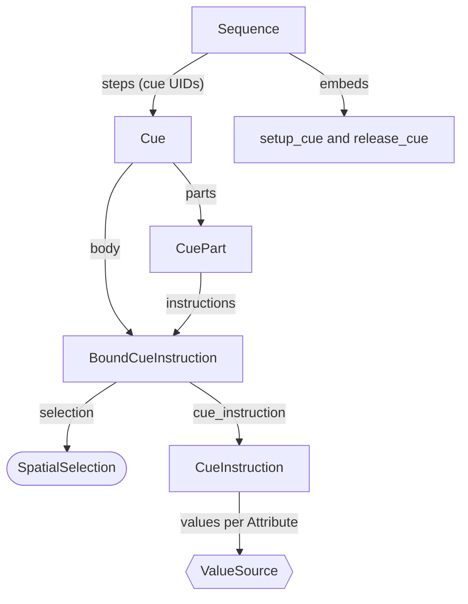
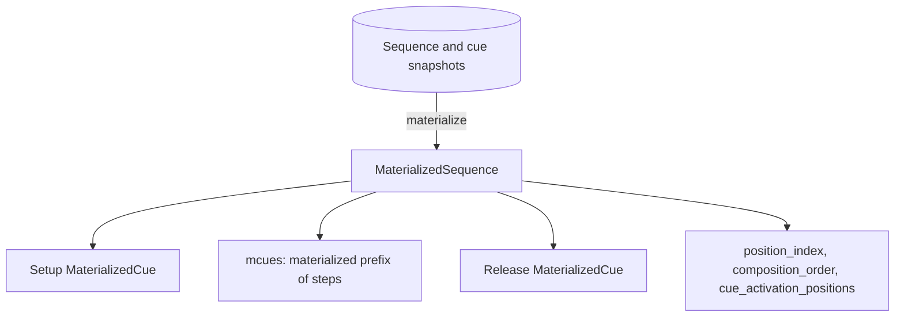
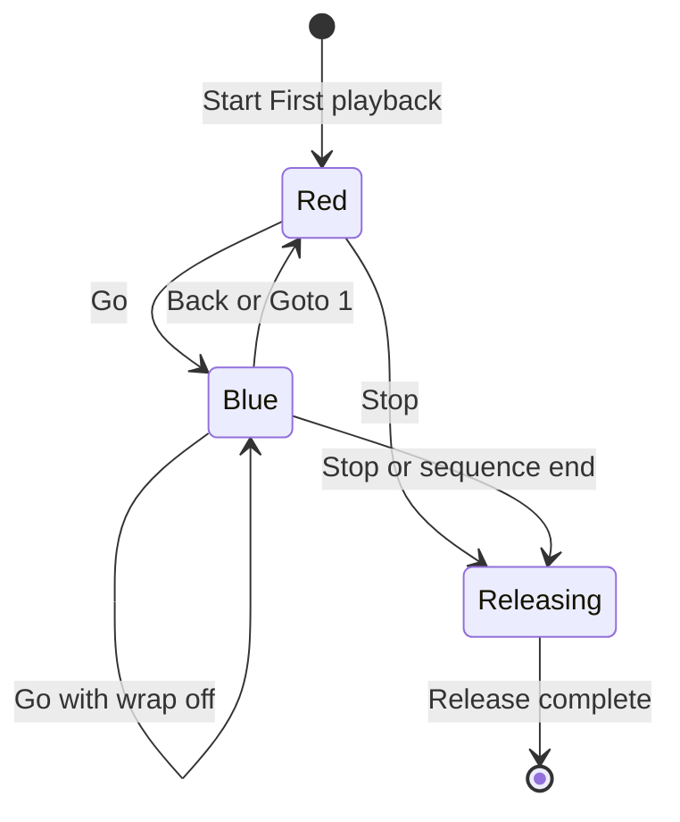
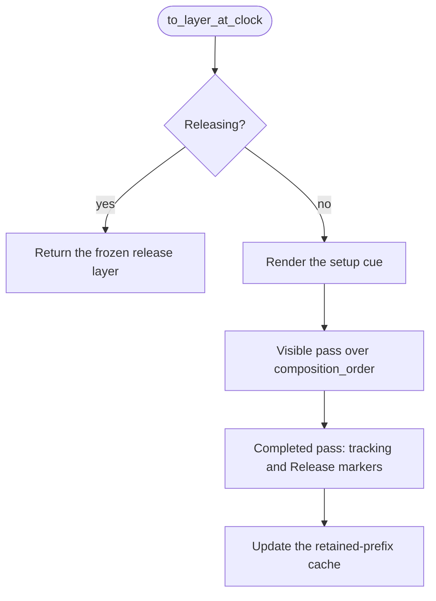

# Cues, sequences, and tracking

{{#include ../includes/human-review-disclaimer.md}}

A sequence is an ordered list of cues, and a running sequence paints one layer in every render pass. To compute that layer, the engine renders the sequence's setup cue and then each cue it still retains, in order, so values from earlier cues can carry into later ones. That carrying is called tracking. The `cues` crate owns the whole path: the authored types a showfile stores, the runtime state built when a clip starts a sequence, the Go, Back, and Goto operations that move it, and the release that fades it out. Read this before you change how cues are stored, how a sequence advances, or what a sequence layer contains.

The examples use the [running example](../README.md#a-running-example): `First sequence` holds `Red`, which sets `Practice light` to full intensity and full red, and `Blue`, whose trigger is **Manual** so it waits for Go. Every attribute of `Practice light` merges latest takes precedence (LTP), as [priorities and merging](../concepts/priorities-and-merging.md) explains.

## The authored model

A showfile stores sequences and cues as separate objects. A sequence refers to its cues by unique ID (UID), and it embeds two extra cues of its own. The following diagram shows how the authored types nest:

A `Sequence` carries the following fields:

- `steps`, the cue UIDs in playback order. Cue IDs are scoped to their sequence, so two sequences can each have a cue 1. When the engine materializes a sequence, it skips a step whose cue is missing and logs a warning.
- `setup_cue` and `release_cue`, two embedded `Cue` values that are not part of `steps`. The setup cue's values sit underneath every step. The release cue only supplies timing when the sequence stops.
- `default_timing`, a complete `Transition` that fills any timing a step cue leaves unset. [Timing and the override chain](timing.md) explains how timing resolves.
- `tracking_mode`, the tracking behavior that cues inherit.
- `wrap`, which makes Go on the last cue return to the first.
- `release_on_start`, which the engine stores but doesn't read during playback.

A `Cue` holds its `trigger`, its timing (`transitions` and `transitions_by_attribute`), its body `instructions`, optional `parts`, and its tracking settings. A `CuePart` is a subset of a cue's instructions with its own timing and lookahead flag. Parts fire at the same moment as their cue and render after the cue body, in part order. When the programmer stores into part 0, it writes the cue body.

A `CueInstruction` maps attributes to value sources. It can instead hold a `blueprint_application`, a live reference to a blueprint that the engine resolves each time it materializes the cue, so a blueprint edit reaches every cue that uses it. The instruction also carries timing overrides and an optional color path.

### Triggers decide when a cue starts

A cue's `trigger` (`CueTriggerType`) controls entry into that cue, measured on the playback's clock:

| Trigger | When the cue starts |
|---------|---------------------|
| `Manual` | Only on Go, Back, or Goto. |
| `FollowPrevious` | When the previous cue's delays and fades finish. This is the default for a `Cue` built in Rust. |
| `AfterDelay(duration)` | The given time after the previous cue started. When wrapping from the last cue to the first, the wait is at least the last cue's duration. |
| `At(duration)` | The given time after the sequence started. |

The first cue is active as soon as the sequence starts, so its trigger only matters when the sequence wraps back to it. `Blue` waits for Go because its trigger is `Manual`.

### Value sources

Each attribute in an instruction has a `ValueSource`:

| Variant | Effect |
|---------|--------|
| `Inline(value)` | Sets one value on every selected fixture. |
| `Fanned { values }` | Spreads values across the selection. Two values make a linear fan, and three or more make an envelope with interpolated waypoints. |
| `Release` | Clears the tracked value for this attribute from this cue forward, so lower layers show through again. |
| `HoldPosition` | Keeps the tracked position value and opts it out of lookahead. |

`Release` is one of several meanings of "release" in the code. The [concept map](../concepts/concept-map.md#words-with-more-than-one-meaning) lists the others.

## Tracking modes and flags

Tracking decides whether a cue's values carry into later cues that don't set those attributes. Two types control it:

- `TrackingFlags` is a bit set with `HTP` (1), `LTP` (2), and `FX` (4). The default enables all three.
- `TrackingMode` is either `Inherit` or `Flags(flags)`.

A cue's effective flags resolve in this order:

1. The sequence's `tracking_mode` resolves first. `Flags` uses its flags, and `Inherit` falls back to the default flags.
1. If the cue has a `tracking_mode`, it resolves against the sequence's flags, so `Inherit` takes the sequence's flags.
1. If the cue has no `tracking_mode`, its older `tracking_flags` field applies unchanged.

The flags apply per parameter, by the parameter's merge rule. An HTP parameter tracks when the flags include `HTP`, and an LTP parameter tracks when they include `LTP`. Sequence tracking doesn't read the `FX` flag. New sequences from the web UI use `Flags` with all three flags, and their step cues and release cue use `Inherit`.

In the running example, suppose `Blue` only stores red at 0% and blue at 100%. With the default flags, `Red`'s intensity at 100% tracks into `Blue`, so `Practice light` stays at full. If `Red`'s flags exclude `LTP`, none of its values track, because every `Practice light` attribute is LTP. `Blue` then contributes only red and blue, and intensity falls to whatever the lower layers or the fixture default give it.

> [!WARNING]
> Rendering reads the cue-level flags for the whole cue, including its parts. A part's own `tracking_flags` field is stored but never read during playback.

## From authored data to runtime state

When a clip starts a sequence, the clip handlers spawn a playback entity with a `MaterializedSequence` component next to the instance components, such as `InstanceId` and `InstanceClock`. Materializing means resolving each cue's selections, blueprints, and color paths into concrete values per fixture parameter. A `MaterializedCue` holds those values in a layer, with a `MaterializedTransition` for each value.

The step cues materialize lazily. Starting a playback materializes only cue 1. Go, Back, and Goto extend the contiguous prefix through their target before they move. A sequence materializes every remaining cue only when lookahead needs a later position value. Before materializing a step cue, the engine places the sequence's default timing underneath the cue's own timing. The setup and release cues materialize without it.

The runtime fields that drive playback are:

| Field | Purpose |
|-------|---------|
| `position_index` | The current cue, as a zero-based index into the steps. |
| `composition_order` | The retained cues, from oldest to newest. Rendering walks this list. |
| `cue_activation_positions` | The clock position where each retained cue became active. |
| `playback_start_position` | The clock position where the playback started. `At` triggers count from here. |
| `render_prefix_cache` | Rendered state for the stable start of `composition_order`. |
| `last_rendered_layer` | The most recent output, which release freezes. |
| `release_layer` | The frozen output that the sequence renders while it releases. |

All of these positions are source-local: they come from the playback's `InstanceClock`, which runs at the playback's own rate and can be repositioned by a timeline. The `activation_time` fields hold host wall-clock time and only feed the status that the UI shows.

When a stored cue, sequence, or blueprint changes while a sequence runs, the engine rematerializes the affected cues in place and keeps their activation and release positions, so a running fade continues with the new values.

Cue preview in the **Sequence Editor** uses the same types at priority 126. It spawns a standalone `MaterializedCue` or a `MaterializedSequence`.

## How a sequence plays

The following state diagram shows `First playback` moving through `First sequence`:

Three things move a sequence between cues:

- **Go and Back.** A clip command such as `clip 1 go` reaches the clip handlers, which pass a `SequencePlaybackOperation::Go` or `Back` to the running playback. The handler runs in `EventHandling`, extends the materialized prefix, and moves the position, anchoring the new cue at the clock's current position. Go on the last cue does nothing unless `wrap` is on, and Back on the first cue does the same. [From command to state change](../engine/command-path.md) follows a command along this path.
- **Goto.** `SequencePlaybackOperation::Goto` jumps to a position. It can carry a `PlaybackReconstructionTiming`, which also resets the playback clock. A timeline uses this to place a cue at an exact point in its own time.
- **Automatic triggers.** In each render pass, `advance_sequences` checks whether the next cue's trigger is due. It advances as many cues as are due, up to 10,000 in one tick, and anchors each cue at the exact position where it became due rather than at the frame's time. Follow chains therefore keep exact timing at any frame rate.

A cue's duration for these triggers is the longer of its materialized delay plus fade and its authored timing, so an empty cue with a 2-second fade still waits 2 seconds.

A non-wrapping sequence ends once its last cue and the cues it retains have finished their transitions. If every clip attached to the playback has the **Deactivate on sequence end** option, the playback starts releasing. When none of those clips auto-releases, the engine first copies the sequence's output into the manual assertion layer at priority -127, so the look stays after the playback ends.

### Go keeps the retained order, Back and Goto rebuild it

`composition_order` decides which earlier cues still contribute. Go moves the entered cue to the newest end of the list and leaves the other retained cues in place. Back and Goto reset the list to every cue from the first through the target, in cue order.

Rebuilding the list is how jumping computes tracked values. After `Goto 5`, the sequence renders cues 1 to 5 in order, and each earlier cue contributes the values its tracking flags allow. The result matches playing the cues in order, without replaying their timing.

### Seek and replay for timelines

A timeline that seeks, or starts playback partway through a song, needs the sequence state at that moment without playing everything before it. The `playback-planner` crate defines the planning contracts, such as `PlannedPlaybackInterval` with its list of Go, Back, Goto, and Stop interventions. The planner works in two steps:

1. `SequenceTimelineSeekPlayback` replays those interventions and the automatic triggers between them on step timings alone. It produces a target cue position and the position where that cue started, without materializing anything.
1. `spawn_reconstructed_sequence_for_clip` materializes the sequence and calls `set_position_reconstructing_prefix_at_playback_position`. That walks back from the target while each cue was entered by an automatic trigger, and gives each one the activation and release positions it would have had. The walk stops at the first cue with a `Manual` trigger.

> [!WARNING]
> Reconstruction retains only the cues back to the nearest manual boundary, while a live Goto retains every cue from the first. A timeline that seeks into `Blue` retains only `Blue`, because `Blue`'s trigger is `Manual`. Values that `Red` would track into `Blue` aren't in the reconstructed layer.

## How the sequence paints its layer

`MaterializedSequence::to_layer_at_clock` builds the layer. In the `LayerGeneration` set, four systems run in a chain: `advance_sequences`, a command flush, `release_materialized_sequences`, and `paint_materialized_sequences`. The paint system calls `to_layer_at_clock`, adds lookahead assertions, and inserts the result as the entity's `Layer` together with a `LayerCompositingContext` that holds the clock position. [The frame loop](../engine/frame-loop.md) shows where `LayerGeneration` runs.

The setup cue renders first, onto an empty base, so its values sit at the bottom of the sequence layer.

The visible pass renders the output you see. For each retained cue, it renders the cue body and then each part, in order, against a running base built from the setup cue and the cues before it. The current cue's values always enter the layer. An older retained cue's values enter only where its tracking flags allow. Every rendered cue still updates the running base, so the next cue fades from what the earlier cues showed even when their values don't track.

Fades in a sequence run inside the sequence. Each value fades from the sequence's running base, or from the parameter's default value when nothing earlier in the sequence set it. The sequence then hands the compositor a value whose fade-in is already applied.

The completed pass walks the same order with every transition finished, using a context position 24 hours in. It computes the tracking base from cue targets instead of half-faded samples, which keeps relative values correct. It also applies `Release` markers. A marker removes its parameter from the layer once the instruction's delay has passed. The fade time doesn't apply, so the value leaves at once and lower layers show through.

### The retained-prefix cache

Rendering every retained cue in every frame gets expensive in long tracking sequences. The render prefix cache, `RenderPrefixCache`, stores the rendered state after the longest start of `composition_order` whose cues have finished their transitions. The next render reuses that state and renders only the cues after it. When the cache covers the whole order, rendering returns the cached layer directly.

A cache entry is valid only for clock positions at or after the position where it was built, and only while `composition_order` still starts with the cached cues. Navigation, priority changes, rematerialization, and a setup cue that is still fading all drop the cache.

> [!WARNING]
> If you add state that changes what a sequence renders, call `invalidate_render_prefix_cache` wherever that state changes. Otherwise the sequence keeps painting the old output for the cached cues.

### Activation time of sequence layers

The compositor orders layers of equal priority by their activation time. Sequence layers take `Instant::now()` as their activation time in every render, both for a newly built layer and for one returned from the cache. [Priorities and merging](../concepts/priorities-and-merging.md#layers-stack-from-lowest-to-highest-priority) describes the effect on equal-priority playbacks.

## Release

Stopping a clip, or reaching the end of the sequence as described earlier, adds a `ReleaseMarker` to the playback entity. In the next pass, `release_materialized_sequences` advances any automatic triggers up to the release position, renders the sequence there, and freezes that output as `release_layer`. From then on, the sequence renders only the frozen layer while its values fade out.

The release cue supplies the fade timing for each frozen value:

1. If the release cue has instructions for that parameter, their timing applies.
1. If the release cue has no instructions, its cue-wide timing applies, but only when the timing for the parameter's direction is set explicitly.
1. Otherwise the value has no release fade and drops out as soon as the release starts. When the release cue has its own nonzero timing, the releasing playback still lasts at least that long.

HTP parameters use the release cue's out timing, and LTP parameters use its in timing. LTP values on a fixture also wait until that fixture's HTP intensity has finished releasing, so color and position don't visibly change while the light fades. A new sequence's release cue has no timing, so stopping `First playback` removes its values at once.

When every release transition has finished, plus a 10-millisecond grace period, `despawn_materialized_sequences` removes the playback entity.

## In the code

| Concept | Where to look |
|---------|---------------|
| `Sequence`, `Cue`, `CuePart`, `CueInstruction`, `TrackingMode`, and `TrackingFlags` | `crates/cues/src/cue.rs` |
| `ValueSource` | `crates/common/src/value_source.rs` |
| `CueTriggerType` and trigger timing helpers | `crates/common/src/transitions.rs` |
| `MaterializedCue` and cue materialization | `crates/cues/src/materialized_cue.rs`, `crates/cues/src/materialized_cue/materialization.rs` |
| `MaterializedSequence` and lazy prefix materialization | `crates/cues/src/materialized_sequence.rs`, `crates/cues/src/materialized_sequence/materialize.rs` |
| Go, Back, Goto, triggers, and prefix reconstruction | `crates/cues/src/materialized_sequence/navigation.rs` |
| Sequence playback operation handlers | `crates/cues/src/events/instance.rs` |
| Systems that advance, paint, release, and despawn sequences | `crates/cues/src/materialized_sequence/systems.rs` |
| Visible and completed rendering passes | `crates/cues/src/materialized_sequence/rendering/` |
| Tracking policy and `Release` markers | `crates/cues/src/materialized_sequence/tracking.rs` |
| Retained-prefix cache | `crates/cues/src/materialized_sequence/rendering/cache.rs` |
| Sequence release | `crates/cues/src/materialized_sequence/release.rs` |
| Rematerialization after definition changes | `crates/cues/src/materialized_sequence/rematerialize.rs` |
| Seek replay for timelines | `crates/cues/src/sequence_planning.rs` |
| Planning contracts and `PlaybackReconstructionTiming` | `crates/playback-planner/src/lib.rs` |
| `InstanceClock` | `crates/instances/src/lib.rs` |

## Related topics

- [Timing and the override chain](timing.md)
- [Priorities and merging](../concepts/priorities-and-merging.md)
- [The frame loop](../engine/frame-loop.md)
- [Crate map](../architecture/crate-map.md)
- [Cues and timing](https://github.com/stewartadam/nightfall-lightdesk/blob/develop/docs/src/user-guide/cues.md) in the user manual
