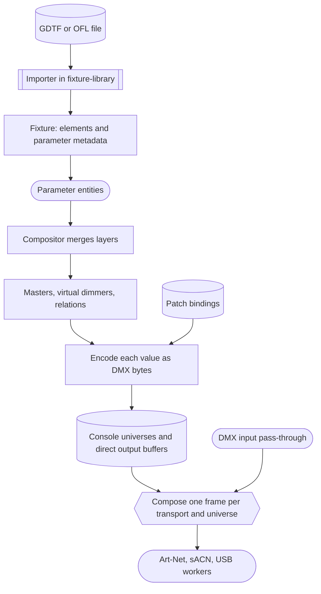
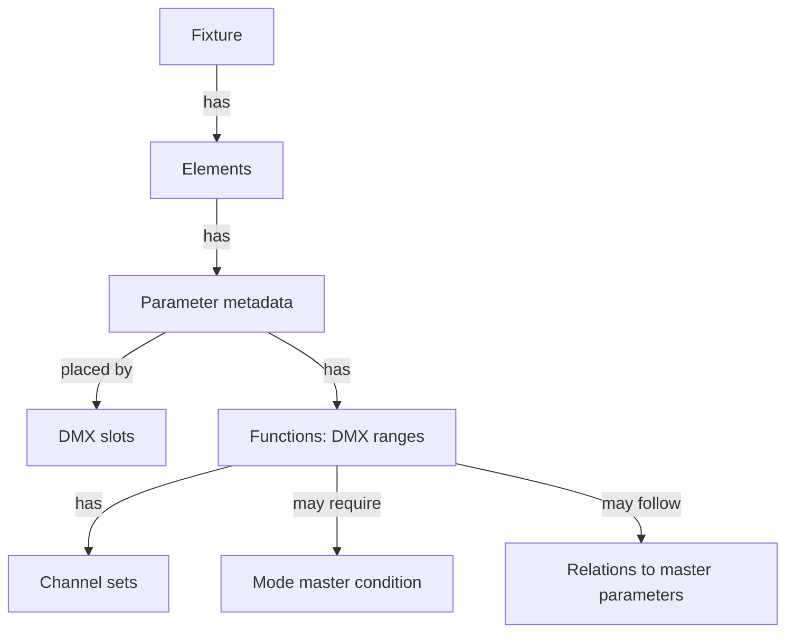
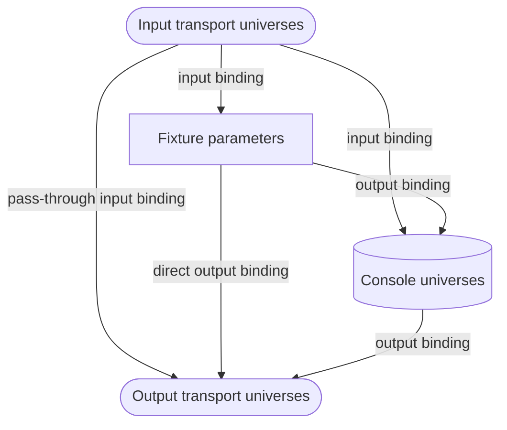
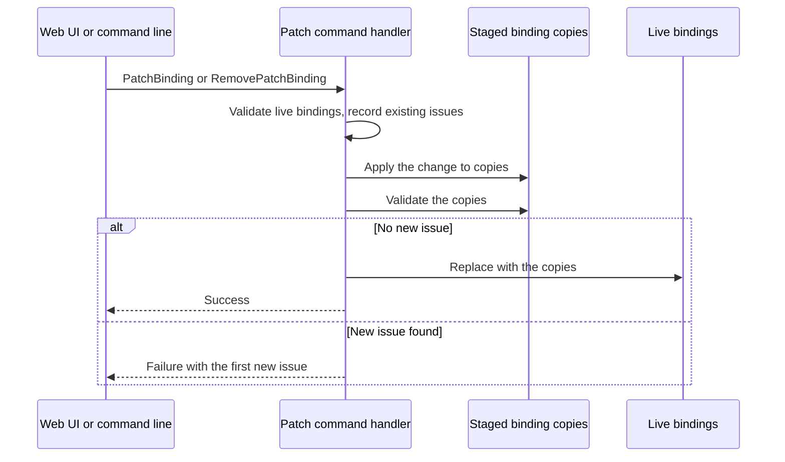
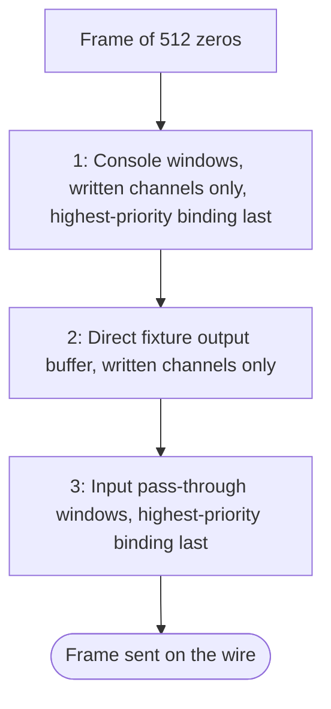
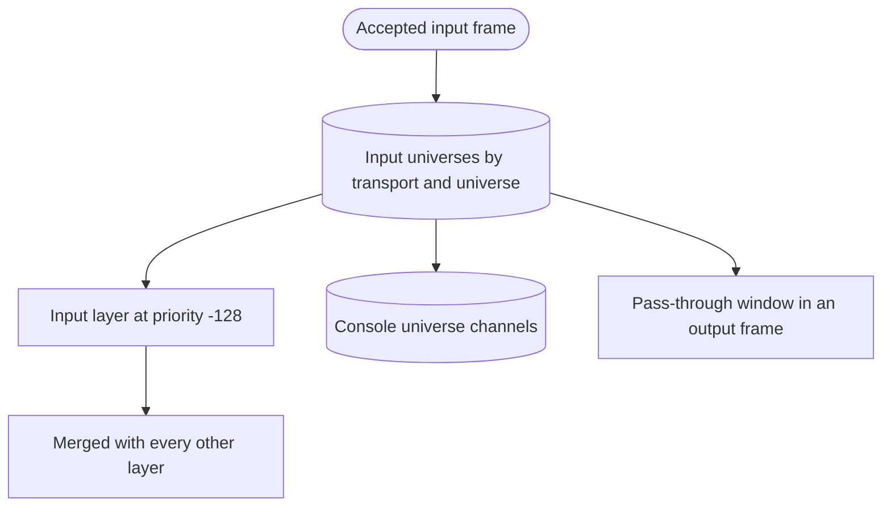

# Fixtures, patching, and DMX output

{{#include ../includes/human-review-disclaimer.md}}

A fixture profile tells Nightfall what each DMX channel of a light means. The patch tells it where those channels live. Together they decide which bytes leave the computer. This page follows that path from an imported GDTF or Open Fixture Library (OFL) file to the bytes in an Art-Net, sACN, or USB frame: the profile model, the importers, the parameter entities a patched fixture becomes, the binding graph and how patch changes are validated, and the order in which console universes, direct fixture patches, and DMX input combine into one output frame. Read it before you change an importer, the patch, or anything in the `DmxOutput` system set.

The page builds on [how a show becomes light](../concepts/show-to-light.md) and [priorities and merging](../concepts/priorities-and-merging.md), and it places each step in the render pass that [the frame loop](../engine/frame-loop.md) describes. It follows `Par 1`, patched at console universe 1, address 1.

## From profile to wire in one picture

The following diagram shows the data flow. Stored data is on the left of each step, and the render pass works from top to bottom:

The profile is static data that the patched fixture copies. The parameter entities hold the live values. The bindings decide addresses, and output frame composition decides what wins when several sources write the same wire channel.

## The profile model

Nightfall has no single "profile" type at runtime. The fixture library keeps one entry per definition file, and a definition can have several DMX modes. When you patch a fixture, the importer converts one mode into a `Fixture`, and the show stores that converted copy. The fixture remembers its mode name and a fingerprint of the library file it came from, so it keeps working even if the library file changes or disappears.

The following diagram shows the parts of a converted fixture:

The `fixture-model` crate defines parameter metadata, functions, mode masters, and relations. It has no engine or ECS dependencies, so the engine and the 3D visualizer share one implementation. The web UI reaches it through the WASM bridge, as [how the pieces fit together](../architecture/system-overview.md) explains.

### Parameters and DMX slots

Each parameter controls one attribute of one element and carries its own metadata. The fields that shape output are:

| Field | Description |
|-------|-------------|
| `attribute` | The attribute the parameter controls, such as `Intensity`, `Red`, or `Pan`. The engine looks parameters up by element and attribute, so an element needs a distinct attribute for each parameter. |
| `resolution` | Channel width: `Coarse` (8-bit), `Fine` (16-bit), `UltraFine` (24-bit), or `Uber` (32-bit). |
| `dmx_slots` | Where the bytes go: `Sequential` (right after the previous parameter), `Explicit` (a DMX break and 1-based footprint slots for each byte, most significant first), or `Virtual` (no slot at all). |
| `min`, `max` | The logical value range. Output is clamped to it. |
| `value_polarity`, `native_unit` | Whether values are unsigned or centered on zero, and the unit operators see, such as percent or degrees. |
| `offset` | A calibration offset added after merging and before clamping. |
| `is_inverted` | Mirrors the range on output, for example for a fixture hung upside down. |
| `merge_type` | `HTP` or `LTP`, the rule for equal-priority layers. |
| `use_grandmaster` | Whether intensity masters scale this parameter. |
| `default_dmx`, `highlight_dmx` | The DMX value the fixture rests at, and the value used while the element is highlighted. |
| `is_snap` | Marks a parameter that should not fade. |
| `functions` | DMX ranges with distinct meanings. An empty list means one linear function over the whole range. |

A parameter's live value is a logical value in its `min` to `max` range. Encoding it for the wire takes three steps:

1. Add the calibration offset, clamp to the logical range, and mirror the value when the parameter is inverted.
1. Normalize the result to 0 to 1 and scale it to the resolution's maximum, such as 255 for coarse or 65535 for fine, rounding to the nearest integer.
1. Split the integer into bytes, most significant first.

A DMX break is a group of channels with its own start address. Most fixtures use only break 1. Some GDTF modes put an accessory, such as a color scroller, on break 2.

### Functions, mode masters, and relations

A function is one DMX range of a parameter with one meaning, imported from a GDTF channel function. A gobo channel can select gobos from 0 to 127 and rotate them from 128 to 255. Each function has a physical range and unit, optional named channel sets (such as "Gobo 3"), and an optional DMX-to-physical curve made of cubic segments.

A **mode master** makes a function active only while another parameter outputs a DMX value in a given range. A fixture's shutter channel can mean strobe speed in one mode and pulse shape in another.

A **relation** lets a master parameter change a follower function's level:

- `Multiply` scales the follower's position within its active function by the master's level. A pixel's red channel that follows the body dimmer works this way.
- `Override` replaces the follower's position with the master's level.

The follower's active function is the first one whose DMX range contains the follower's value and whose mode master condition holds. The evaluator follows chains of masters up to `MAX_RELATION_DEPTH` (8) levels and treats anything deeper as a cycle.

Relations need a decision about who applies them. When both the master and the follower have DMX slots, the light applies the relation itself, so the console sends the raw values and only the visualizer simulates the relation. When either side is virtual, the light never sees that channel, so the console must apply the relation before output. `RelationScope::Console` and `RelationScope::Fixture` encode that split, and both sides use the same `FixtureEvaluator`.

### Two kinds of virtual channel

"Virtual" means two different things in the profile model:

- A parameter whose `dmx_slots` is `Virtual` occupies no DMX slot. The GDTF importer produces these for channels without an `Offset`, such as a virtual dimmer that masters the color emitters of each pixel, and for a channel that reuses another channel's slots. Only relations make these parameters affect output.
- A parameter whose attribute is `VirtualIntensity` is a desk-side dimmer for lights without an intensity channel. Some built-in profiles, such as the pixel bars and strobes in the `fixtures` crate, include one. It never occupies a slot, starts at full when the profile gives no default, and dims the element's color parameters through the virtual dimmer system.

### Which attributes masters affect

An intensity master scales a parameter only when both conditions hold:

- The parameter's attribute is `Intensity` or `VirtualIntensity`.
- The profile sets `use_grandmaster` on it.

Both importers set `use_grandmaster` on intensity parameters. The GDTF importer then clears it on some virtual dimmers so that a master scales each light path once, as the next section describes. Setting `use_grandmaster` on any other attribute has no effect.

### The profile of `Par 1`

`Par 1` comes from the tutorial's OFL file, `nightfall@tutorial-rgbi-par.json`, mode **4 channel**. The importer produces one element, labeled `Main`, with four parameters:

| Attribute | Resolution | Slots | Merge rule | Masters affect it | Default |
|-----------|------------|-------|------------|-------------------|---------|
| Intensity | Coarse | Sequential, slot 1 | HTP | Yes | 0 |
| Red | Coarse | Sequential, slot 2 | LTP | No | 0 |
| Green | Coarse | Sequential, slot 3 | LTP | No | 0 |
| Blue | Coarse | Sequential, slot 4 | LTP | No | 0 |

Each parameter has a logical range of 0 to 255, no offset, no inversion, and no functions. The file declares no `precedence`, so intensity merges HTP and red, green, and blue merge LTP. The profile has no virtual parameters and no relations, so the virtual dimmer and relation systems leave it alone.

## Importing GDTF and OFL profiles

The `fixture-library` crate scans the library directory for `.gdtf` and `.json` files, watches it for changes, and converts a mode on demand when you create fixtures. The browser demo uses a built-in library with compiled-in profiles instead. The two importers follow different rules:

| Topic | GDTF importer | OFL importer |
|-------|---------------|--------------|
| Elements | One element per geometry instance that owns channels, in first-channel order. | One element named `Main`. Matrix fixtures get a `Master` element for shared channels and one element per pixel. |
| Merge rule | `Intensity` and `VirtualIntensity` are HTP. Everything else is LTP. | Each channel's `precedence` field decides. A missing or unknown value falls back to the GDTF rule: `Intensity` and `VirtualIntensity` are HTP, everything else LTP. Matrix template channels use the same fallback. |
| Masters | `use_grandmaster` on intensity, then cleared on virtual dimmers that would scale a light path twice. | `use_grandmaster` on intensity. |
| DMX slots | `Explicit`, from the channel's `Offset` and DMX break. Channels without an offset become `Virtual`. | `Sequential`, in mode channel order. |
| Resolution | From the number of offset bytes, up to 4. | From the channel's `dmxValueResolution` field, 8-bit by default. |
| Functions, mode masters, relations | Imported from channel functions, `ModeMaster` links, and the mode's relations. | Not imported. |
| Defaults and inversion | `default_dmx` and `highlight_dmx` from the channel. Pan and tilt ranges come from the physical range, and a reversed range sets inversion. | No `default_dmx`. Pan and tilt ranges come from `panMax` and `tiltMax`. Inversion comes from the channel's `invert` flag. |

Both importers map unknown attribute names to `Attribute::Custom` with the source name as its label, so no channel is silently dropped for having an unfamiliar name.

> [!WARNING]
> OFL parameters are `Sequential`, so their addresses depend on every earlier parameter being present. The OFL importer skips mode entries it can't find in `availableChannels`, including `null` placeholders and fine channel aliases such as `Pan fine`, and every later channel then lands one slot early. Within each pixel element, channels follow the profile's template channel map, not the mode's channel order, so pixel channel addresses can differ from the profile. Matrix fixtures also pack the `Master` element before the pixels, whatever order the mode lists them in. Check the addresses of OFL modes with 16-bit or unused channels before you rely on them.

The GDTF importer resolves each mode once and records diagnostics for problems it works around:

- A channel whose offsets the model can't represent (more than four bytes, or slots outside 1 to 512) is dropped.
- A channel that reuses another channel's slots becomes a `Virtual` copy, so two parameters never write the same byte. Links that name the copy resolve to the channel that owns the slots.
- A mode master or relation that names a channel which produced no parameter is dropped.

After linking, the GDTF importer decides which virtual dimmers respond to intensity masters. A virtual dimmer gives up its master response when it follows another dimmer, when it mirrors a physical dimmer whose slots it shares, or when a physical dimmer already covers every channel it masters. Otherwise a master at 50% would scale the light twice, once through the physical dimmer and once through the virtual one.

> [!WARNING]
> Importer changes alter the output of every show that patches an affected fixture. Run the GDTF bench described in [GDTF regression testing](../contributing/gdtf-regression-testing.md) before you change the GDTF converter.

## A patched fixture becomes entities

A fixture isn't an entity. The engine stores `Fixture` values in `FixtureDataProviderExt`, a data provider keyed by fixture UID. Elements aren't entities either: code refers to an element with a `FixtureRef`, which holds the fixture UID and a 1-based element index. Only parameters are entities. Each one carries a `Parameter` component with the profile metadata and its live values.

When the library commands `CreateFixtureFromLibrary` or `CreateFixturesFromLibrary` create fixtures, they convert the mode once, validate every requested fixture ID, store the fixtures, and spawn one parameter entity per parameter of every element. Loading a showfile spawns the same entities. A parameter index maps each (element, attribute) pair to its entity and back, so commands, layers, and bindings can find the parameter that `fixture 1 red` means.

Each parameter starts at its profile default. When the profile gives no default, `VirtualIntensity` starts at full so that the element isn't dark, and every other parameter starts at a logical value of 0.

> [!WARNING]
> The `StoreFixture` command only stores the fixture definition. It doesn't spawn or rebuild parameter entities, so a fixture created or reshaped through it has no parameters to control or patch. Create fixtures through the library commands.

For `Par 1`, the result is one stored fixture, one element reference with index 1, and four parameter entities for intensity, red, green, and blue.

## The binding graph

Patch bindings connect four kinds of endpoint: fixtures, console universes, output transports, and input transports. A binding has a source, a target, a priority, and a clone flag. The following diagram shows the routes the engine resolves:

The engine keeps three binding lists:

- **Output bindings** route fixture parameters to console universes or straight to an output transport, and route console universes to output transports.
- **Input bindings** route incoming DMX to fixture parameters, to console universes, or straight to an output transport. Console and fixture sources are also possible, for example to copy one fixture's values onto others.
- **Disabled bindings** filter out matching input sources. Only inputs can be disabled. To stop an output, remove its binding.

When two bindings conflict, the higher priority wins, and among equal priorities the earlier binding wins. Fixture-to-console bindings resolve this way per parameter: a parameter has at most one console address. Fixture-to-transport bindings add up instead, so a fixture patched to two transports sends to both.

A fixture binding can select whole fixtures, one element, or one parameter. It places its fixtures in order:

- The Nth fixture lands in the Nth universe of the binding's universe range, and every fixture past the end of the range lands in the last universe.
- Fixtures that share a universe are packed one after another from the binding address, unless the clone flag puts every fixture at the same address.
- A whole-fixture selection keeps the profile's footprint offsets. An element or parameter selection is rebased so its first byte lands on the binding address.
- Fixture bindings route break 1. Each additional DMX break needs its own `FixtureBreak` binding with its own address.
- Parameters without slots, including `VirtualIntensity`, get no output address. An input binding that targets a fixture can still drive a `VirtualIntensity` parameter, which it treats as one sequential intensity byte.

The **Patch** wizard creates `Par 1` through the library, then adds one output binding: source fixture 1, target console universe 1 at address 1, priority 0, no clone. The fixture's footprint is four slots, so its parameters get console addresses 1 to 4.

### How bindings resolve each frame

Resolution happens in two places, and only when bindings, fixtures, or output targets change:

- In `Update`, during `InputHandling`, the engine derives every parameter's console address from the fixture-to-console bindings and resolves the input bindings into a list ordered by precedence.
- In the render pass, at the start of `DmxOutput`, the engine resolves the output bindings. It writes each parameter's direct transport destinations and console address into components on the parameter entity, and builds an output routing plan: which (transport, universe) frames exist and which console windows, direct buffers, and input windows feed each one. It then clears every value that output bindings wrote, so a moved or removed binding leaves no stale bytes behind.

### Staged patch validation

Every patch change is staged before it takes effect. The following diagram shows how a patch command is checked:

Issues that existed before the change are tolerated, so one bad binding in a loaded show doesn't block every later edit. `UpdateFixturePatch`, which moves a fixture's single transport patch, rejects the change when any issue involves that fixture.

Validation always checks the following:

- Console patch overlaps and fixtures that run past channel 512 of a console universe, using only the addresses output actually uses.
- Fixtures whose transport patch runs past channel 512.
- Fixture-to-fixture input bindings whose shapes don't match.

In the default strict mode, validation also rejects:

- Overlapping transport-to-console input bindings with the same priority.
- Any two output or pass-through spans that overlap on the same transport universe and address.
- A console-to-transport binding and a direct fixture-to-transport binding on the same transport universe.

Permissive mode drops the strict rules. When a showfile loads, the engine validates its bindings but only logs the issues, so a loaded show can contain overlaps that a new patch command would reject.

## Console universes and output transports

A console universe is Nightfall's internal 512-channel address space, numbered from 1. An output transport is a concrete destination: sACN multicast or unicast, Art-Net broadcast or unicast, or a uDMX USB interface. Commands and bindings name transports by target ID. Every show has the targets `sacn`, `artnet`, and `udmx`, and you can add more in **I/O Transports**.

The `ConsoleDmxUniverses` resource holds two numbering spaces:

- Console universes, keyed by console universe number. They hold fixture values at their console addresses, manual `channel` writes, and input routed to the console.
- Direct output buffers, keyed by (transport, wire universe). They hold the values of fixtures patched straight to a transport.

Every channel in both spaces records its origin: an output binding, an input transport, a manual command, or a system clear. Neither space is sent as it is. Console space reaches the wire only through a console-to-transport binding, which is why the tutorial runs without hardware.

In each render pass, the `dmx_universes` system encodes every parameter that has a console address or a direct destination, and writes its bytes to both places. It writes console channels with the output binding origin and skips any channel that a manual write owns.

> [!WARNING]
> A manual `channel` write owns its console channel until you release it. On a console-patched fixture, the manual byte stays on that channel even when a higher-priority layer, such as the programmer, sets the parameter. The manual value also enters the compositor as a layer at priority -127, which is what the **Fixtures** panel shows. The wire and the parameter value can therefore disagree until you release the channel.

## Composing an output frame

At the end of `DmxOutput`, the engine composes one 512-channel frame for each (transport, wire universe) in the routing plan. The output workers send these frames. [The frame loop](../engine/frame-loop.md#dmx-output-runs-on-its-own-threads) explains how the workers pick them up on their own clocks.

The following diagram shows the composition order. Each step overwrites the channels it writes, so a later step wins:

Only channels that something wrote are copied from the console and direct buffers, so an unused console channel never masks a value from another window. A frame with no data from any source isn't composed at all.

When a console universe, a direct fixture patch, and DMX input pass-through all target the same wire channel, the result is:

| Sources writing the channel | Value on the wire |
|-----------------------------|-------------------|
| Console window only | The console channel value. |
| Console window and direct fixture patch | The direct fixture value. Binding priority does not matter between the two. |
| Any of the above and an active pass-through window | The incoming DMX value. |
| Two console windows | The value from the higher-priority binding, then the earlier binding. |
| Two pass-through windows | The value from the higher-priority binding, then the earlier binding. |

Strict validation rejects all of these overlaps when you add a binding, so in practice the order matters for shows in permissive mode and for overlaps that existed before a change. The order is still the contract that output relies on: pass-through is the strongest source, and a direct fixture patch beats routed console space.

## DMX input

Art-Net and sACN input adapters receive frames on their own threads and publish each accepted frame to the engine. In the render pass, during `LayerGeneration`, the engine stores the frame and applies every input binding whose source matches its transport and universe. The following diagram shows the three routes an input frame can take:

Each route behaves differently:

- **Input to fixtures.** The engine decodes each target parameter's bytes into an absolute value and asserts it in the input layer, which has priority -128 (`TRANSPORT_INPUT_LAYER_PRIORITY`). Every other layer overrides it. When two bindings drive the same parameter, the stronger binding keeps it until its binding is removed or its source goes stale.
- **Input to a console universe.** The engine writes the raw channels into console space with the input transport origin. Fixtures that are console-patched in that universe, at or after the binding address, also receive their values through the input layer. Later in the same render pass, `dmx_universes` overwrites the channels those fixtures occupy with their merged output, so on fixture channels the input arrives only through the layer. Channels without a fixture keep the input value.
- **Pass-through.** A binding from an input transport to an output target copies a window of the latest input frame into the output frame, as step 3 of the composition order.

When a source stops sending, the IO setting for input signal loss decides what happens. The default policy, `Hold`, keeps the last values. With `ClearAfterTimeout`, the engine clears channels and input layer values owned by a source whose last frame is older than the timeout (2000 ms by default), and stops passing its frame through until a new one arrives. The desk command `ReleaseStaleInputs` applies the same clear on demand.

## Virtual dimmers and relations at render time

After the compositor writes each parameter's merged value, the `VdimProcessing` system set adjusts it in a fixed order:

1. **Intensity masters** multiply every targeted parameter whose attribute is `Intensity` or `VirtualIntensity` and whose `use_grandmaster` is set. Several masters on one fixture multiply together.
1. **Virtual dimmers** take each `VirtualIntensity` value as a level from 0 to 1, apply a gamma of 1.6 (`DEFAULT_GAMMA`), and multiply the element's color parameters by the result. The affected attributes are red, green, blue, amber, white, warm white, cool white, cyan, magenta, yellow, and UV.
1. **Virtual relations** run the fixture model's evaluator in console scope for every fixture with at least one relation involving a virtual channel, and write the followers' new values.

The order matters. A master scales a virtual dimmer before the virtual dimmer scales the colors, so masters dim color-only lights. A master also scales a GDTF virtual dimmer before relations multiply its followers, which is why the importer silences virtual dimmers that would apply a master twice.

Relations between two real channels don't run here. The fixture applies them itself, and the 3D visualizer evaluates them through the WASM bridge to show what the fixture will do.

## Following `Par 1` from profile to wire

The following steps trace `Par 1` at the moment `First playback` finishes fading into `Red` while the programmer holds intensity at 50%:

1. The OFL importer converts mode **4 channel** into one element with four coarse, sequential parameters, an HTP intensity and LTP red, green, and blue, as the profile table above shows.
1. The library command spawns four parameter entities. The patch wizard's binding gives them console universe 1, addresses 1 to 4.
1. The compositor merges the layers. The programmer at priority 127 sets intensity to 50%, which is a logical value of 127.5. `First playback` at priority 0 sets intensity to full, red to 255, and green and blue to 0. The programmer's higher priority wins intensity.
1. No intensity master targets the fixture. It has no `VirtualIntensity` and no relations, so `VdimProcessing` changes nothing.
1. `dmx_universes` encodes each value. Intensity normalizes to 0.5, scales to 127.5, and rounds to 128.
1. With no console-to-transport binding, the bytes stay in console universe 1, visible in the **Console DMX** panel. After you add a binding from console universe 1 to `artnet` universe 1, the composed Art-Net frame for universe 1 carries the same bytes in channels 1 to 4 and zeros elsewhere. It leaves the computer once **Network output** is on in **I/O Transports**.

The bytes in console universe 1 are:

| Channel | Parameter | Logical value | DMX byte |
|---------|-----------|---------------|----------|
| 1 | Intensity | 127.5 | 128 |
| 2 | Red | 255 | 255 |
| 3 | Green | 0 | 0 |
| 4 | Blue | 0 | 0 |

An intensity master at 50% on `Par 1` would halve the intensity to 63.75, which encodes as 64. It wouldn't touch red, green, or blue, because the profile sets `use_grandmaster` only on intensity.

## In the code

| Concept | Where to look |
|---------|---------------|
| Parameter metadata, DMX slots, functions, mode masters, relations | `crates/fixture-model/src/parameter.rs` |
| Relation evaluation and relation scope | `crates/fixture-model/src/evaluation.rs` |
| `Fixture`, `FixtureElement`, element wiring order | `crates/fixtures/src/fixture.rs` |
| `Parameter` component and default values | `crates/fixtures/src/parameter.rs` |
| Library entries and modes | `crates/fixture-library/src/manager.rs` |
| GDTF conversion, slot sharing, and diagnostics | `crates/fixture-library/src/converters/gdtf.rs` |
| GDTF mode masters, relations, and virtual dimmer master response | `crates/fixture-library/src/converters/gdtf_links.rs` |
| OFL conversion and `precedence` | `crates/fixture-library/src/converters/ofl.rs` |
| OFL file schema | `crates/open-fixture-library/src/schema.rs` |
| Spawning parameter entities | `crates/fixtures/src/library/instantiate.rs` |
| Fixture store and parameter index | `crates/fixtures/src/data_provider_ext.rs`, `crates/fixtures/src/parameter_index.rs` |
| Binding types | `crates/fixtures/src/bindings.rs` |
| Binding resolution and fixture placement | `crates/fixtures/src/binding_resolution.rs` |
| Byte placement in a footprint | `crates/fixtures/src/wire_layout.rs` |
| Validation rules | `crates/fixtures/src/binding_validation.rs` |
| Staged patch commands | `crates/desk/src/systems/event_handlers/fixture_events/patch.rs` |
| Console universes, direct output buffers, encoding | `crates/fixtures/src/universe.rs` |
| Output frame composition order | `crates/fixtures/src/output_frames.rs` |
| Input and manual channel layers | `crates/fixtures/src/compositor.rs` |
| Applying input frames | `crates/fixtures/src/input_apply.rs` |
| Stale input handling | `crates/desk/src/systems/stale_inputs.rs` |
| Output transports and target IDs | `crates/io/src/lib.rs` |
| Input signal loss settings | `crates/io/src/settings.rs` |
| Intensity masters | `crates/desk/src/masters.rs` |
| Virtual dimmers | `crates/desk/src/systems/vdim.rs` |
| Console-side relations | `crates/desk/src/systems/relations.rs` |

## Related topics

- [How a show becomes light](../concepts/show-to-light.md)
- [Priorities and merging](../concepts/priorities-and-merging.md)
- [Concept map](../concepts/concept-map.md)
- [The frame loop](../engine/frame-loop.md)
- [From command to state change](../engine/command-path.md)
- [Crate map](../architecture/crate-map.md)
- [GDTF regression testing](../contributing/gdtf-regression-testing.md)
- [Patch panel](https://github.com/stewartadam/nightfall-lightdesk/blob/develop/docs/src/user-guide/panels/patch.md) in the user manual
