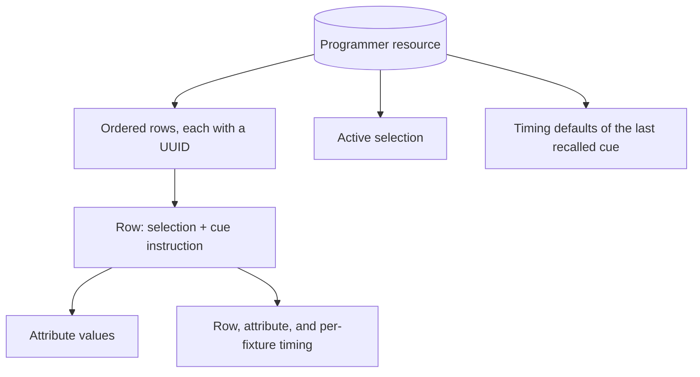
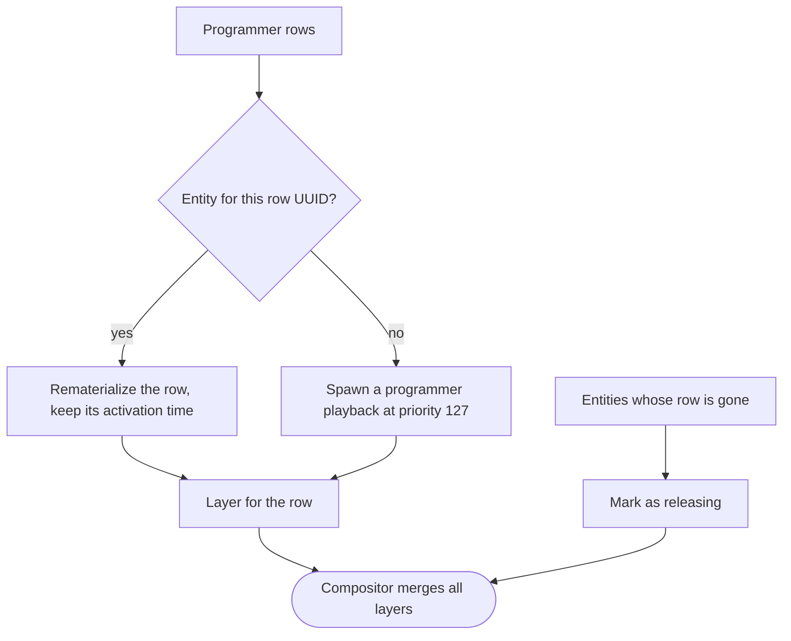
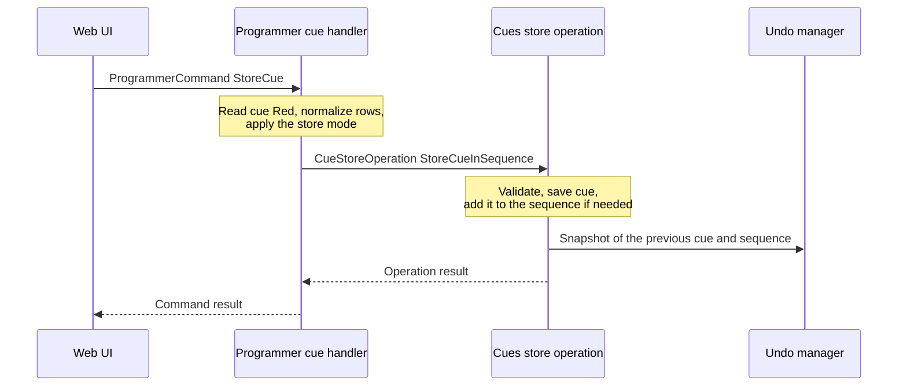
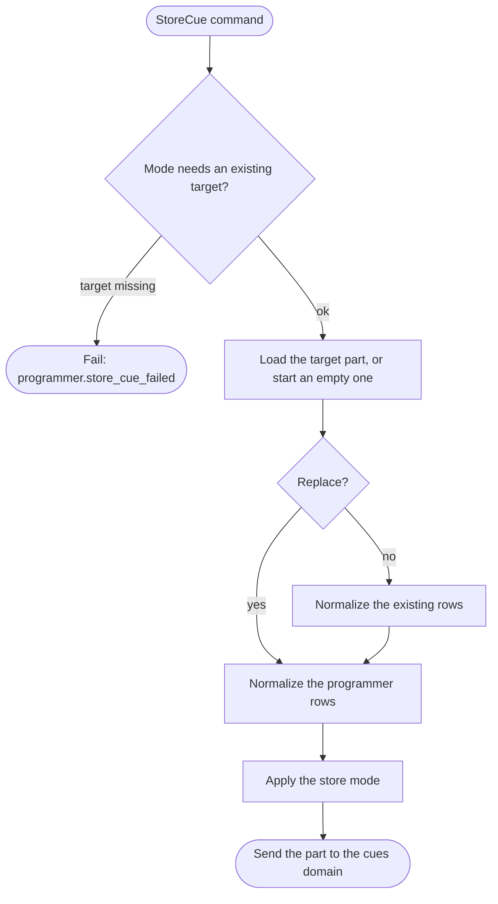

# The programmer and storing cues

{{#include ../includes/human-review-disclaimer.md}}

The programmer is where you build a look before you keep it. It holds a list of rows, each one a selection of fixtures with the values and timing you set for them, plus an active selection that later commands can reuse. The engine paints every row as a layer at priority 127, so programmer values override every playback below that priority. Storing copies the rows into a cue, and the store mode decides how they combine with what the cue already holds.

Read this page before you change programmer commands, the programmer painter, or anything that writes cue instructions. Most surprises in this area come from the normalization step of a store, which rewrites the target cue's rows as well as the new ones.

The examples use the [running example](../README.md#a-running-example). The programmer holds `Practice light` at 50% intensity, and cue `Red` of `First sequence` stores `Practice light` at full intensity and full red. For how a typed command such as `fixture 1 @ 50` reaches the programmer, see [from command to state change](../engine/command-path.md).

## What the programmer holds

The programmer is one Bevy resource, `Programmer`, in the `programmer` crate. The following diagram shows the parts that matter at runtime:

Each row is a `BoundCueInstruction`, the same type a cue uses for its instructions. A row pairs a spatial selection, such as `fixture 1` or `group 2`, with a fan or mirror clause, with a `CueInstruction`. The instruction carries:

- A map from attribute to value source. A value source is an inline value, a fanned list of values spread across the selection, `Release`, or `HoldPosition`.
- An optional blueprint application, for rows that apply a blueprint by reference instead of holding values.
- Timing at three levels: for the whole row, for each attribute, and for each fixture and attribute.
- An optional color path.

Because programmer rows and cue instructions share one type, storing and recalling copy rows without converting them.

The rows live in a list with a UUID index. Merged rows move to the end, and removing a row moves the last row into its place. Order matters because the later row wins when rows coalesce. The UUID identifies the row for its whole life, and the painter uses it to find the row's layer from one frame to the next.

In the running example, `fixture 1 @ 50` produces one row: selection `fixture 1`, intensity at 50%. With the `programmer_auto_select` desk setting on, the command also makes `fixture 1` the active selection. The setting is off by default, so the active selection changes only through selection commands.

The programmer isn't part of the showfile. Loading a show clears it.

### Rows merge by selection, and narrower rows carve broader ones

Adding a row doesn't always append one. Two rules keep the list free of conflicts:

- **Same selection merges.** When a new row has exactly the same selection as an existing row, its values and timing merge into that row, which keeps its UUID. Typing `fixture 1 red @ 100` after `fixture 1 @ 50` leaves one row with intensity and red. Blueprint rows never merge.
- **Overlap carves.** When the new row targets some of the same fixture elements and attributes as an existing row with a different selection, the existing row gives those attributes up for those elements. The engine splits the existing row into a row for the elements it keeps unchanged and a row for the overridden elements without the overlapping attributes. A row left with nothing is removed.

Carving keeps rows added by value commands from setting the same attribute on the same element. Recalling a cue, applying a blueprint, and splitting a row on release add rows without carving. That matters for painting, because rows paint as separate layers at the same priority, and the merge rule between equal-priority layers would otherwise decide which one wins. Split rows inherit the timing anchors of the row they came from, so a fade that is in progress continues instead of restarting.

Carving compares selections at the level of fixture elements. When a carved row has fanned values or fanned timing, the engine splits it into one row per element, so each element keeps the value the fan gave it.

### Live and blind buffers

The data model has two row lists, `live_instructions` and `blind_instructions`, and a `ProgrammerMode` that picks the active one. Every command, the painter, the web UI feed, and the store algorithm read and write only the active list.

**Warning:** No command changes the mode. It starts as `Blind`, so all programmer work happens in the blind list, and the painter renders it like a live list. The doc comment on `ProgrammerMode::Blind` says blind rows aren't rendered, but nothing implements that. Treat blind programming as unimplemented. `commit_blind` exists but has no caller.

## One programmer for every client

The engine holds one programmer, and every connected client edits the same one. When one web UI selects `fixture 1` and another sets intensity, both act on the same rows and the same active selection.

After any update that changes the programmer, the engine publishes the full programmer state and the active selection to every client as non-droppable messages. The state lists, for each fixture element, the attribute values the programmer holds. Clients that connect later get the same messages from the programmer's resync handler. For how these messages travel, see [how the engine and the web UI talk](../architecture/client-protocol.md).

This follows the model of consoles such as Eos, where one programmer belongs to the console. Per-user programmers don't exist.

## The programmer paints one layer per row

The concept pages describe the programmer as one layer at priority 127. In the code, each row becomes its own playback with its own layer, all at priority 127. The painter, `materialize_and_paint_programmer`, runs in the `LayerGeneration` set of every render pass. For where that set sits in a frame, see [the frame loop](../engine/frame-loop.md).

For each row, the painter wraps the row in a cue with one instruction, whose UID is the row's UUID, and materializes it. A new row gets a new entity that carries the materialized cue, its layer, an instance clock, and instance metadata of kind `Programmer`. The instance metadata names each one `Programmer Instruction <uuid>`.

An existing row is rematerialized in every render pass, whether it changed or not. The painter keeps the entity's original activation time and start position, so editing a value mid-fade doesn't restart its timing, and the layer keeps its place among equal-priority layers.

When a row disappears, the painter marks its entity as releasing. If nothing has marked it yet, the painter also zeroes the layer's release timing, so the values drop out at once instead of fading with the row's authored fade-out time.

**Warning:** The `clear` and `release` handlers mark removed rows as releasing themselves, through a cue lifecycle operation that runs in `Update`, before the painter sees them. The painter then skips its zeroing step, so on that path a row with authored fade-out timing may fade out instead of dropping at once. The painter test that checks the instant drop clears the resource directly and doesn't cover the command path.

The painter passes no color path data when it materializes rows, so a color path on a programmer row doesn't affect live output.

## Clearing and releasing

Clearing removes rows or parts of rows from the programmer. Releasing does the same and also releases the matching values of running playbacks. The commands differ in what they touch:

| Command | Effect on the programmer | Effect on playbacks |
|---------|--------------------------|---------------------|
| `clear` | Clears the active selection when one exists. Otherwise clears every row. | None |
| `clear selection` | Clears the active selection. Rows stay. | None |
| `clear values` | Removes every row. The selection stays. | None |
| `release` | Removes every row. | Releases parameters of running playbacks for every fixture. |
| `release` with a selection or attributes | Removes the matching attributes from the matching fixtures. Rows that also cover other fixtures are split. | Releases parameters for the selection when no attributes are named. |
| `clear` with a fixture selection | Same as `release` with that selection and attributes. | Releases parameters for the selection when no attributes are named. |
| `clear` with attributes only | Removes those attributes from every row. | None |

The two-step `clear` follows console convention: the first press drops the selection you were working with, and the second drops the values. The **Programmer** panel's clear button and <kbd>Shift</kbd>+<kbd>Escape</kbd> send the same two-step clear as a `ProgrammerCommand::ClearProgrammer`.

Partial clears and releases resolve the row's selection to concrete fixtures before removing anything. When a row uses a selection that isn't a plain fixture list, such as a group, removing part of it turns the rest into a resolved fixture list. The `selection_flatten_policy` desk setting decides whether this flattening needs confirmation. With the `Prompt` policy, the command fails and returns a retry command that carries a one-use approval, so the client can confirm with the operator and send the retry.

Once the programmer holds no rows, it also forgets the timing defaults of the last recalled cue.

## Storing into a cue

Storing writes the programmer's rows into a cue or a cue part. The store command names a sequence, a cue, an optional part, and a mode:

- `store cue 1.1` stores into cue 1 of sequence 1 with the default mode, Replace.
- `store cue 1.1 /merge`, `/update`, or `/remove` picks another mode.
- `store cue 1.1p2` targets part 2 of the cue. Part 0 is the cue itself.
- `store cue 1.` stores into the next free cue number. Cue 0 is the sequence's setup cue.

The **Programmer** panel's **Store cue** dialog always stores with Replace into part 0. The other modes are only available from the command line.

Storing doesn't change the programmer. Its rows stay after the store, so you can keep building on the same look or store it again elsewhere.

### The store in one picture

A store crosses two domains. The programmer prepares the new cue part, and the `cues` crate commits it, records undo, and reports the result. The following sequence diagram shows the hand-offs for `store cue 1.1 /merge`:

The programmer only prepares data. The cues domain owns validation and persistence, so a store that conflicts with stored data fails there and the programmer reports that failure as the command's result.

### The store algorithm

The following diagram shows how the programmer cue handler builds the new cue part:

The handler works on a cue part. When the target is part 0, it builds a temporary part from the cue's own instructions, timing, and tracking flags, and the cues domain copies the result back onto the cue. Modes other than Replace need the target cue and part to exist, and only Replace accepts the next free cue or part number.

#### Normalization: resolve, flatten, split, and coalesce

Before comparing rows, the handler rewrites them into one shape: one row per fixture or per fixture element, with a resolved selection. It does this to the programmer rows in every mode, and to the cue's existing rows in every mode except Replace. Normalization runs these steps:

1. **Resolve.** Each selection resolves to concrete fixture references, identified by fixture UID and optional element index. A spatial selection with iteration indexes, such as a grid, becomes one row per index, and fanned values and fanned timing resolve for that index. When every element of a fixture is selected, the selection uses the whole fixture instead of listing elements.
1. **Flatten and split.** Each row with several fixtures splits into one row per fixture or element. Fanned values and timing resolve to the value for that position, and per-fixture timing overrides fold into the row's per-attribute timing.
1. **Promote timing (Replace only).** Row-wide timing moves onto each attribute in the row, so it survives the next step.
1. **Coalesce.** Rows with identical selections merge into one.

After normalization, stored cue rows refer to fixtures by UID, so a cue survives renumbering fixtures.

**Warning:** Merge, Update, and Remove normalize the target's existing rows too. A cue row that targeted `group 1` comes back as one row per fixture in the group, and the group reference is gone, even when the programmer didn't touch those fixtures. Replace leaves no existing rows to normalize because it discards them.

**Warning:** Only Replace promotes row-wide timing to attributes before coalescing. In the other modes, two rows for the same fixture with different row-wide timing coalesce into one row whose timing comes from the later row, so the earlier row's attributes can change timing.

#### What each store mode does

After normalization, the store mode decides how the programmer rows, called incoming rows here, combine with the part's existing rows. A row matches another row when both target the same fixture element, or when the incoming row targets the whole fixture and the existing row targets one of its elements.

| Mode | Command flag | Description |
|------|--------------|-------------|
| Replace | **None** | Discards every existing row of the target part and stores the incoming rows. |
| Merge | `/merge` | Merges each incoming row into every matching existing row, adding and overwriting attributes and timing. Appends incoming rows that match nothing. |
| Update | `/update` | Overwrites values that matching existing rows already store, and the attribute timing of those attributes. Ignores new fixtures, new attributes, and row-wide timing. |
| Remove | `/remove` | Deletes the incoming rows' attributes from matching existing rows. The incoming values do not matter. Drops rows left with no attributes. |

An incoming row for one element doesn't edit an existing row for the whole fixture. Merge, Update, and Remove skip such rows and send a warning: "Element store skipped existing whole-fixture instruction rows." In Update and Remove, blueprint rows only match blueprint rows that apply the same blueprint. Merge always appends incoming blueprint rows.

The following table shows cue `Red` after storing the programmer's single row, `Practice light` at intensity 50%, with each mode. Before the store, `Red` holds one row for `Practice light` with intensity 100%, red 100%, green 0%, and blue 0%.

| Mode | Command | `Red` afterwards | Description |
|------|---------|------------------|-------------|
| Replace | `store cue 1.1` | Intensity 50% | Red, green, and blue are no longer stored. The cue keeps its label and timing. |
| Merge | `store cue 1.1 /merge` | Intensity 50%, red 100%, green 0%, blue 0% | The intensity value is overwritten and the color values stay. |
| Update | `store cue 1.1 /update` | Intensity 50%, red 100%, green 0%, blue 0% | Same as Merge, because `Red` already stores intensity for `Practice light`. |
| Remove | `store cue 1.1 /remove` | Red 100%, green 0%, blue 0% | Intensity is removed. The stored 50% plays no part. |

Merge and Update differ when the programmer holds something the cue doesn't. If the programmer also held `Practice light` at green 40% and `Red` stored no green, Merge would add green and Update would leave it out. The same goes for a fixture the cue doesn't store: Merge adds a row for it and Update ignores it.

#### Timing, labels, and recalled cues

Storing into an existing cue keeps the cue's own timing and label, unless the command names a new label. The **Store cue** dialog always sends a label. A new cue gets the label `Cue <n>`, and a new part gets `Part <n>`.

Recalling a cue, with `recall cue 1.1`, clears the programmer, loads the cue's rows, and remembers the cue's own timing. A later Replace store copies that remembered timing onto the target cue or part. So recalling `Red`, editing it, and storing it as cue 3 gives cue 3 the timing of `Red`. Other modes ignore the remembered timing.

### Tracking after a store

A store changes what a cue asserts, and tracking decides what that means for later cues. With tracking, a value carries forward into later cues until a cue changes it. For the terms, see the [concept map](../concepts/concept-map.md). A new cue gets the `Inherit` tracking mode, so it follows its sequence. A store into an existing cue keeps the cue's tracking mode and flags.

This makes Remove and Replace different from clearing a value. After `store cue 1.1 /remove`, `Red` no longer asserts intensity, so intensity tracks in from earlier cues. `Red` is the first cue in `First sequence`, so nothing tracks in, and once you clear the programmer, `Practice light` plays at its default intensity during `Red`. In a later cue, the same store would let the previous cue's intensity show through. To make a cue actively drop a tracked value, store the `Release` value source for that attribute instead.

Storing 50% into `Red` doesn't change `Blue`, because `Blue` stores its own intensity. In the tutorial, the programmer still held intensity when you stored `Blue`.

### Undo for stores

A store is one undo step that restores the cue and the sequence. The undo entry comes from the cues domain, not from undo capture:

- The `StoreCue` command returns no inverse at capture time.
- When the cues domain commits the store, it snapshots the cue and the sequence as they were before and pushes a `RestoreCueStoreState` entry into the command's undo group. A store into the setup cue pushes the previous sequence, or a sequence delete when the sequence is new.
- A failed store pushes nothing.

Undoing a store doesn't touch the programmer, because the store didn't change it. For how undo groups commit and replay, see [how undo works](../engine/command-path.md#how-undo-works).

Programmer edits undo differently. Adding a row, clearing values, and releasing through `ProgrammerCommand` capture a snapshot of the whole programmer as their inverse, because merging and carving can change many rows at once. Selection commands capture the previous selection.

**Warning:** Two programmer changes leave no undo step. `RecallCue` replaces the programmer's rows without capturing an inverse. Typed `clear` and `release` text parses into a `UserCommand`, which the planner turns into `ProgrammerOperation`s, and neither type is registered with the undo registry. The **Programmer** panel's clear button sends `ProgrammerCommand::ClearProgrammer`, which is undoable.

## In the code

| Concept | Where to look |
|---------|---------------|
| `Programmer`, row list, mode, and `add_instruction` | `crates/programmer/src/resources.rs` |
| `BoundCueInstruction`, `CueInstruction`, `CuePart`, `Cue`, tracking flags and modes | `crates/cues/src/cue.rs` |
| `ValueSource` | `crates/common/src/value_source.rs` |
| `ProgrammerCommand`, `StoreMode`, store targets | `crates/programmer/src/events/contracts.rs` |
| Command handler and selection commands | `crates/programmer/src/events/programmer.rs`, `crates/programmer/src/events/programmer/` |
| Carving overlapping rows and the store normalization and modes | `crates/programmer/src/events/store_mode.rs` |
| Clear and release planning | `crates/programmer/src/action_model.rs`, `crates/programmer/src/command_planner.rs`, `crates/programmer/src/events/planning.rs` |
| Applying clears and releases | `crates/programmer/src/events/programmer/operations.rs`, `crates/programmer/src/events/programmer/instruction_release.rs` |
| Programmer painter | `crates/programmer/src/painter.rs` |
| Store and recall handler | `crates/programmer/src/events/cues.rs` |
| Committing a store and its undo entry | `execute_cue_store_operation` in `crates/cues/src/events/actions.rs`, `CueStoreOperation` in `crates/cues/src/lib.rs` |
| Programmer undo snapshots and restore | `crates/programmer/src/undo.rs`, `crates/programmer/src/events/undo.rs` |
| Programmer state sent to clients | `crates/programmer/src/websocket.rs` |
| Store command grammar | `parse_store_cue_mode_token` in `crates/cmd-parse/src/parser/strict.rs` |
| Store cue dialog | `webui/features/programmer/model/programmer-store-model.ts` |
| `programmer_auto_select` and `selection_flatten_policy` | `crates/desk/src/settings.rs` |
| Store tests, one per behavior | `crates/programmer/tests/it/store_cue_events.rs` |

## Related topics

- [From command to state change](../engine/command-path.md)
- [Priorities and merging](../concepts/priorities-and-merging.md)
- [How a show becomes light](../concepts/show-to-light.md)
- [The frame loop](../engine/frame-loop.md)
- [Command line reference](https://github.com/stewartadam/nightfall-lightdesk/blob/develop/docs/src/user-guide/commands.md) in the user manual
