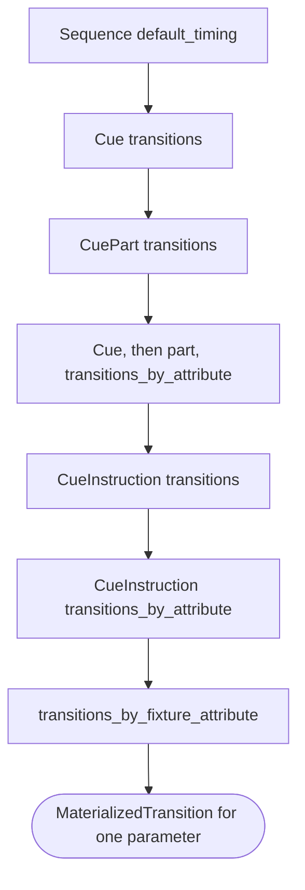

# Timing and the override chain

{{#include ../includes/human-review-disclaimer.md}}

Every value a cue sets gets its own delay, fade, and curve, for each direction. The engine works these out when it materializes the cue, by layering timing from the sequence's default timing down to overrides for one attribute on one fixture element. A layer only replaces the fields it sets, so a cue can change its fade without touching its delay. A fanned timing then spreads a duration across the instruction's selection, and the direction of the change decides whether the in or the out timing applies. Read this before you add a timing field, change how cues are stored, or debug a fade that runs at the wrong speed.

[Cues, sequences, and tracking](cues-and-sequences.md) describes the cue types this page refers to.

## What a timing holds

A timing has six fields: `delay_in`, `fade_in`, `curve_in`, `delay_out`, `fade_out`, and `curve_out`. Two types carry them:

- `Transition` sets every field. A sequence's `default_timing` is a `Transition`.
- `PartialTransition` leaves any field unset. Cues, cue parts, and instructions store this type, so an unset field inherits from the layer below while an explicit zero overrides it.

Each delay and fade is a `TransitionMode`, which is either one duration or a fan across the selection. The curves are `FadeCurve` values: `Linear`, `EaseIn`, `EaseOut`, or `EaseInOut`.

## The override chain

The following diagram shows the order in which timing layers apply to one value. Each layer overrides only the fields it sets:

From the bottom of the stack to the top, the layers are:

1. **Sequence default timing.** The engine places `Sequence.default_timing` beneath a step cue's own timing before it materializes the cue. New sequences from the web UI start with zero delays and fades and linear curves.
1. **Cue timing.** `Cue.transitions` applies to every value in the cue.
1. **Cue part timing.** For values in a cue part, `CuePart.transitions` overrides the cue timing.
1. **Attribute timing on the cue and the part.** `Cue.transitions_by_attribute` applies, and for a part, the part's `transitions_by_attribute` overrides it field by field.
1. **Instruction timing.** `CueInstruction.transitions` applies to every value in the instruction.
1. **Attribute timing on the instruction.** `CueInstruction.transitions_by_attribute` overrides it for one attribute.
1. **Fixture attribute timing.** `CueInstruction.transitions_by_fixture_attribute` overrides it for one attribute on one fixture. Entries for the whole fixture apply first, then entries for the exact element.

The cue's attribute timing sits below the instruction's own timing. When an instruction sets a fade, that fade beats an attribute fade on the cue.

Each attribute lookup applies the logical attribute's entry first, then the entry for the attribute the fixture actually has. They differ for fixtures without a dimmer channel: a cue's intensity resolves to the fixture's virtual intensity, and an entry for virtual intensity overrides an entry for intensity.

Any field still unset after the chain takes the `Transition` default: zero delay, zero fade, and a linear curve.

> [!NOTE]
> The setup cue, the release cue, and cues that play outside a sequence, such as standalone cue preview, don't get a sequence default. For these cues, an attribute other than intensity whose `fade_in` or `delay_in` is unset borrows its `fade_out` or `delay_out`.

## Fanned timing across a selection

A `TransitionMode` resolves per selection slot:

| Mode | Resolved duration |
|------|-------------------|
| `Fixed(duration)` | The same duration for every slot. |
| `Interpolated { start, end }` | A linear fan from `start` on the first slot to `end` on the last. |
| `Manual(durations)` | An envelope through the listed waypoints, interpolated across the slots. |

The engine resolves each instruction's selection with its spatial clauses, then numbers the non-empty slots in order. A slot's number is its offset, and the number of slots is the total. With one slot, `Interpolated` resolves to `start` and `Manual` to its first waypoint. `Fanned` values use the same offset and total, so a value fan and a timing fan line up across the same fixtures.

Spatial clauses reach timing because they shape these slots. `Mirror` and `Shuffle` change the order of the slots, so a fade fan follows the new order. `Shuffle` is deterministic for a given seed, so cue timing stays the same each time the cue materializes. `Blocks` and `Merge` put several fixtures into one slot, and fixtures that share a slot share one delay and fade. A whole-fixture reference expands to all of the fixture's elements, and they all share the fixture's slot. Each instruction resolves its own selection, so fans never span two instructions.

## Direction picks in or out timing

When the sequence renders, each value picks one side of its resolved timing:

- An HTP parameter whose value goes down uses `delay_out`, `fade_out`, and `curve_out`.
- Every other change uses `delay_in`, `fade_in`, and `curve_in`. This includes every change on an LTP parameter, in either direction.

One exception keeps simple cues natural. When a cue's own chain, without the sequence default, sets no out fields for an HTP parameter, the resolved out timing is zero, and the in timing isn't, a downward move uses the in timing. With the web UI's zero default out timing, a cue with a 3-second fade then dims over 3 seconds as well as brightening over 3 seconds.

Release uses the sequence's release cue, with the same rule by merge type: HTP parameters use its out timing and LTP parameters use its in timing. [Cues, sequences, and tracking](cues-and-sequences.md#release) explains how release chooses timing for each value.

## Worked example: `Par 1` from `Red` to `Blue`

Suppose you add timing to `First sequence` as follows:

- The sequence's default timing has a 2-second fade-in.
- The `Blue` cue sets a 3-second fade-in.
- `Blue`'s instruction for `Par 1` overrides the blue attribute with a 0.5-second delay-in and a 1-second fade-in.

When you press Go, `Blue` becomes active at the playback clock's current position, and each value resolves through the chain:

| Attribute | Change | Delay | Fade | Description |
|-----------|--------|-------|------|-------------|
| Intensity | Stays at 100% | Does not apply | Does not apply | Whether `Blue` restates it or it tracks from `Red`, the value does not move. |
| Red | 100% to 0% | 0 s | 3 s | The cue's fade overrides the sequence default. The delay comes from the sequence default. |
| Green | 0% to 0% | 0 s | 3 s | `Blue` restates green at 0%, so the fade has no visible effect. |
| Blue | 0% to 100% | 0.5 s | 1 s | The instruction's attribute override wins over the cue and the sequence default. |

`Par 1` is one fixture, so each instruction has one slot, and a fanned mode would resolve to its first value. Red merges LTP, so it uses its in timing even though it goes down. Intensity merges HTP, so a cue that lowered it would use the out timing, or the in timing under the exception described earlier.

Red reaches 0% 3 seconds after Go. Blue starts moving half a second after Go and reaches full 1.5 seconds after Go.

## In the code

| Concept | Where to look |
|---------|---------------|
| `Transition`, `PartialTransition`, `TransitionMode`, `FadeCurve`, and `MaterializedTransition` | `crates/common/src/transitions.rs` |
| Timing fields on cues, parts, and instructions | `crates/cues/src/cue.rs` |
| Sequence default timing beneath cue timing | `crates/cues/src/materialized_sequence/materialize.rs` |
| The override chain and fanned values | `resolve_partial_transition_definition` and `resolve_fanned_value` in `crates/cues/src/materialized_cue/materialization.rs` |
| Selection slots and spatial clauses | `ResolvedSelection` in `crates/common/src/command_types.rs`, `crates/common/src/spatial_projection.rs` |
| Logical attribute to fixture parameter | `try_parameter_for_logical_attribute` in `crates/fixtures/src/data_provider_ext.rs` |
| In or out timing by direction | `crates/cues/src/materialized_sequence/tracking.rs`, `crates/compositor/src/stages/transition.rs` |
| Release timing | `crates/cues/src/materialized_sequence/release.rs` |

## Related topics

- [Cues, sequences, and tracking](cues-and-sequences.md)
- [Priorities and merging](../concepts/priorities-and-merging.md)
- [Cues and timing](https://github.com/stewartadam/nightfall-lightdesk/blob/develop/docs/src/user-guide/cues.md) in the user manual
