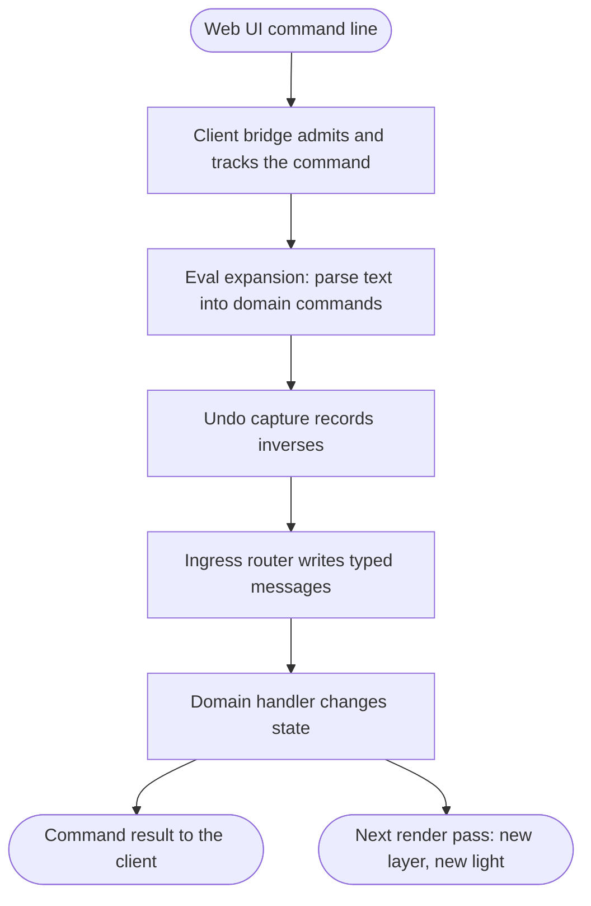
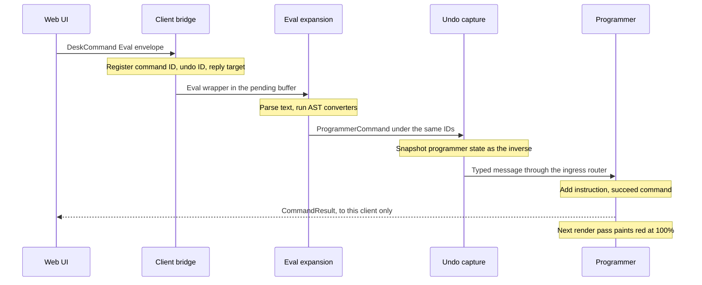

# From command to state change

{{#include ../includes/human-review-disclaimer.md}}

Every change you make in Nightfall, whether you type it, click it, or press a mapped MIDI button, enters the engine as a tracked command. The engine gives the command an identity, captures how to undo it before anything changes, routes it to the plugin crate that owns it, and sends exactly one result back to the client that asked. This page follows one typed command, `fixture 1 red @ 100`, from the web UI to the programmer and onto the next frame. It then shows how a bindable action takes a shorter path into the same pipeline.

Read this page before you add a command or change how one is handled. Most command bugs come from skipping one of the stages below: a command that never reaches undo capture can't be undone, and a handler that forgets to finish its command leaves the web UI waiting.

## The path in one picture

The following diagram shows the stages a typed command passes through. Each stage gets its own section below.

All of this, except the render pass, happens in one engine update. An update is one run of the engine's Bevy schedules. Updates that only handle input skip rendering, so the result can reach the web UI slightly before the light changes. For how updates and render passes are scheduled, see [the frame loop](frame-loop.md).

## Follow `fixture 1 red @ 100`

In the running example, `Par 1` is fixture 1. Typing `fixture 1 red @ 100` in the command line adds an instruction to the programmer: set red to 100% on fixture 1. The following sequence diagram shows every hand-off. The sections after it explain each step.

### The web UI sends a command envelope

The command line splits your input into statements with the same Rust statement splitter the engine uses, compiled to WebAssembly. It then sends each statement on its own and waits for that statement's result before sending the next. A failed statement stops the rest.

Each statement travels as a command envelope, a JSON object with these fields:

- `module`: the name of the command type, here `DeskCommand`.
- `command`: the serialized command, here `{ "type": "Eval", "data": "fixture 1 red @ 100" }`.
- `command_id`: a fresh UUID that identifies this command until its result arrives.
- `undo_id`: the undo group the command belongs to. It defaults to the command ID, so each statement undoes on its own.

`DeskCommand::Eval` carries command text that the engine parses itself. Panels that already know the exact change send typed commands instead, such as a `ProgrammerCommand`, and skip the parsing stages below.

The host that carries the envelope stamps a reply target on it. The websocket host uses the sending client's session, and a client can't choose another session's target. For the transports and the outbound format, see [how the engine and the web UI talk](../architecture/client-protocol.md).

### The client bridge admits and tracks the command

The client bridge is the engine side of every host. When a command arrives, it wakes the engine so the command doesn't wait for the next scheduled frame. In the `InputHandling` system set, the bridge drains the incoming envelopes. A system set is a named group of Bevy systems that the engine orders against other sets.

For each envelope, the bridge first registers the command with the command tracker, using its command ID, undo ID, origin (`WebUi`), and reply target. From this point the command has a lifecycle: it must finish exactly once, with success or a structured error. A duplicate command ID is rejected.

The bridge then looks up the deserializer registered for the `module` name and calls it. An unknown module or a payload that doesn't deserialize finishes the command as failed right away, so the web UI always gets an answer.

The desk deserializer doesn't execute `Eval`. It pushes the wrapper into the pending command buffer, a queue of type-erased commands waiting for undo capture and dispatch.

### Eval expansion parses the text

Eval expansion runs in the `PendingCommandExpansion` set, after input handling and before undo capture. It drains the pending command buffer, leaves non-`Eval` commands in place, and replaces each `Eval` wrapper with the domain commands its text produces. Because expansion happens before capture in the same update, parsed commands get undo capture and dispatch without waiting for another update.

Expansion accepts exactly one statement. Text with several semicolon-separated statements fails with `desk.eval.statement_count`, because each statement needs its own result. Parsing itself happens in two steps: the parser builds an abstract syntax tree (AST), and domain converters turn the AST into commands.

#### The grammar and the AST

The `cmd-parse` crate owns the command language. It declares the grammar as constant data: each clause, such as `Programmer` or `Tempo`, lists its child clauses, its slots, the head tokens that start it, and conditional rules for when a child or slot is available. One structural parser walks that grammar token by token. Autocomplete reads the parse branches it builds, and execution materializes an AST from the same branches, so a rule the grammar enforces applies to both.

For `fixture 1 red @ 100`, the parser enters the `Programmer` clause and produces a `CommandAst::Attribute` node. The node keeps the selection text (`fixture 1`) and the attribute actions (`red @ 100`), with no timing.

#### Domain converters turn the AST into commands

The `cmd-parse` crate knows nothing about fixtures, cues, or clips. Each plugin crate that owns commands registers an AST converter when its plugin builds. Dispatch offers the AST to every converter in registration order:

- A converter that doesn't handle this kind of AST returns `NotApplicable`, and dispatch tries the next one.
- The first converter that handles the AST returns its commands, and dispatch stops.
- A converter that handles the AST but can't convert it returns `ConversionFailed`, and dispatch stops with that error.
- When no converter handles the AST, parsing fails with "unhandled AST".

The programmer's converter handles `CommandAst::Attribute`. It parses the selection text into a spatial selection and turns `red @ 100` into a cue instruction, producing one `ProgrammerCommand::AddProgrammerInstruction`. When the attribute actions reference a blueprint, it produces `ApplyAttributeOperations` instead.

Expansion pushes the resulting commands back into the pending buffer under the wrapper's command ID and undo ID. When the text produces more than one command, expansion tells the command tracker how many completions to expect, and the command succeeds only after all of them succeed. Any parse or conversion error finishes the command as failed with `desk.eval.parse_failed`.

> [!WARNING]
> Converters live in a process-wide list, not in a Bevy resource. Every plugin build appends to it and nothing removes entries, so each world swap that rebuilds the plugins adds another copy of every converter. Behavior stays correct because the first match wins, but tests that build several apps share the same list. Focused tests guard registration with `std::sync::Once`, and `clear_converters` exists for tests that need a clean list.

### Undo capture runs before anything changes

Undo capture is an exclusive system in the `PendingCommandProcessing` set. An exclusive system gets the whole Bevy world instead of declaring the resources it reads, which lets it hand read-only world access to every domain's undo code.

Capture drains the pending command buffer. For each command whose type is registered with the undo registry, it asks the command for its inverse while the world still holds the state before the change. For `AddProgrammerInstruction`, the inverse is a snapshot of the whole programmer state, because the handler may merge the new instruction into existing ones. The inverse joins the pending undo group for the command's undo ID.

Capture then queues every command for dispatch, whether or not it produced an inverse. Commands without an inverse, such as Go on a clip, run normally and leave no undo history.

### The router turns payloads into typed messages

Until now, commands travel type-erased, as boxed payloads in a shared buffer. The ingress router restores their types. Each domain registers its command types with the router, and the router keeps one handler function per type. Dispatch looks up the payload's type, downcasts it, and writes a typed Bevy message, `CommandEnvelope<ProgrammerCommand>`, carrying the command ID, undo ID, origin, and reply target. A Bevy message is a buffered notification that systems read later in the same update or the next one.

A payload type without a registered route finishes its command as failed with `command.handler_missing`.

### The handler changes state and reports the result

Domain handlers run in the `EventHandling` set and read their typed messages. The programmer's handler resolves the selection. When `fixture 1` resolves to nothing, it fails the command. Otherwise it adds the instruction to the programmer, applies per-fixture overrides, follows the selection when auto-select is on, and marks the command as succeeded.

Handlers finish commands through the command responder, a Bevy system parameter that wraps the command tracker. Finishing writes three messages: the `CommandResult` for clients, a reply that carries the reply target, and a finished-command record. In the `Last` schedule, the undo system reads the finished-command records. It commits a successful command's undo group to history and discards a failed command's group, so a failed edit never leaves an undo step behind.

Handlers must finish every command exactly once, on every path. A handler that returns early without finishing leaves the web UI waiting for a result that never comes. When one command fans out into several domain operations, the handler tells the tracker how many completions to expect, as Eval expansion does.

### The result returns to the client

The client bridge forwards command results in the `PostUpdate` schedule of the same update, and once more right after input handling for results finished outside `Update`. The reply target decides the audience:

| Reply target | Audience | Description |
|--------------|----------|-------------|
| `Client` | The submitting session only | Commands sent by a web UI or desktop client. |
| `ClientBroadcast` | Every client | Commands no client sent, such as those from MIDI, OSC, or boards. |
| `Cli` | **None** | The local command-line interface reads its own results. |
| `Detached` | **None** | Tracked work without a reply transport, such as timeline evals. |

Results travel as non-droppable messages, so a busy connection never loses them. In the web UI, the awaiting promise resolves, the console marks the statement as succeeded or failed, and the command line sends the next statement.

### The light changes on the next render pass

The handler changed the programmer resource, not the output. The `Render` schedule turns state into light, and it only runs in updates that the frame limiter marks as render passes. In its layer generation stage, the programmer paints its layer from its current instructions. `Par 1` then gets red at 100% from the programmer layer at priority 127. For what happens after that, see [how a show becomes light](../concepts/show-to-light.md).

Render systems read world state and never input messages. This is why handlers apply commands to resources and components in `Update`: any number of input-only updates can run between two render passes.

## How undo works

The undo system uses a two-phase design, described in the [undo crate's design record](https://github.com/stewartadam/nightfall-lightdesk/blob/develop/crates/undo/README.md). Its main points:

- Domains own their undo logic. A command type implements the `Undoable` trait, which returns an inverse and a description, and the domain plugin registers the type with the undo registry. The undo crate doesn't depend on any domain.
- Inverses are captured before a command runs, through an undo context that gives read-only world access. An inverse that can't be computed returns nothing, and the command isn't undoable.
- Inverses group by undo ID. Everything one command produces, including all commands from one `Eval`, undoes as one step. An action can lower to several commands that share one undo ID, as a board press does.
- Undo and redo run in an exclusive system. Undo pops the newest group, computes redo inverses from the current state, pushes them onto the redo stack, and replays the stored inverses through the normal dispatch path. Replayed commands are marked as undo replays, so handlers restore the saved state without validating it as a new edit.
- When the current state no longer matches what an inverse expects, undo fails with `undo.state_conflict` and leaves the history unchanged.
- History follows the GURQ model. When you make a new change after undoing, the redo stack collapses back into the undo stack instead of being discarded, so every earlier state stays reachable through undo. History keeps 100 groups by default.

Some changes are captured at the operation stage instead. An engine operation registered for undo is captured when it leaves its own pending buffer, just before the systems that apply it. Fixture snapshots and MIDI and OSC mapping edits use this route. For how commands and operations relate, see [control layers](control-layers.md).

> [!NOTE]
> The design record describes command-stage capture only. It doesn't cover operation-stage capture or the rule that a failed command's undo group is discarded. Trust the code in `crates/undo/src/` when the two disagree.

## Actions take a shorter path in

A bindable action enters the same pipeline after the parsing stages. Suppose a MIDI button is mapped to `clip.go` for `First playback`:

1. The MIDI input system matches the incoming message to the mapping and writes an action invocation with the `Midi` surface.
1. The action dispatcher runs after input handling and before Eval expansion. It looks up `clip.go` in the action registry, checks that MIDI may invoke it, and calls the lowering registered by the desk plugin.
1. The lowering registers a new command with the tracker under an `Automation` origin and a `ClientBroadcast` reply target, and pushes `ClipCommand::GoClip` into the pending command buffer.
1. From here the command follows the typed path: undo capture, the ingress router, and the clip handler, which turns it into a clip operation for the running playback.

The differences from a typed command are small:

- No parsing. The action already carries typed arguments.
- No client waits for the result, so it goes to every client. A failed invocation also broadcasts an `ActionInvocationFailed` message, throttled when the same input fails repeatedly.
- `GoClip` has no inverse, so pressing Go leaves no undo step. Cue navigation, such as Go, Back, and Goto, isn't undoable. Starting and stopping a clip is.

Timeline actions that hold command text go through `Eval` too, but as a detached engine operation. That path schedules the parsed commands for the next update instead of expanding them in the current one.

For the full distinction between actions, commands, updates, and engine operations, see [control layers](control-layers.md).

## Add a new command

To add a new top-level command to the command language, follow the path of an existing one. The `tempo` command in the `tempo` crate is a small, complete example.

1. Add the grammar in `cmd-parse`. Add any new keywords as tokens in the lexicon. Declare the root clause with its slots, rules, and head tokens in the clause schema list, and add a command family entry that names the clause, its completion groups, and its structural AST dispatch kind.
1. Define the clause's slots in the slot catalog and its completion group in the completion group catalog, and map the clause to a grammar rule in `parser/structural/grammar_mapping.rs`.
1. Add an AST node to `CommandAst`, and materialize it from the parse branch in the strict parser, matched on the new dispatch kind.
1. Define the domain command type in the plugin crate. Derive `Serialize`, `Deserialize`, and `EnginePayload`, add the `typeshare` attribute, and implement `IngressCommand`.
1. In the domain plugin, register the command with `register_ingress_command`. Register a deserializer for the web UI with `register_command_deserializer`. Push undoable commands into the pending command buffer from the deserializer. Writing the typed message directly skips undo capture.
1. Implement `AstConvert` for a converter type in the domain's `ast_conv.rs`. Return `NotApplicable` for every AST the domain doesn't own, and register the converter with `register_converter` in the plugin.
1. Add a handler system in the `EventHandling` set that reads `CommandEnvelope<YourCommand>` and finishes every command exactly once through the command responder.
1. When the command edits show data, implement `Undoable` and register the type with the undo registry. Compute the inverse from the state before the change. Add `UndoPlugin` before your plugin, because it creates the undo registry and the pending command buffer.
1. Run `pnpm run typeshare` and `pnpm run wasm --dev`, so the web UI gets the new types, its autocomplete uses the new grammar, and the browser demo engine understands the command.

To add a clause to an existing command, such as a new programmer option, skip steps 4 and 5 and extend the existing clause, AST node, and converter instead.

> [!WARNING]
> Plugins check their dependencies by resource, not by plugin. The client bridge requires a pending command buffer and asserts that one exists, but it's the undo plugin that creates it. Keep `UndoPlugin` before `ClientBridgePlugin` in plugin groups and in test apps.

## In the code

| Concept | Where to look |
|---------|---------------|
| Command line sending one `Eval` per statement | `webui/lib/command-sequence.ts`, `webui/lib/engine-runtime.ts` |
| Command envelope, client bridge, and result forwarding | `crates/engine/src/client_bridge.rs` |
| Admitting and deserializing incoming commands | `process_json_envelopes` in `crates/engine/src/client_ingress.rs` |
| `DeskCommand::Eval` and its deserializer | `crates/desk/src/desk_command.rs`, `crates/desk/src/websocket/inbound.rs` |
| Eval expansion | `expand_pending_eval_commands` and `handle_eval` in `crates/desk/src/systems/event_handlers/desk_events.rs` |
| `parse_command_string` | `crates/engine/src/lib.rs` |
| Grammar, AST, and strict parser | `crates/cmd-parse/src/slots/contracts.rs`, `crates/cmd-parse/src/command_family.rs`, `crates/cmd-parse/src/ast.rs`, `crates/cmd-parse/src/parser/strict.rs`, `crates/cmd-parse/src/parser/strict/`, `crates/cmd-parse/src/slots/catalog.rs`, `crates/cmd-parse/src/completion_groups/catalog.rs` |
| AST converter registry and `dispatch_ast` | `crates/engine/src/protocol/dispatch_ast.rs` |
| Programmer AST converter | `crates/programmer/src/ast_conv.rs` |
| `PendingCommandBuffer` and `PendingEngineOperationBuffer` | `crates/engine/src/protocol/erased.rs` |
| `CommandIngressRouter` and `EngineOperationRouter` | `crates/engine/src/protocol/dispatch.rs` |
| Command lifecycle, `CommandTracker`, `CommandResponder` | `crates/engine/src/command_lifecycle.rs`, `crates/engine/src/protocol/results.rs` |
| Update system sets and their order | `crates/engine/src/lib.rs` |
| Undo capture, registry, history, and replay | `crates/undo/src/dispatcher.rs`, `crates/undo/src/manager.rs`, `crates/undo/src/systems.rs` |
| Programmer instruction handler and inverse | `crates/programmer/src/events/programmer/values.rs`, `crates/programmer/src/undo.rs` |
| Render schedule and render passes | `crates/engine/src/render_pass.rs` |
| Action lowering to commands | `crates/actions/src/lowering.rs`, `dispatch_action_invocations` in `crates/actions/src/lib.rs` |
| Clip actions and MIDI input | `crates/desk/src/automation_actions.rs`, `crates/input_midi/src/lib.rs` |
| Example command end to end | `crates/tempo/src/lib.rs`, `crates/tempo/src/ast_conv.rs` |

## Related topics

- [Control layers](control-layers.md)
- [The frame loop](frame-loop.md)
- [How the engine and the web UI talk](../architecture/client-protocol.md)
- [How a show becomes light](../concepts/show-to-light.md)
- [Command line reference](https://github.com/stewartadam/nightfall-lightdesk/blob/develop/docs/src/user-guide/commands.md) in the user manual
