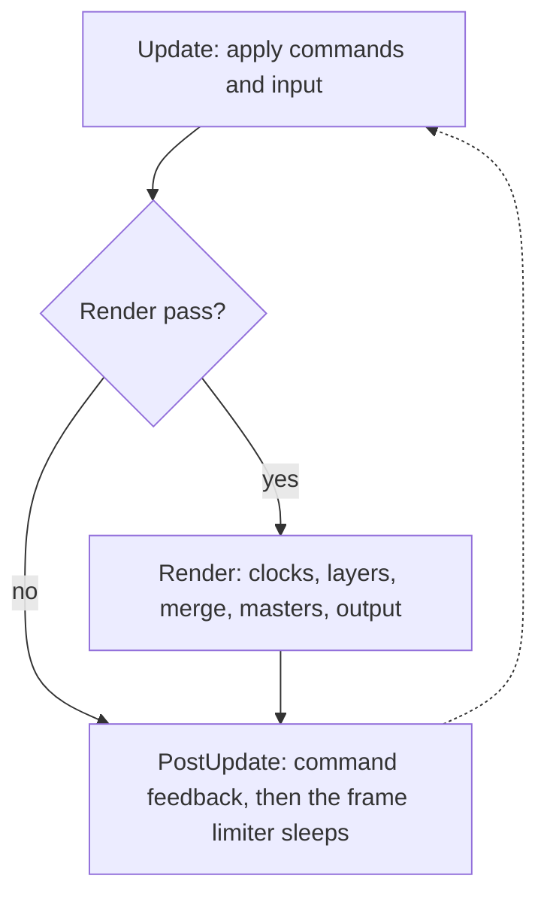
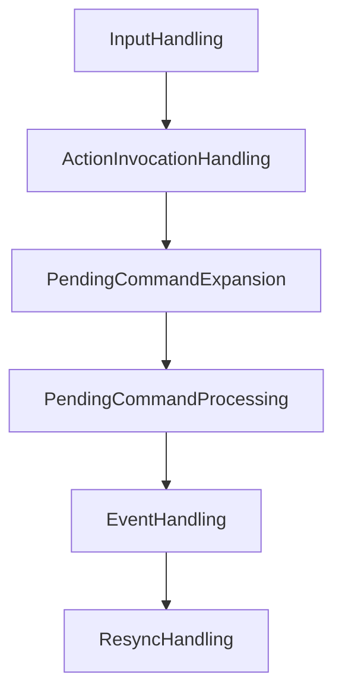
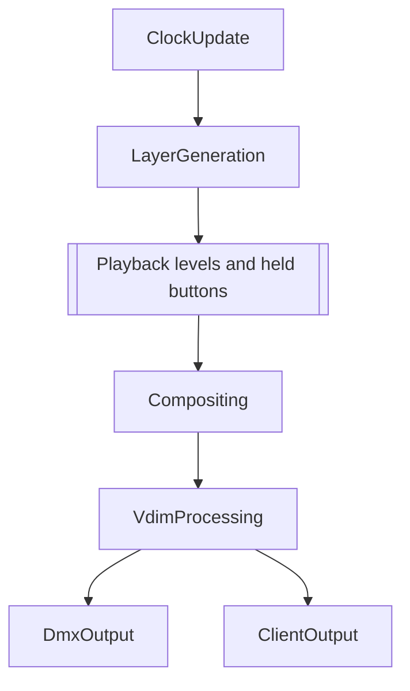
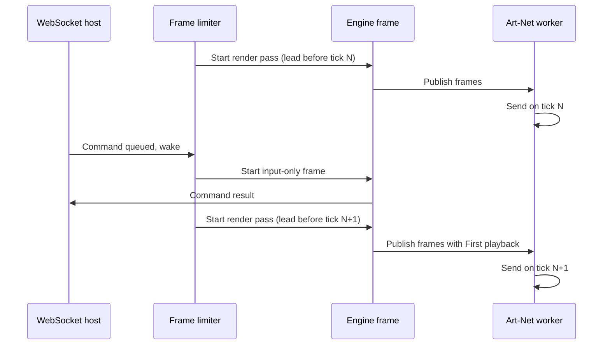

# The frame loop

{{#include ../includes/human-review-disclaimer.md}}

The engine is a Bevy app, and one frame is one call to Bevy's `App::update`. Every frame applies the commands and input that arrived since the last one. Most frames also run a render pass, which advances playback clocks, builds layers, merges them, applies masters, and hands DMX to the output transports. A frame limiter sleeps between frames so that render passes finish just before the DMX output workers send, and wakes the engine early when a command arrives. This page retells [how a show becomes light](../concepts/show-to-light.md) with that machinery visible, following the same running example through each schedule and system set.

The order of these stages, and the rules that keep them apart, decide whether your system sees a command in time, whether its output reaches the lights in the same frame, and whether it silently misses input. Read this page before you add a system that touches playback or output.

## Terms this page uses

The earlier parts of the guide avoid Bevy vocabulary. This page uses the following terms:

- A **system** is a Rust function that the engine calls once per frame with access to the Bevy world's components and resources.
- A **schedule** is an ordered collection of systems that runs as a unit. Bevy runs a fixed list of schedules in each frame, such as `First`, `PreUpdate`, `Update`, `PostUpdate`, and `Last`.
- A **system set** is a named group of systems inside a schedule. Plugins order whole sets against each other, so a plugin crate places its systems by joining a set instead of naming another crate's functions.
- A **message** is a typed notification that one system writes and others read later, such as a `CommandEnvelope` or an `EngineOperationEnvelope`. [Control layers](control-layers.md) explains how commands become operations.
- A **render pass** is the part of a frame that computes and sends output. It is a custom schedule called `Render`.

## One frame at a glance

Each frame runs the same three stages in order. The render stage runs only when sufficient time has passed and the frame limiter marks the frame as a render pass:

`Update` and `PostUpdate` are standard Bevy schedules. `Render` is Nightfall's own schedule. The engine inserts it into Bevy's main schedule order right after `Update`, so a render pass always sees everything that `Update` applied in the same frame, and `PostUpdate` always sees what the render pass changed.

The frame limiter, which the framepace crate provides, runs after `CommandFeedbackEgress` at the end of `PostUpdate`. It sleeps until the next frame should start and decides whether that frame renders. The rest of this page walks through the three stages, then explains the limiter's timing.

## Update applies commands and input

`Update` runs in every frame, whether or not the frame renders. The engine orders its system sets so that commands pass through a fixed pipeline:

Each set has one job:

| System set | What runs there |
|------------|-----------------|
| `InputHandling` | Drains the channels that hosts write to: command and update envelopes from the web UI, client disconnects, and MIDI and OSC events. Command JSON goes through the deserializer that its domain registered and lands in the pending command buffer. Updates, such as a fader drag, apply directly. |
| `ActionInvocationHandling` | Dispatches actions that MIDI and OSC mappings, keyboard shortcuts, the command palette, board buttons, web clients, or timeline events invoked. Actions that lower to commands queue them in the pending command buffer. |
| `PendingCommandExpansion` | Replaces wrapper commands with the concrete commands they stand for. For example, desk eval text such as `clip 1 go` becomes a typed clip command here, and scheduled commands that are now due move into the buffer. |
| `PendingCommandProcessing` | Drains the pending command and operation buffers, captures undo inverses for registered command types, and writes each command as a typed message. |
| `EventHandling` | Domain handlers read those messages and change world state: they spawn playbacks, store cues, change masters, and so on. |
| `ResyncHandling` | Plugins resend their full state to clients that requested a resync. |

Resync runs in `Update` on purpose. The resync completion message goes out before clock and layer work starts, so a slow first render after a show load doesn't delay the moment a client knows it has the full state.

> [!WARNING]
> A system that queues commands outside `InputHandling` must order itself before `PendingCommandProcessing`. Otherwise its commands wait in the buffer until the next frame, and they miss undo capture for this frame.

### What happens to `Par 1` in `Update`

Suppose you press Go on `First playback` while the programmer already holds `Par 1` at 50% intensity. The web UI sends a clip command, and `Update` applies it:

1. `InputHandling` receives the Go command envelope and registers it with the command tracker, so its result can be reported later.
1. `PendingCommandProcessing` writes it as a clip Go command message.
1. In `EventHandling`, the clip handlers start the playback. They spawn a playback entity for `First sequence`, with cue `Red` materialized and ready to render.

Nothing about the light has changed yet. The new playback has no clock and no layer until the next render pass.

The example assumes launch quantize is off. When the Tempo panel sets it to **Beat** or **Bar**, the clip handlers hold the Go as an armed launch instead. They check armed launches in `EventHandling` of every frame and release the Go in the first `EventHandling` after a render pass moves the show tempo to or past the target beat. The show tempo advances only in the render pass, so the release lands one frame after the beat.

## Render computes and sends output

`Render` runs only in render passes. Its sets run in this order:

The stages map onto the journey from [how a show becomes light](../concepts/show-to-light.md):

| Stage | What runs there | What happens to `Par 1` |
|-------|-----------------|----------------------------------|
| `ClockUpdate` | The show tempo advances first, and the timecode generators also advance here. After the tempo, the desk adds a clock to new playbacks, applies speed masters, and advances each free-running clock. A seconds-timed clock advances by the wall-clock time since the previous render pass, and a beat-timed clock by the beats the show tempo moved in that time. | `First playback` gets its clock and moves up to one frame period into the `Red` cue's fade. |
| `LayerGeneration` | Each playback type paints its layer: sequences, cues, FX, Step FX, FX modules, flows, timelines, and the programmer. Incoming DMX also lands in its input layer here. | `First playback` paints a priority 0 layer with intensity and red partway up the fade. The programmer paints a priority 127 layer with intensity at 50%. |
| Between layers and compositing | The desk resolves held Flash and Swop buttons and scales each playback's intensity values by its level. These systems belong to no set. They order themselves after `LayerGeneration` and before `Compositing`. | If `First playback`'s fader sits at 50%, its intensity contribution halves. The programmer layer is unaffected. |
| `Compositing` | The compositor sorts layers by priority and activation time, merges them, and writes the final value into each fixture parameter. | Intensity comes out at 50% from the programmer, and red follows `First playback`'s fade. |
| `VdimProcessing` | Applies intensity masters, then virtual dimmers, then virtual relations to the merged values. | An intensity master that targets `Par 1` scales its intensity. Virtual dimming does not apply, because `Par 1` has a real intensity channel. |
| `DmxOutput` | Resolves DMX routes, packs parameter values into console universes, composes output frames, and hands them to the Art-Net, sACN, and USB outputs. | Intensity, red, green, and blue land in channels 1 to 4 of console universe 1. If a DMX route sends that universe to Art-Net, the Art-Net worker receives the new frame. |
| `ClientOutput` | Publishes render-derived state to clients: parameter values, layer stacks, playback status, and changed show objects. | The 3D visualizer and the **Fixtures** panel receive the new values. |

`DmxOutput` and `ClientOutput` both run after `VdimProcessing`, but the engine doesn't order them against each other. The client systems that publish DMX and parameter state order themselves after `DmxOutput`, so they report the values that went to the outputs.

Some sets in `Render` skip work when nothing changed. The compositor returns early when no layer and no parameter changed since its last run, so an idle show costs less than a fading one.

### DMX output runs on its own threads

The output systems in `DmxOutput` don't transmit anything themselves. The Art-Net and sACN outputs replace the frames that their worker thread sends, and each worker transmits the latest frames on its own fixed-rate clock. When a render pass runs late, the worker sends the previous frames again on its tick. The USB output passes each render pass's frames to its device thread, which writes them as they arrive.

> [!WARNING]
> Running a system under `ClientOutput` doesn't guarantee that DMX packing has run. If your system requires DMX output values, order it after `DmxOutput`.

## PostUpdate acknowledges commands

`PostUpdate` runs in every frame, after `Render` when the frame renders. Two sets matter here:

- `ClientFeedback` forwards input-derived client messages, such as command echoes, notifications, and state changes that commands made. It runs in every frame, so a client doesn't wait for the next render pass to see that its command took effect.
- `CommandFeedbackEgress` publishes the notices and terminal results of commands that finished during the frame. The frame limiter runs after it, so results reach clients before the engine sleeps.

In the running example, the Go command's result goes out in `CommandFeedbackEgress` of the same frame that applied it, even when that frame doesn't render.

Undo history closes the command's undo group in `Last`, which runs after the frame limiter's sleep.

> [!WARNING]
> Put messages that acknowledge input in `ClientFeedback` and render-derived state in `ClientOutput`. A command acknowledgement in `ClientOutput` is delayed until the next render pass.

## When a frame renders

A frame skips its render pass only when the frame limiter woke early for input. The next section describes these input-only frames.

While the engine builds and swaps in a new world for a showfile, it pauses command processing (`InputHandling`, `ActionInvocationHandling`, `EventHandling`, and showfile handling) and client and DMX output (`ClientOutput`, `DmxOutput`, and `ClientFeedback`) in the outgoing and staged worlds. On native hosts the swap happens between two frames, so in practice neither world runs a frame while it is paused. For the whole swap, see [showfiles and loading a show](../architecture/showfiles.md).

Hosts without a frame limiter render in every frame. `RenderPass` defaults to rendering, so tests and the embedded browser runtime render on every update using a worker that calls `update` on its own timer.

## The frame limiter and the shared send schedule

The engine's frame rate follows the DMX output rate. The showfile's IO settings set the DMX output rate between 1 and 60Hz, with 44 Hz by default. When the rate is 30 Hz or more, the engine renders once per output interval. Below 30 Hz, the engine renders an equal division of the output interval that keeps it at 30 frames per second or more, so clients and timeline playback stay responsive. At 20 Hz output, for example, the engine renders twice per output interval, at 40 frames per second. When a showfile load changes the output rate, the limiter follows.

### Every scheduler shares one schedule

The DMX output workers and the frame limiter compute their deadlines from one process-wide schedule, which the code calls the tick grid. Its send times, called ticks, fall at `epoch + n * period`, from an epoch fixed when the process first asks for it. Two schedulers with the same period therefore tick at the same instants, on different threads, and across world swaps.

The frame limiter starts each render pass a short lead before a tick, so the render finishes just before the output worker sends on that tick. The lead is twice the recent average render time plus 1 ms, at least 2 ms and at most half the frame period. A 3 ms render gets a 7 ms lead. If a render still runs past its tick, its frames go out on the following tick.

The following diagram shows two frames at 44 Hz, with a Go command arriving between render passes:

### Input-only frames

Commands should be processed immediately instead of waiting for the next full frame. Each command sender holds a `FrameWaker`, and queuing a command wakes the limiter. The following senders wake it:

- The client bridge, for every command and every client disconnect.
- The MIDI and OSC input services, for every incoming event.

A wake ends the limiter's sleep and starts an input-only frame. That frame runs `Update` and `PostUpdate` but notably not `Render`, so the command is applied and acknowledged right away, and the pending render tick stays on its original schedule. Input-only frames are cheap, because they skip all rendering. Three limits keep them from disturbing the render pass:

- An input-only frame starts no sooner than 2 ms after the previous frame started, which bounds what a burst of input can cost.
- A wake that arrives within 3 ms of the next render start waits for the render pass instead, because the render pass handles input too.
- The last 2 ms before a render start is a precise sleep that doesn't check for wakes, so render passes start on time.

The input-only frame changes nothing on the DMX output or 3D visualizer. In the running example, the Go command spawns the playback and returns its result in the input-only frame, and `Par 1` starts its fade in the next render pass.

Untracked updates, such as a fader drag in the web UI, don't wake the limiter. They wait for the next frame, which keeps a stream of updates from turning into a stream of extra frames.

## The cost of one thread

The engine runs every schedule on Bevy's single-threaded executor. The workspace builds Bevy without its `multi_threaded` feature, so systems run one after another on the engine thread, even when they touch disjoint data. The compute task pool that the app configures doesn't change this.

Every system therefore adds directly to frame time. A profiling run in October 2026 on the sample show, with 101 fixtures, measured the following:

| Scenario | Frames per second | Engine thread |
|----------|-------------------|---------------|
| Idle | 44, the frame limit | 0.42 of a core |
| Every sample clip running | 10.5 | 1.0 core, saturated |

The other cores stayed idle. When the render pass overruns the frame period, the frame rate drops, and the output workers resend stale frames until a new render publishes.

Keep render systems cheap, and keep expensive work out of the per-frame path. A system that runs every render pass but only needs to react to changes should check change detection first and return early.

## Rules for system authors

These rules follow from the frame structure. Each one prevents a class of bug that is easy to introduce and hard to see.

### Render systems read world state, not messages

A render system must not read messages written outside the render pass, and must not read `RemovedComponents`. Any number of input-only frames can run between two render passes. Bevy drops a message after two buffer swaps, and with Bevy's time plugin, buffers swap only after a fixed-timestep tick. It drops removals after two updates. A message written in an input-only frame can therefore expire before the next render pass reads it, and the render system never sees it.

Apply input that render systems depend on to components or resources in the `Update` sets instead. Change detection works across skipped render passes: a component changed in an input-only frame still reads as changed in the next render pass, because change ticks compare against the last time each system ran. To react to removals, register an observer that records the removal in a resource when it happens. The compositor does this for removed parameters and layer state.

Messages that a render system writes and another reads within the same render pass are fine. Incoming DMX does this: the Art-Net and sACN input systems write accepted frames, and a later system in `LayerGeneration` reads them in the same pass.

### Messages from a render pass reach the next frame

A render system can write messages for `Update` handlers. The timeline does this when its playhead crosses a clip action: it writes clip operations during `LayerGeneration`, and the clip handlers apply them in `EventHandling` of the next frame. The resulting layer appears one render pass later. Account for that delay when output timing matters.

### Order command producers before processing

Systems that queue commands must run before `PendingCommandProcessing`, in `InputHandling`, `ActionInvocationHandling`, or `PendingCommandExpansion`. That is where undo capture and dispatch happen. A command queued later waits a frame.

### Put feedback in the right set

Acknowledgements of input go in `ClientFeedback` in `PostUpdate`. Render-derived state goes in `ClientOutput`. A client system that reports DMX or parameter values orders itself after `DmxOutput`.

### Don't assume every frame renders

`Update` systems run in input-only frames too, so they must not assume time has passed since the last render. Clocks advance only in `ClockUpdate`, by the wall-clock time or show tempo beats since the previous render pass, so playback timing stays correct however many input-only frames ran in between.

### Register the render schedule in plugin tests

`EnginePlugin` adds the `Render` schedule to the main schedule order. A plugin test that builds an app without `EnginePlugin` must call `add_render_schedule`, or its render systems never run.

## In the code

| Concept | Where to look |
|---------|---------------|
| Update and Render system sets and their order | `crates/engine/src/lib.rs` |
| `Render` schedule, `RenderPass`, and the module rules for render systems | `crates/engine/src/render_pass.rs` |
| `FrameWaker` | `crates/engine/src/frame_waker.rs` |
| Command and disconnect senders that wake the limiter | `crates/engine/src/client_bridge.rs` |
| Frame limiter, render lead, and early-frame limits | `crates/framepace/src/lib.rs` |
| Shared send schedule (tick grid) | `crates/service_host/src/tick_grid.rs` |
| Fixed-rate output worker | `crates/service_host/src/fixed_rate.rs` |
| Frame rate from the DMX output rate, and the 30 Hz floor | `crates/app-runtime/src/composition.rs` |
| Default, minimum, and maximum DMX output rate | `crates/io/src/settings.rs` |
| Pausing input and output during show loads | `crates/app-runtime/src/swap_orchestrator.rs` |
| Undo capture in `PendingCommandProcessing` | `crates/undo/src/lib.rs` |
| Clock, playback level, and master systems | `crates/desk/src/lib.rs`, `crates/desk/src/instances.rs`, `crates/desk/src/masters.rs` |
| Armed launches for launch quantize | `forward_clip_ingress_actions` in `crates/desk/src/systems/event_handlers/clip_events.rs`, `crates/desk/src/launch_quantize.rs` |
| Compositor and its removal observers | `crates/compositor/src/lib.rs`, `crates/compositor/src/system.rs` |
| Virtual dimmers and virtual relations | `crates/desk/src/systems/vdim.rs`, `crates/desk/src/systems/relations.rs` |
| DMX packing and output frames | `crates/fixtures/src/lib.rs`, `crates/fixtures/src/output_frames.rs` |

## Related topics

- [How a show becomes light](../concepts/show-to-light.md)
- [Priorities and merging](../concepts/priorities-and-merging.md)
- [From command to state change](command-path.md)
- [Control layers](control-layers.md)
- [How the engine and the web UI talk](../architecture/client-protocol.md)
- [Bevy schedules](https://docs.rs/bevy_ecs/0.20.0/bevy_ecs/schedule/index.html)
