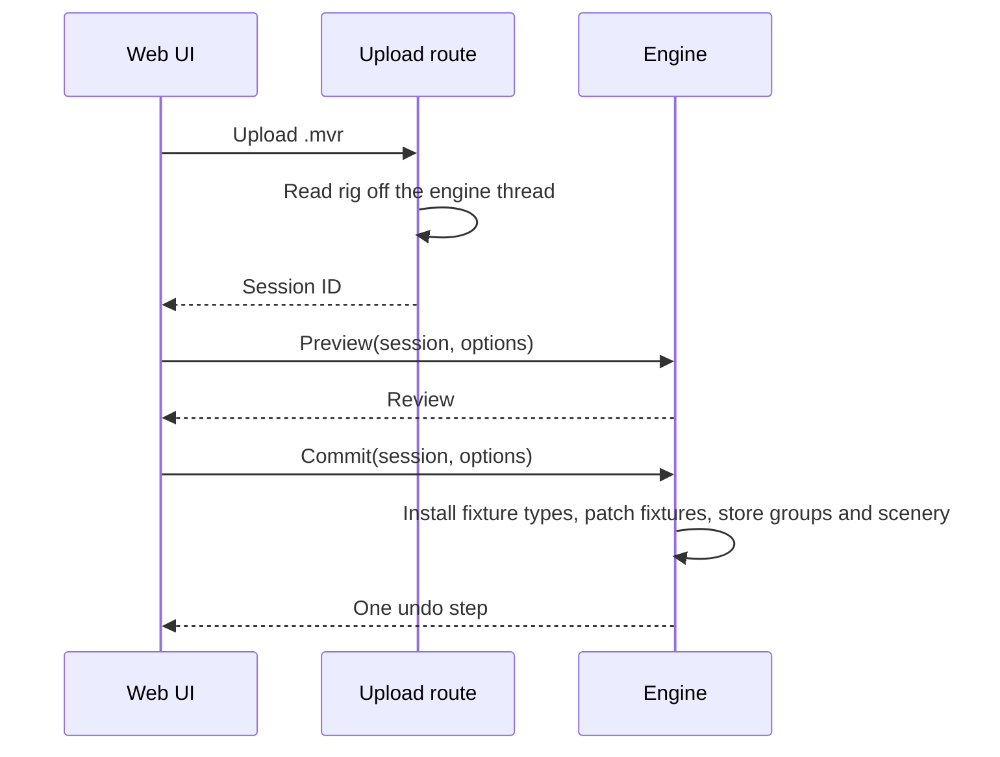

# MVR rig import

{{#include ../includes/human-review-disclaimer.md}}

MVR import turns the rig a lighting designer drew in Vectorworks, Capture or another previsualization tool into Nightfall fixtures, patch, groups and scenery, so nobody types the rig in by hand. Importing a revised file later updates the same fixtures in place, so the programming that uses them keeps working.

This page records what the import must do, how it is built, and why. Read it before you change how a rig file is read, how its fixtures map to Nightfall fixtures, or how re-importing behaves.

## Problem

My Virtual Rig (MVR, DIN SPEC 15801) is the exchange format lighting tools use for a rig: every fixture with its fixture type and mode, its ID, its DMX address, and where it hangs in the venue, plus trusses and set pieces. Before this feature, a designer's MVR had to be retyped in the Patch panel fixture by fixture, then placed by hand in the visualizer. Each revision of the plot meant doing it again, and a mistake in an ID or address only showed up at the venue.

## Users and goals

The following table lists who imports rigs and what each needs:

| User | Goal |
|------|------|
| Programmer receiving a plot | Get the designer's whole rig, patched and placed, into the show in one step. |
| Programmer on a tour | Import each revision of the plot and see exactly what moved or changed, without losing cues, groups or Blueprints. |
| Operator in the venue | See the fixtures where they really hang, with the trusses and set they hang from. |

## Requirements

### Reading the file

- The import reads MVR 1.4 to 1.6 files from any tool that writes the format. Files from Capture and Vectorworks are tested.
- The file is untrusted. The number of files in the archive, their declared and actual sizes, and the nesting depth of 3D models are capped, and nothing is written to disk under a name taken from the archive.
- Large files with venue models, hundreds of megabytes, must import. The file is read once, and changing an option doesn't read it again.
- Features of the file that the import doesn't support yet, such as pan or tilt inversion, are listed as warnings. Nothing is dropped silently.

### Reviewing before importing

- Nothing in the show changes until the user presses **Import**. Every choice first shows its result in a review.
- The review lists each fixture type and where its definition comes from, each fixture with its Nightfall ID, label, mode, patch and status, the groups the import makes, and the scenery it brings in.
- The engine computes the review. The web UI only displays it, so the review and the import can't disagree.
- When the import can't add anything, the review says why, for example a fixture type that needs a library fixture or a show that already matches the file.

### Fixture types

- A fixture type whose exact GDTF file is already in a library uses that library entry.
- A GDTF file included in the MVR is added to the show package, so the show stays self-contained. An option also copies it into the user's library.
- A type the file names without including it uses a library fixture with the same manufacturer and name when one exists. Otherwise the user picks a library fixture and mode once for the type, and every fixture of that type uses them.
- When GDTF Share lists a missing type, the review offers to download it into the library.
- A fixture type without a 3D model is flagged, since the visualizer can only draw it as simple shapes or a placeholder.

### Fixtures, IDs and patch

- Each fixture keeps its ID from the file by default. Options offset every ID by a number or number the fixtures in order. IDs already in use are never reused, and fixtures without a usable ID are numbered after the highest ID in use.
- A fixture's label is its name in the file, unless the name only repeats the fixture type, so the Patch panel shows the type instead.
- Each DMX break in the file becomes a patch route to the same console universe and address. Address 0 means unpatched, which Vectorworks writes for every fixture it exports without a patch.
- Fixtures are placed where the file puts them. +X is the audience's right, as everywhere in Nightfall.

### Re-importing

- An imported fixture keeps the MVR fixture's UUID as its Nightfall UID. Importing a revised file matches fixtures by that UID.
- A fixture that moved, was repatched or was renamed in the file is updated in place, so cues, groups and Blueprints that use it keep working. A fixture that already matches is listed as unchanged. An option turns updates off.
- Re-importing never changes a fixture's type or mode, because that would lose its programming. A difference is reported instead.
- A fixture the file leaves unpatched keeps the patch made in Nightfall.
- A fixture that shares a patch route with other fixtures keeps its patch, with a warning, because moving the route would move the others too.

### Removing what a revision drops

- Every fixture, scene object and group the import adds records the rig file it came from, saved with the show. Objects made in Nightfall have no rig source.
- The review lists, on a Not in file tab, the fixtures and scene objects that have a rig source but whose UID is not in the file being imported, with the file they came from. Scene objects are listed only when scenery is imported.
- The tab also lists groups with a rig source whose name no fixture in the file has under the chosen group source, such as the group for a truss the new revision took down. Groups are listed only when the import makes groups. A group that cues or other objects use is kept with a warning instead, because it can't be deleted.
- Nothing is removed unless the user picks it, because a fixture missing from a file may still be wanted, for example when a show combines two rig files.
- Removed fixtures leave in the same fixture command as the rest of the change, so their addresses are free for the fixtures the file adds or repatches, and a failed patch keeps them. Removed scene objects and groups are deleted in the same undo step, once the fixture command succeeds.
- A group the file no longer makes and the user keeps may still list a removed fixture.

### Groups

- The import makes one group per hanging position, or per layer when the file has no hanging positions. Options use layers or classes instead, or make no groups.
- On a re-import, a group with the same name gets the file's members if it is a plain list of fixtures. A group defined another way is left alone, with a warning.

### Scenery

- Trusses, supports, set pieces, video screens, projectors and the venue are imported as scene objects with their 3D models from the file. An option turns scenery off.
- Each truss and support is its own scene object. Other scenery is merged into one scene object per layer, because venues are often built from thousands of small pieces.
- Re-importing matches scene objects by MVR UUID, and moves or replaces one only when the file changed it.
- The visualizer can hide all scenery, so fixtures inside a venue model can be seen and picked.

### Undo

- One import is one undo step: new, updated and removed fixtures, patch, groups and scene objects together.
- Fixture types added to the show package or the user's library stay after an undo, like any other library install.

## Design

The import runs in three steps, so the slow work happens once and off the engine thread:

1. **Upload.** The web UI uploads the file over HTTP, because a file with venue models is too large for a websocket command. The server reads it off the engine thread into a rig: the fixtures, the GDTF files they use with their make, model and modes, the scenery with its models converted to glTF binary, and every warning. The rig is kept under a session ID, and only the newest four rigs are kept, so a client that never discards one can't fill the disk.
2. **Preview.** The client sends the session ID and the chosen options. The engine plans the import against the current show and replies with the review. This runs again whenever an option changes, without reading the file again.
3. **Commit.** The client sends the same session ID and options. The engine plans the import again, so it applies exactly what the review showed, then expands the commit into one fixture command that adds, updates and removes the fixtures with their patch, plus the scene object stores, all inside the commit's undo step. The group stores and the scene object and group deletes are queued only once the fixture command succeeds, because groups name the imported fixtures; if it fails, the commit fails with its error and no group changes and nothing is deleted.

### Why the reader is its own crate

Reading MVR has nothing to do with shows, so the reader is a separate base-layer crate with no engine dependency. It parses the scene, follows symbol definitions, and works out each object's world transform. The importer, a cross-plugin crate, owns everything Nightfall-specific: the planning, the commands and the upload route. Keeping them apart lets a later MVR export reuse the reader and lets the reader's tests run without an engine.

### Placement

MVR space is right-handed with Z up, in millimetres. Nightfall places fixtures in the visualizer's space: right-handed with Y up, in metres, with +X to the audience's right and +Z toward the audience. The axes map as `x = X`, `y = Z`, `z = -Y`. The visualizer builds a GDTF fixture in its own Z-up space and turns it upright with the same axis change, so a fixture whose MVR rotation is `R` gets the placement rotation `C R Cᵀ`, where `C` is the axis change, written as XYZ Euler angles in degrees. The engine does this conversion and stores the result, and the web UI only renders placements.

Scale and mirroring that a placement can't express are baked into a truss's model, so a stretched truss keeps its length. Imported scene objects keep their model's own origin instead of being centered and stood on the floor, so they line up with the fixtures.

### Matching names

Files name fixture types and modes loosely. A missing type is matched to the library by manufacturer and fixture name, compared ignoring case, spacing and punctuation, using the same name folding as the GDTF Share lookup, so the two always agree. Mode names are compared after replacing characters GDTF doesn't allow in names, because some tools write the mode name as it was before the GDTF writer changed it.

## Out of scope

The following parts of MVR aren't imported yet:

- MVR export, and the MVR-xchange protocol that syncs a rig live with other tools.
- Pan and tilt inversion, which needs a per-fixture invert that Nightfall doesn't have.
- Focus points, gel colors, gobos, video mappings and connections.
- Multipatch fixtures. Only the parent fixture is imported.
- `.gltf` models that keep their buffers in separate files or data URIs. Only GLB and 3DS models are read.

## In the code

The following table lists where each part of the import lives:

| Part | Location | Description |
|------|----------|-------------|
| MVR reader | `crates/mvr` | Archive limits, scene parsing, symbols and world transforms. |
| Importer | `crates/mvr-import` | Upload route, sessions, planning, placement and scenery conversion. |
| Planning | `crates/mvr-import/src/plan.rs` | Fixture types, IDs, labels and statuses, shared by the preview and the commit. |
| Commands | `crates/mvr-import/src/commands.rs` | The preview, commit and discard commands. |
| Upload route | `crates/mvr-import/src/http.rs` | `POST /api/mvr-import`, which returns the session ID. |
| Import dialog | `webui/features/rig-import` | The review and its options. |
| Sample files | `scripts/mvr-samples.mjs` | Fetches the public sample files the ignored tests use, pinned by SHA-256. |

## Related topics

- [Crate map](../architecture/crate-map.md)
- [From command to state change](../engine/command-path.md)
- [GDTF regression testing](../contributing/gdtf-regression-testing.md)
